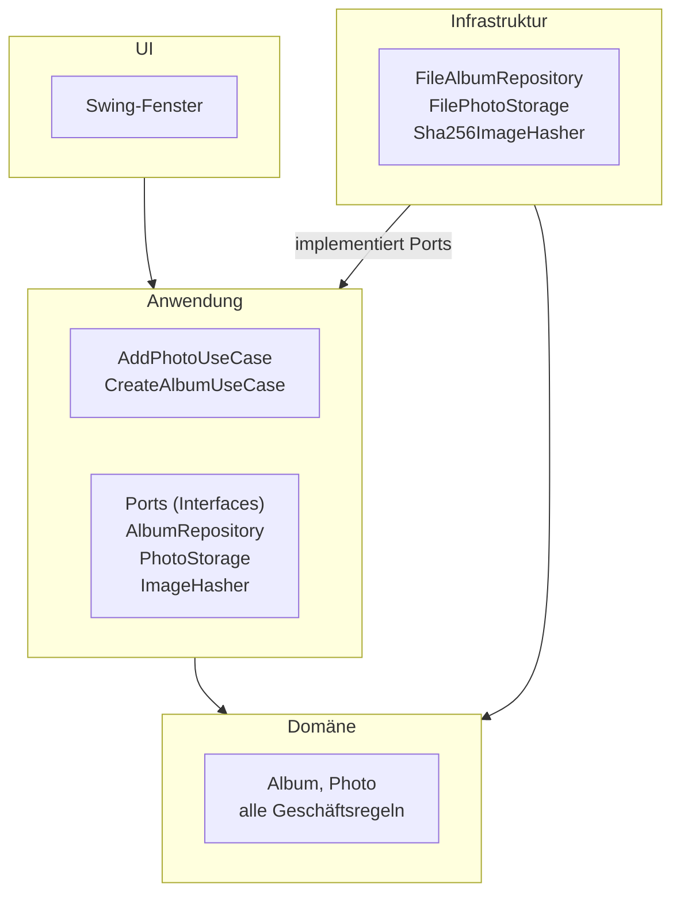

# Architektur

## 1. Schichten und Abhängigkeitsrichtung

Das Fotoalbum ist in vier Schichten aufgeteilt. Abhängigkeiten zeigen nur nach innen zur Domäne.

Ein Pfeil bedeutet „hängt ab von“. Die Infrastruktur implementiert die Ports der Anwendung und kennt `Album` und `Photo`, um sie zu speichern. Die Domäne hängt von keiner anderen Schicht ab. Die Klasse `Main` erzeugt die Infrastrukturklassen und übergibt sie den Use Cases. Nur sie kennt alle Schichten.

| Schicht | Aufgabe | Klassen (vorläufig) |
|---|---|---|
| UI | Zeigt Alben und Fotos an, nimmt Eingaben entgegen und zeigt Meldungen. Enthält keine Geschäftsregeln und greift nicht auf Dateien zu. | Swing-Fenster |
| Anwendung | Ein Use Case je Nutzerziel. Lädt das Album über einen Port, lässt die Domäne entscheiden und speichert das Ergebnis. Legt die Ports als Interfaces fest. | `AddPhotoUseCase`, `CreateAlbumUseCase`; Ports `AlbumRepository`, `PhotoStorage`, `ImageHasher` |
| Domäne | Enthält alle Geschäftsregeln aus [REQUIREMENTS.md](REQUIREMENTS.md): Albumname, höchstens 100 Fotos, kein Duplikat, Textlängen. | `Album`, `Photo` |
| Infrastruktur | Setzt die Ports technisch um: JSON-Dateien, App-Kopien der Bilder, Bildprüfung und Inhaltshash. | `FileAlbumRepository`, `FilePhotoStorage`, `Sha256ImageHasher` |

Die Klassenliste ist ein erster Stand. Sie wird mit den CRC-Karten und dem Klassendiagramm abgeglichen. Die Ports beschreibt [Abschnitt 2](#2-komponenten-und-ports).

**Begründung:**

- **Testbarkeit:** Die Geschäftsregeln liegen in der Domäne und hängen von keiner anderen Schicht ab. Unit-Tests prüfen sie ohne Oberfläche und ohne Dateizugriffe, wie NFA-05 es verlangt.
- **Austauschbarkeit:** Use Cases kennen nur die Ports. Speicherung und Oberfläche lassen sich ändern, ohne Use Cases oder Domäne anzupassen. Im Test ersetzt eine Variante im Arbeitsspeicher die Dateispeicherung.
- **Klare Zuständigkeit:** Jede Geschäftsregel steht an genau einer Stelle. Die UI zeigt nur an, was die Anwendung zurückmeldet.

## 2. Komponenten und Ports

Jede Schicht ist ein eigenes Java-Paket: `ui`, `application`, `domain` und `infrastructure`. Ihre Aufgaben stehen in Abschnitt 1. Die Klasse `Main` verbindet die Pakete beim Start.

Die Anwendung erreicht Dateien nur über drei Ports. Sie sind Interfaces im Paket `application` und in Fachsprache benannt.

| Port | Verantwortung | Adapter |
|---|---|---|
| `AlbumRepository` | Alben speichern, einzeln und vollständig laden. Die Daten bleiben über einen Neustart erhalten (NFA-02). | `FileAlbumRepository` (JSON-Dateien) |
| `PhotoStorage` | Die eigene Kopie einer importierten Bilddatei anlegen (A-05), zum Anzeigen laden und wieder löschen. | `FilePhotoStorage` |
| `ImageHasher` | Eine ausgewählte Datei lesen, als JPEG oder PNG bis 20 MiB prüfen (A-03) und den Inhaltshash für die Duplikatprüfung berechnen (A-01). | `Sha256ImageHasher` |

`ImageHasher` übernimmt neben dem Hash auch die Prüfung, weil beides dieselben Bytes in einem Durchgang liest. Die Formatprüfung ist eine technische Eingangsprüfung. Sie braucht eine Bildbibliothek und liegt deshalb nicht in der Domäne. Ob ein Foto ein Duplikat ist, entscheidet `Album` anhand des Hashes.

Methoden und Parameter legt das Klassendiagramm fest. Ports für die Uhrzeit des Papierkorbs und für die KI-Komponente folgen in eigenen Abschnitten.
