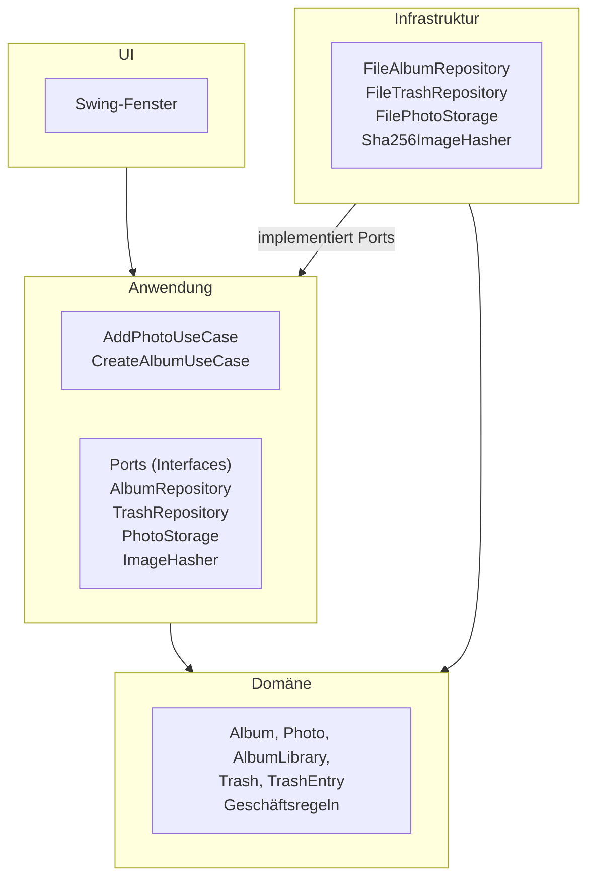
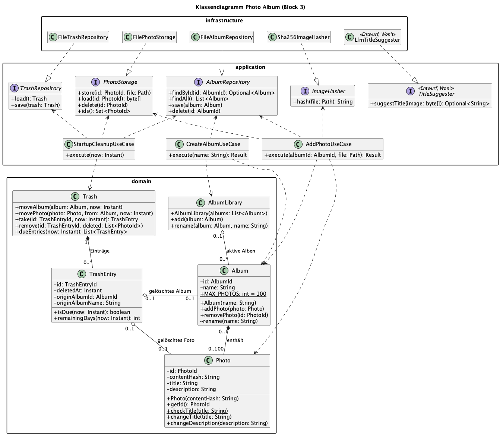
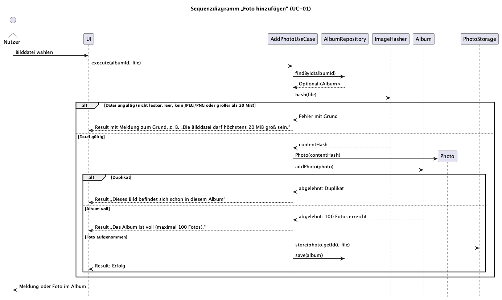

# Architektur

## 1. Schichten und Abhängigkeitsrichtung

Das Fotoalbum ist in vier Schichten aufgeteilt. Abhängigkeiten zeigen nur nach innen zur Domäne.

Ein Pfeil bedeutet „hängt ab von“. Die Infrastruktur implementiert die Ports der Anwendung und kennt `Album` und `Photo`, um sie zu speichern. Die Domäne hängt von keiner anderen Schicht ab. Die Klasse `Main` erzeugt die Infrastrukturklassen und übergibt sie den Use Cases. Nur sie kennt alle Schichten.

| Schicht | Aufgabe | Klassen (vorläufig) |
|---|---|---|
| UI | Zeigt Alben und Fotos an, nimmt Eingaben entgegen und zeigt Meldungen. Enthält keine Geschäftsregeln und greift nicht auf Dateien zu. | Swing-Fenster |
| Anwendung | Ein Use Case je Nutzerziel. Lädt das Album über einen Port, lässt die Domäne entscheiden und speichert das Ergebnis. Legt die Ports als Interfaces fest. | `AddPhotoUseCase`, `CreateAlbumUseCase`; Ports `AlbumRepository`, `TrashRepository`, `PhotoStorage`, `ImageHasher` |
| Domäne | Enthält die Geschäftsregeln aus [REQUIREMENTS.md](REQUIREMENTS.md): Albumname, höchstens 100 Fotos, kein Duplikat, Textlängen und Papierkorbfristen. Nur die technische Dateiprüfung nach A-03 liegt im Adapter (Abschnitt 2). | `Album`, `Photo`, `AlbumLibrary`, `Trash`, `TrashEntry` |
| Infrastruktur | Setzt die Ports technisch um: JSON-Dateien, App-Kopien der Bilder, Bildprüfung und Inhaltshash. | `FileAlbumRepository`, `FileTrashRepository`, `FilePhotoStorage`, `Sha256ImageHasher` |

Die Oberfläche nutzt Swing, weil es im JDK enthalten ist und keine zusätzliche Abhängigkeit braucht. Die Klassen leiten sich aus den [CRC-Karten](docs/design/crc-karten.md) ab und stehen im [Klassendiagramm](#3-klassendiagramm). Die Ports beschreibt [Abschnitt 2](#2-komponenten-und-ports).

**Begründung:**

- **Testbarkeit:** Die Geschäftsregeln liegen in der Domäne und hängen von keiner anderen Schicht ab. Unit-Tests prüfen sie ohne Oberfläche und ohne Dateizugriffe, wie NFA-05 es verlangt.
- **Austauschbarkeit:** Use Cases kennen nur die Ports. Speicherung und Oberfläche lassen sich ändern, ohne Use Cases oder Domäne anzupassen. Im Test ersetzt eine Variante im Arbeitsspeicher die Dateispeicherung.
- **Klare Zuständigkeit:** Jede Geschäftsregel steht an genau einer Stelle. Die UI zeigt nur an, was die Anwendung zurückmeldet.

## 2. Komponenten und Ports

Jede Schicht ist ein eigenes Java-Paket: `ui`, `application`, `domain` und `infrastructure`. Ihre Aufgaben stehen in Abschnitt 1. Die Klasse `Main` verbindet die Pakete beim Start.

Die Anwendung erreicht Dateien nur über vier Ports. Sie sind Interfaces im Paket `application` und in Fachsprache benannt.

| Port | Verantwortung | Adapter |
|---|---|---|
| `AlbumRepository` | Alben speichern, einzeln und vollständig laden. Die Daten bleiben über einen Neustart erhalten (NFA-02). | `FileAlbumRepository` (JSON-Dateien) |
| `TrashRepository` | Den Papierkorb mit seinen Einträgen und Löschzeitpunkten speichern und laden (A-07). | `FileTrashRepository` (JSON-Datei) |
| `PhotoStorage` | Die eigene Kopie einer importierten Bilddatei anlegen (A-05), zum Anzeigen laden und wieder löschen. | `FilePhotoStorage` |
| `ImageHasher` | Eine ausgewählte Datei lesen, als JPEG oder PNG bis 20 MiB prüfen (A-03) und den Inhaltshash für die Duplikatprüfung berechnen (A-01). | `Sha256ImageHasher` |

`ImageHasher` übernimmt neben dem Hash auch die Prüfung, weil beides dieselben Bytes in einem Durchgang liest. Die Formatprüfung ist eine technische Eingangsprüfung. Sie braucht eine Bildbibliothek und liegt deshalb nicht in der Domäne. Ob ein Foto ein Duplikat ist, entscheidet `Album` anhand des Hashes.

Methoden und Parameter legt das Klassendiagramm fest. Ports für die Uhrzeit des Papierkorbs und für die KI-Komponente folgen in eigenen Abschnitten.

## 3. Klassendiagramm

Quelle: [klassendiagramm.puml](docs/design/klassendiagramm.puml)

- Ein `Album` enthält 0 bis 100 Fotos. Jedes aktive `Photo` gehört genau einem Album (A-05), im Papierkorb hält es ein `TrashEntry`.
- `AlbumLibrary` sorgt für eindeutige Namen. `Album.rename` ist paketsichtbar, damit niemand diese Prüfung umgeht.
- `TrashEntry` kennt Löschzeitpunkt und Ursprungsalbum und berechnet Fälligkeit und Resttage. Beim Wiederherstellen prüft `Trash` nur die Frist, die übrigen Regeln prüfen wie sonst `AlbumLibrary` und `Album`. Die aktuelle Zeit kommt als Parameter `now`, so prüfen Unit-Tests den Fristablauf ohne Wartezeit (NFA-05).
- `ImageHasher.hash` und die Domäne lehnen Verstöße mit einer Exception samt Grund ab. Der Use Case übersetzt sie in ein `Result` mit Erfolg oder Meldung für die UI.
- Einfache Getter sind nur eingezeichnet, wenn das Sequenzdiagramm sie aufruft. `DescriptionSuggester` und sein Adapter sind nur ein Entwurf, die KI-Funktion wird nicht umgesetzt.

## 4. Sequenzdiagramm „Foto hinzufügen“

Quelle: [sequenz-foto-hinzufuegen.puml](docs/design/sequenz-foto-hinzufuegen.puml)

Der Ablauf folgt UC-01: Erst laufen alle Prüfungen, dann werden App-Kopie und Album gespeichert. In jedem Fehlerzweig wurde noch nichts verändert (NFA-01). Die Meldungen stimmen mit dem Klickprototyp überein. Fehler beim Speichern und das Zurücknehmen der App-Kopie (A-11) zeigt das Diagramm nicht. Sie regelt [ADR-002](docs/adr/ADR-002-fehlerbehandlung.md).

## 5. Architekturentscheidungen

- [ADR-001: Speicherung als JSON-Dateien hinter Ports](docs/adr/ADR-001-speicherung.md) mit den Mustern Repository und Adapter
- [ADR-002: Fehlerbehandlung über Exceptions und Result](docs/adr/ADR-002-fehlerbehandlung.md)
