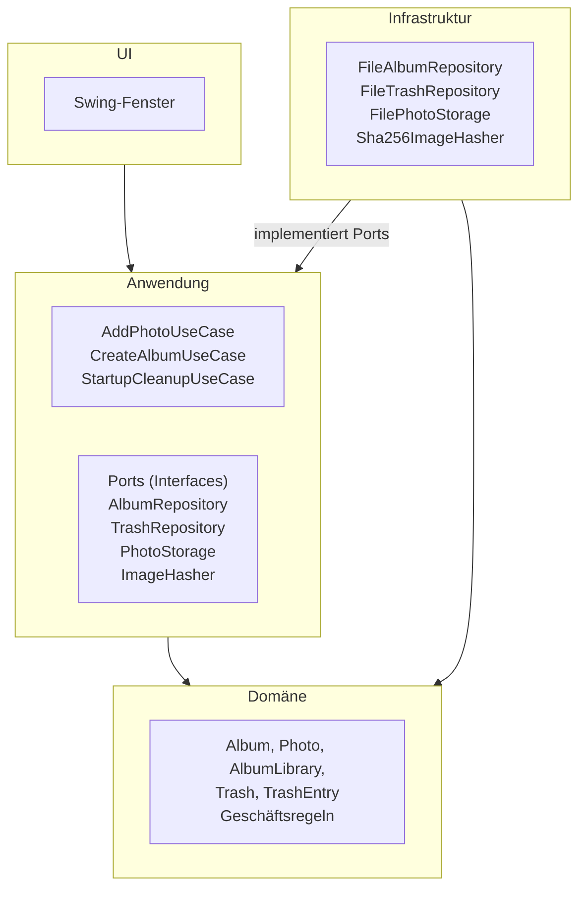
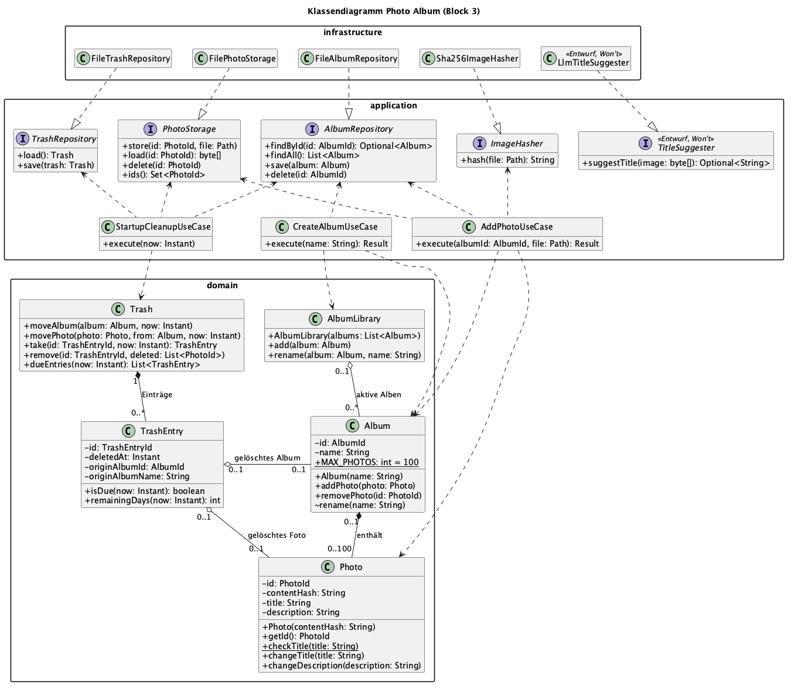
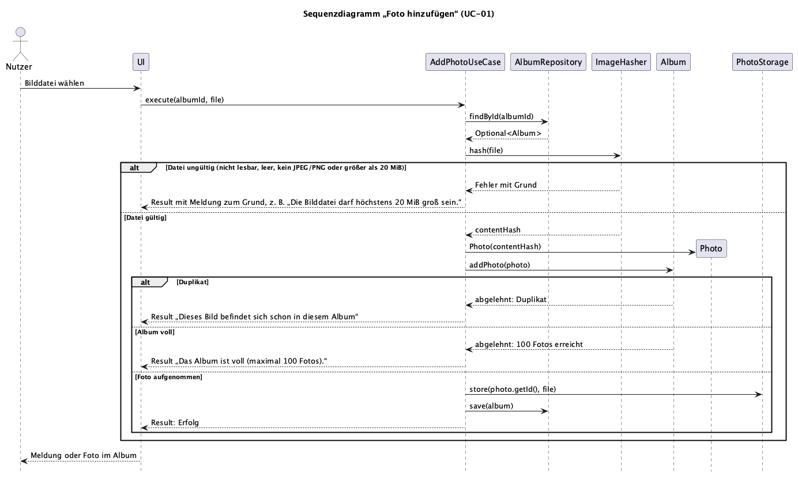

# Architektur

## 1. Schichten und Abhängigkeitsrichtung

Das Fotoalbum ist in vier Schichten aufgeteilt. Abhängigkeiten zeigen nur nach innen zur Domäne.



Ein Pfeil bedeutet „hängt ab von“. Die Infrastruktur implementiert die Ports der Anwendung und kennt `Album` und `Photo`, um sie zu speichern. Die Domäne hängt von keiner anderen Schicht ab. Die Klasse `Main` erzeugt die Infrastrukturklassen und übergibt sie den Use Cases. Nur sie kennt alle Schichten.

| Schicht | Aufgabe | Klassen (Auswahl) |
|---|---|---|
| UI | Zeigt Alben, Fotos und den Papierkorb an, nimmt Eingaben entgegen und zeigt Meldungen. Enthält keine Geschäftsregeln und greift nicht auf Dateien zu. | `AlbumOverviewWindow`, `AlbumWindow`, `TrashWindow`, die Dialoge, der Bildpuffer `ImageBuffer` und die gemeinsame Dateiauswahl `PhotoFileChooser` |
| Anwendung | Ein Use Case je Nutzerziel, dazu die Bereinigung beim Start. Lädt das Album über einen Port, lässt die Domäne entscheiden und speichert das Ergebnis. Legt die Ports als Interfaces fest. Gibt der UI nur `Result` und einfache Datenklassen wie `AlbumSummary` zurück. | `AddPhotoUseCase`, `CreateAlbumUseCase`, `RestoreTrashEntryUseCase`, `StartupCleanupUseCase` und weitere; Ports `AlbumRepository`, `TrashRepository`, `PhotoStorage`, `ImageHasher` |
| Domäne | Enthält die Geschäftsregeln aus [REQUIREMENTS.md](REQUIREMENTS.md): Albumname, höchstens 100 Fotos, kein Duplikat, Textlängen und Papierkorbfristen. Nur die technische Dateiprüfung nach A-03 liegt im Adapter (Abschnitt 2). Die Bereinigung beim Start nach A-11 koordiniert `StartupCleanupUseCase`, weil sie Alben, Papierkorb und Kopien zusammen betrachtet. | `Album`, `Photo`, `AlbumLibrary`, `Trash`, `TrashEntry` |
| Infrastruktur | Setzt die Ports technisch um: JSON-Dateien, App-Kopien der Bilder, Bildprüfung und Inhaltshash. Das Speicherformat beschreibt Abschnitt 10. | `FileAlbumRepository`, `FileTrashRepository`, `FilePhotoStorage`, `Sha256ImageHasher` |

Die Oberfläche nutzt Swing, weil es im JDK enthalten ist und keine zusätzliche Abhängigkeit braucht. Die Klassen leiten sich aus den [CRC-Karten](docs/design/crc-karten.md) ab und stehen im [Klassendiagramm](#3-klassendiagramm). Die Ports beschreibt [Abschnitt 2](#2-komponenten-und-ports).

**Begründung:**

- **Testbarkeit:** Die Geschäftsregeln liegen in der Domäne und hängen von keiner anderen Schicht ab. Unit-Tests prüfen sie ohne Oberfläche und ohne Dateizugriffe, wie NFA-05 es verlangt.
- **Austauschbarkeit:** Use Cases kennen nur die Ports. Speicherung und Oberfläche lassen sich ändern, ohne Use Cases oder Domäne anzupassen. Im Test ersetzt eine Variante im Arbeitsspeicher die Dateispeicherung.
- **Klare Zuständigkeit:** Jede Geschäftsregel steht an genau einer Stelle. Die UI zeigt nur an, was die Anwendung zurückmeldet.

## 2. Komponenten und Ports

Jede Schicht ist ein eigenes Java-Paket unter `de.commitmentissues.photoalbum`: `ui`, `application`, `domain` und `infrastructure`. Das Projektgerüst legt diese Pakete mit Maven und Java 21 an. Ihre Aufgaben stehen in Abschnitt 1. Die Klasse `Main` verbindet die Pakete beim Start.

Die Anwendung erreicht Dateien nur über vier Ports. Sie sind Interfaces im Paket `application` und in Fachsprache benannt.

| Port | Verantwortung | Adapter |
|---|---|---|
| `AlbumRepository` | Alben speichern, einzeln und vollständig laden und beim Verschieben in den Papierkorb löschen (A-07). Die Daten bleiben über einen Neustart erhalten (NFA-02). | `FileAlbumRepository` (JSON-Dateien) |
| `TrashRepository` | Den Papierkorb mit seinen Einträgen und Löschzeitpunkten speichern und laden (A-07). | `FileTrashRepository` (JSON-Datei) |
| `PhotoStorage` | Die eigene Kopie einer importierten Bilddatei anlegen (A-05), zum Anzeigen laden und wieder löschen. Die IDs aller Kopien nennen, damit beim Start verwaiste Kopien entfernt werden (ADR-002). | `FilePhotoStorage` |
| `ImageHasher` | Eine ausgewählte Datei lesen, als JPEG oder PNG bis 20 MiB prüfen (A-03) und den Inhaltshash für die Duplikatprüfung berechnen (A-01). | `Sha256ImageHasher` |

`ImageHasher` übernimmt neben dem Hash auch die Prüfung, weil beides dieselben Bytes in einem Durchgang liest. Die Formatprüfung ist eine technische Eingangsprüfung. Sie braucht eine Bildbibliothek und liegt deshalb nicht in der Domäne. Ob ein Foto ein Duplikat ist, entscheidet `Album` anhand des Hashes.

Methoden und Parameter zeigt das Klassendiagramm aus dem Entwurf. Die Abweichungen der Umsetzung nennt Abschnitt 3. Die Uhrzeit bekommt der Papierkorb als Parameter, ohne eigenen Port (Abschnitt 6).

## 3. Klassendiagramm



Quelle: [klassendiagramm.puml](docs/design/klassendiagramm.puml)

- Ein `Album` enthält 0 bis 100 Fotos. Jedes aktive `Photo` gehört genau einem Album (A-05), im Papierkorb hält es ein `TrashEntry`.
- `AlbumLibrary` sorgt für eindeutige Namen. `Album.rename` ist paketsichtbar, damit niemand diese Prüfung umgeht.
- `TrashEntry` kennt Löschzeitpunkt und Ursprungsalbum mit ID und Namen und berechnet Fälligkeit und Resttage. Beim Wiederherstellen prüft `Trash` nur die Frist, die übrigen Regeln prüfen wie sonst `AlbumLibrary` und `Album`. Die aktuelle Zeit kommt als Parameter `now` (Abschnitt 6).
- `ImageHasher.hash` und die Domäne lehnen Verstöße mit einer Exception samt Grund ab. Der Use Case übersetzt sie in ein `Result` mit Erfolg oder Meldung für die UI.
- Einfache Getter sind nur eingezeichnet, wenn das Sequenzdiagramm sie aufruft. `TitleSuggester` und sein Adapter sind nur ein Entwurf, siehe Abschnitt 7.

### Abweichungen der Umsetzung vom Entwurf

Das Diagramm zeigt den Entwurf aus Block 3. Beim Umsetzen in Block 4 haben sich die folgenden Punkte geändert. Die Geschäftsregeln und ihre Zuordnung zu den Klassen sind gleich geblieben.

| Entwurf | Umsetzung | Grund |
|---|---|---|
| Use Cases mit Domänentypen, etwa `execute(albumId: AlbumId, file: Path): Result` | Use Cases nehmen `UUID` entgegen und liefern `Result<T>` mit einfachen Datenklassen wie `AlbumSummary`, `AlbumDetails`, `PhotoSummary` und `TrashEntrySummary`. | Die UI kennt keine Domänenklassen (Abschnitt 1). |
| Drei Use Cases als Beispiele | Ein Use Case je Nutzerziel, insgesamt 13, darunter `RenameAlbumUseCase`, `RemovePhotoUseCase`, `RestoreTrashEntryUseCase` und `DeletePermanentlyUseCase`. `Main` übergibt sie der UI gebündelt im Record `UseCases`. | Ein Use Case je Nutzerziel (Abschnitt 1). Die Bündelung hält die Konstruktoren der Fenster kurz. |
| Die aktuelle Zeit als Parameter `now` | Die Use Cases des Papierkorbs bekommen eine `java.time.Clock`. `StartupCleanupUseCase.execute(now)` bleibt wie im Entwurf. | Tests setzen eine feste Uhr ein (Abschnitt 6). |
| `TrashEntry` hält das gelöschte `Album` oder `Photo` | `TrashEntry` hält die Fotos des Eintrags, das Ursprungsalbum mit ID und Namen und ob es eine Albumkachel ist. | Ein wiederhergestelltes Album bekommt ohnehin eine neue ID (ADR-001). Fotos, Name und ID genügen, und auch eine teilweise gelöschte Kachel (A-12) lässt sich so abbilden. |
| `Album.removePhoto(id)`, `Trash` ohne Abfragen | `removePhoto` liefert das entfernte Foto zurück. `Trash` hat zusätzlich `find(id)` und `getEntries()`. | Das entfernte Foto wandert in den Papierkorb. Use Cases prüfen, ob ein Eintrag existiert, und die UI zeigt den Papierkorb an. |
| Nicht im Entwurf | Weitere Hilfsklassen: `DomainException` mit `Violation`, `StorageException`, `TextLength`, `DueEntryCleanup`, `AtomicFile` und die Dateiklassen `AlbumFile`, `PhotoFile`, `TrashFile` und `TrashEntryFile` | Fehlerbehandlung (ADR-002), Zählweise nach A-04, eine gemeinsame Löschregel für Bereinigung und endgültiges Löschen, sicheres Schreiben (ADR-002) und JSON-Dateiklassen (ADR-003). |

## 4. Sequenzdiagramm „Foto hinzufügen“



Quelle: [sequenz-foto-hinzufuegen.puml](docs/design/sequenz-foto-hinzufuegen.puml)

Der Ablauf folgt UC-01: Erst laufen alle Prüfungen, dann werden App-Kopie und Album gespeichert. In jedem Fehlerzweig wurde noch nichts verändert (NFA-01). Die Meldungen der Fehlerzweige stimmen mit dem Klickprototyp überein. UC-01 setzt ein geöffnetes Album voraus, deshalb fehlt im Diagramm der Fall, dass `findById` kein Album liefert. Der Use Case meldet dann „Das Album wurde nicht gefunden.“ Fehler beim Speichern und das Zurücknehmen der App-Kopie (A-11) zeigt das Diagramm nicht. Sie regelt [ADR-002](docs/adr/ADR-002-fehlerbehandlung.md).

## 5. Bildpuffer

Beim Ansehen eines Albums hält die Anwendung höchstens **5 Bilder** gleichzeitig im Arbeitsspeicher: das angezeigte Foto und je zwei davor und danach (NFA-03, A-06). Beim Blättern lädt sie das nächste Bild nach und gibt das am weitesten entfernte frei. Die Bilder werden auf Anzeigegröße verkleinert gehalten, nicht in voller Auflösung. Beim Öffnen erscheinen zuerst Fotoanzahl und erstes Bild, die Nachbarn folgen danach. Anders als der Klickprototyp zeigt die Albumansicht keine Vorschaubilder, sondern nur diese Einzelansicht mit Fotozähler. Das hält die Oberfläche einfach und lädt keine Bilder über den Puffer hinaus.

Der Puffer gehört zur Anzeige in der UI und enthält keine Geschäftsregel. Die Bilddaten bekommt er über die Anwendung, die sie mit `PhotoStorage.load` lädt.

## 6. Testbarkeit des Papierkorbs

Unit-Tests prüfen die Papierkorbregeln ohne Wartezeit und ohne echte Dateien (NFA-05):

- **Frist:** `Trash` und `TrashEntry` erhalten die aktuelle Zeit als Parameter `now`. Ein Test übergibt etwa einen Zeitpunkt genau 30 × 24 Stunden nach dem Löschen und prüft, ob der Eintrag fällig ist.
- **Uhrzeit:** Die Use Cases bekommen eine `java.time.Clock` aus dem JDK und reichen `clock.instant()` als `now` weiter. `Main` übergibt die Systemuhr, Tests eine feste Uhr (`Clock.fixed`). Ein eigener Port ist dafür nicht nötig.
- **Löschfehler:** Der Test setzt statt `FilePhotoStorage` eine Variante im Arbeitsspeicher ein, die beim Löschen eines bestimmten Fotos einen Fehler wirft. So lässt sich der Teilerfolg nach A-12 prüfen: Die übrigen Fotos sind gelöscht, das betroffene bleibt im Papierkorb.

## 7. KI-Komponente (Entwurf)

Die App enthält keine KI-Funktion (Won't, REQUIREMENTS 3.3). Die Projektbeschreibung verlangt aber einen Entwurf. Wie in REQUIREMENTS 3.3 betrachtet er einen Titelvorschlag für ein ausgewähltes Foto.

- **Entwurf:** Der Port `TitleSuggester` in der Anwendung liefert zu einem Bild einen Titelvorschlag. Der Adapter `LlmTitleSuggester` in der Infrastruktur fragt dafür einen KI-Dienst an und protokolliert jeden Aufruf mit Ergebnis.
- **Prüfung vor der Anfrage:** Der Port erhält nur die Bilddaten. Der Adapter entfernt Metadaten, bevor er sie sendet. Dateinamen und andere Fotos erreichen die KI nicht (KI-01).
- **Prüfung nach der Antwort:** Der Adapter verwirft leere Vorschläge und gibt dann ein leeres `Optional` zurück. Die Länge prüft die Anwendung mit `Photo.checkTitle` (A-04), damit die Regel nur an einer Stelle steht. Ist der Vorschlag zu lang, wird er nicht angezeigt. Die Daten bleiben unverändert, der Titel lässt sich weiter von Hand eingeben. Einen gültigen Vorschlag zeigt die UI als Vorschlag, gespeichert wird erst nach Bestätigung des Nutzers (KI-03).

Die Folien fragen zusätzlich nach Werkzeugen für einen Agenten „Fotos aufräumen“. Für ihn gilt derselbe Grundsatz wie in KI-02: Er darf nichts ändern. Vorschläge setzt der Nutzer selbst über die normale Oberfläche um.

| Werkzeug | Beschreibung | Einordnung |
|---|---|---|
| `removePhoto` | Verschiebt ein Foto in den Papierkorb. | nicht anbieten |
| `renameAlbum` | Gibt einem Album einen neuen Namen. | nicht anbieten |
| `deleteAlbum` | Verschiebt ein Album samt Fotos in den Papierkorb. | nicht anbieten |
| `shareAlbum` | Gibt ein Album an andere weiter. Teilen liegt außerhalb des Projektumfangs. | nicht anbieten |

„Nur mit Freigabe“ entfällt wegen KI-02. So kann auch ein Prompt-Injection-Angriff über ein Foto nichts verändern. Der Agent bekommt damit kein Werkzeug und bleibt wie die ganze KI-Komponente ein Entwurf.

## 8. Architekturentscheidungen

- [ADR-000: Maven mit Wrapper als Build-Werkzeug](docs/adr/ADR-000-build.md)
- [ADR-001: Speicherung als JSON-Dateien hinter Ports](docs/adr/ADR-001-speicherung.md) mit den Mustern Repository und Adapter
- [ADR-002: Fehlerbehandlung über Exceptions und Result](docs/adr/ADR-002-fehlerbehandlung.md)
- [ADR-003: Gson für JSON-Dateien](docs/adr/ADR-003-json-bibliothek.md)

## 9. Schwächen und offene Punkte

- Scheitern ein Speichern und danach auch das Zurücknehmen, bereinigt die App den Zustand erst beim nächsten Start. Liegt dieselbe Foto-ID dann in einem Album und im Papierkorb, bleibt das Foto im Album. Verwaiste Kopien löscht die App nur, wenn alle Alben und der Papierkorb lesbar sind. Diese Ausnahme ist in A-11 festgelegt und in [ADR-002](docs/adr/ADR-002-fehlerbehandlung.md) beschrieben.
- Ist eine einzige Albumdatei nicht lesbar, scheitert `findAll`. Die Übersicht meldet dann nur den Lesefehler (AK-02.3), und auch Album erstellen, Wiederherstellen und endgültiges Löschen scheitern, bis die Datei repariert ist. Der Fall ist selten, deshalb bleibt es bei diesem einfachen Verhalten.
- `ImageHasher` und `PhotoStorage` lesen die gewählte Datei getrennt. Ändert sie sich genau dazwischen, etwa in einem synchronisierenden Cloud-Ordner, wird eine ungeprüfte Fassung gespeichert. Auch dieser Fall ist selten.
- Ein einzeln entferntes Foto sucht sein Ursprungsalbum über die Album-ID. Wurde dieses Album inzwischen gelöscht und als Kachel wiederhergestellt, hat es eine neue ID (ADR-001). Beim Wiederherstellen des Fotos ist der Name dann vergeben. Die App meldet den Konflikt, und der Nutzer stellt das Foto in ein neues Album wieder her. Es geht kein Foto verloren, es ist nur ein Schritt mehr nötig.
- Bildprüfung, Inhaltshash und das Verkleinern zur Anzeige laufen im Swing-Thread. Bei großen Bildern reagiert die Oberfläche deshalb kurz nicht. Ob die Grenze aus NFA-03 eingehalten wird, misst Block 5 (AK-N03.1).
- Bricht die App beim Schreiben ab, kann eine Zwischendatei `*.tmp` liegen bleiben. Die App liest und zeigt sie nie. Die Bereinigung beim Start entfernt sie aber auch nicht, weil sie nur Dateien betrachtet, deren Name eine Foto-ID ist.
- Die App schreibt Dateien vor dem Ersetzen nicht ausdrücklich auf den Datenträger. Nach einem Absturz der App ist eine Datei trotzdem vollständig alt oder vollständig neu, nach einem Stromausfall hängt das vom Betriebssystem ab. Ein `force()` vor dem Umbenennen allein würde nicht reichen, weil auch das Umbenennen gesichert sein müsste, und das lässt sich aus Java nicht auf allen Systemen erreichen. Für eine Einzelplatz-App nehmen wir das in Kauf. Ein Kandidat für Block 6.

## 10. Speicherformat

Die App speichert alle Daten im Ordner `.photo-album` im Benutzerverzeichnis, unter Windows also `C:\Users\<Name>\.photo-album`. `Main` legt den Ordner fest. Fehlende Ordner und Dateien legen die Adapter beim ersten Speichern an.

| Pfad | Inhalt | Adapter |
|---|---|---|
| `albums/<AlbumId>.json` | Ein Album mit ID, Name und seinen Fotos samt Inhaltshash, Titel und Beschreibung, in der Reihenfolge des Hinzufügens | `FileAlbumRepository` |
| `trash.json` | Alle Papierkorbeinträge: Kacheln gelöschter Alben und einzeln entfernte Fotos | `FileTrashRepository` |
| `photos/<PhotoId>` | Die App-Kopie eines Bildes, bytegleich zur ausgewählten Datei und ohne Dateiendung | `FilePhotoStorage` |

Die JSON-Dateien sind UTF-8-kodiert und eingerückt, damit sie lesbar bleiben. Gson schreibt sie über eigene Dateiklassen, nicht über die Domänenklassen (ADR-003). IDs sind UUIDs, der Inhaltshash ist ein SHA-256-Wert mit 64 Hexadezimalzeichen, und Zeitpunkte stehen als ISO-8601-Text in UTC. In den Beispielen sind IDs und Hashes gekürzt.

Albumdatei `albums/<AlbumId>.json`:

```json
{
  "id": "35154bc3-…",
  "name": "Urlaub",
  "photos": [
    { "id": "4d240acf-…", "contentHash": "1f4ccd53…", "title": "Am Strand", "description": "" }
  ]
}
```

Papierkorb `trash.json`:

```json
{
  "entries": [
    {
      "id": "936f7511-…",
      "deletedAt": "2026-11-14T17:11:26.653482400Z",
      "originAlbumId": "35154bc3-…",
      "originAlbumName": "Urlaub",
      "album": false,
      "photos": [
        { "id": "4d240acf-…", "contentHash": "1f4ccd53…", "title": "Am Strand", "description": "" }
      ]
    }
  ]
}
```

`album` ist `true` für die Kachel eines gelöschten Albums und `false` für ein einzeln entferntes Foto. Ein Foto steht im Papierkorb in derselben Form wie in der Albumdatei. So behält ein wiederhergestelltes Foto ID, Hash und Texte, und seine App-Kopie bleibt unter derselben ID erreichbar.

Regeln beim Lesen und Schreiben:

- Jede JSON-Datei entsteht zuerst als `<Name>.tmp` und ersetzt dann die alte Datei in einem Schritt. App-Kopien entstehen ebenso über `<PhotoId>.tmp` (ADR-002).
- Fehlt `trash.json`, ist der Papierkorb leer. Fehlt bei einem Album `photos`, hat es keine Fotos. Fehlen bei einem Foto `title` oder `description`, gelten die Texte als leer. So bleiben Dateien aus früheren Ständen lesbar.
- Fehlt eine Pflichtangabe wie ID, Name, Inhaltshash, Löschzeitpunkt oder die Art des Eintrags, passt die ID einer Albumdatei nicht zu ihrem Dateinamen, oder verletzt der Inhalt eine Regel der Domäne, ist die Datei nicht lesbar. `findAll` und `load` melden das als Fehler, statt die Datei zu überspringen (ADR-002, AK-02.3, AK-N02.2).
- `photos/` enthält nur App-Kopien. Dateien, deren Name keine Foto-ID ist, beachtet die App nicht.
