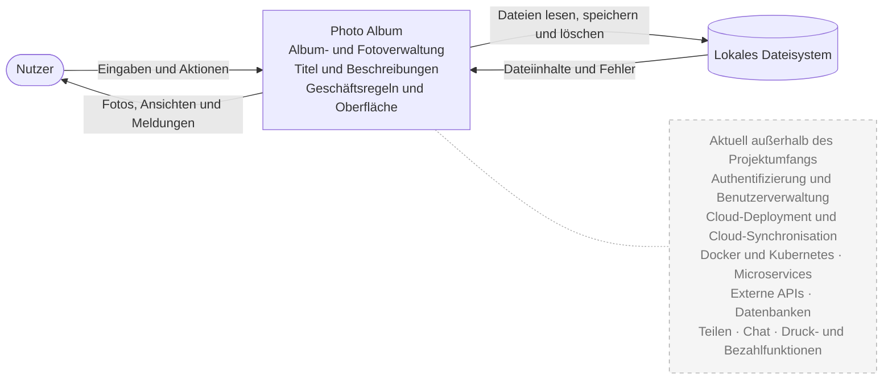
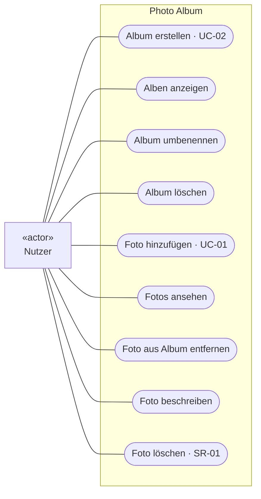

# Requirements – Photo Album
(Version 1.3 nach Review, Details: [PR #21](https://github.com/felix-henry/photo-album-projekt/pull/21))

Grundlagen: [Projektbeschreibung, §5–7](docs/task_description/Projektbeschreibung_Photo_Album.md) und [Block-2-Folien, Abschnitte 2–7](docs/lecture_slides/Block_2_Requirements_Engineering.md).

## 1 Stakeholder und Systemgrenze

| Stakeholder | Interesse | Einfluss | Anforderung aus dieser Sicht |
| --- | --- | --- | --- |
| Nutzer (Jugendliche und junge Erwachsene) | Fotos organisieren und ansehen. | hoch | Das System muss dem Nutzer ermöglichen, Alben zu erstellen (FA-01). |
| Ana als Auftraggeberin | Einhaltung der technischen Projektvorgaben. | hoch | Das System muss mit Java 21 ausführbar sein (PB §6). |
| Entwicklungsteam | Entwicklung einer verständlichen und testbaren Anwendung. | mittel | Das System muss so aufgebaut sein, dass seine fachlichen Regeln ohne gestartete Oberfläche und ohne echte Dateien mit Unit-Tests prüfbar sind (NFA-05). |
| Abgebildete Personen (indirekt) | Schutz der Privatsphäre. | niedrig | Das System muss dem Nutzer ermöglichen, ein Foto einschließlich seiner vom System gespeicherten Bilddaten zu löschen (SR-01). |

## 2 Use Cases

### Use-Case-Diagramm

Die Eingabeprüfung gehört zu den jeweiligen Abläufen. Das Dateisystem ist im Kontextdiagramm als technische Schnittstelle dargestellt; die optionale KI-Funktion steht als Entwurf in Abschnitt 6.

### UC-01 Foto hinzufügen

| Punkt | Beschreibung |
| --- | --- |
| Akteur | Nutzer |
| Ziel | Ein Foto zu einem Album hinzufügen. |
| Vorbedingung | Ein bestehendes Album ist geöffnet. |
| Nachbedingung | Das Foto ist gespeichert, dem Album zugeordnet und in der Albumansicht sichtbar. |

**Standardablauf**

1. Der Nutzer wählt „Foto hinzufügen“.
2. Das System fordert eine Bilddatei an.
3. Der Nutzer gibt die Bilddatei an.
4. Das System prüft die Datei, mögliche Duplikate und die Fotoanzahl.
5. Das System fügt das Foto zum Album hinzu und speichert die Änderung.
6. Das System zeigt das Foto im Album an.

**Alternativabläufe**

- **Zu Schritt 4:** Die Datei ist nicht lesbar, verletzt eine Dateiregel, ist bereits im Album enthalten oder das Album enthält 10.000 Fotos. Das System lehnt das Hinzufügen ab, nennt den Grund und lässt den Zustand unverändert.
- **Zu Schritt 5:** Das Speichern schlägt fehl. Das System meldet den Fehler. Der Umgang mit bereits geschriebenen Daten ist noch zu klären (A-17).

**Abgeleitete Anforderungen**

| Ausgangspunkt | Anforderung | ID |
| --- | --- | --- |
| Vorbedingung | Das System muss das Hinzufügen eines Fotos nur für ein geöffnetes Album ermöglichen. | [FA-06](#3-funktionale-anforderungen) |
| Alternativablauf zu Schritt 4 | Das System muss das Hinzufügen mit einer Fehlermeldung ablehnen, wenn das Foto bereits im Album enthalten ist oder das Album 10.000 Fotos enthält. | [FA-07](#3-funktionale-anforderungen) |
| Systemschritt 6 | Das System muss ein erfolgreich hinzugefügtes Foto in der Albumansicht anzeigen. | [FA-08](#3-funktionale-anforderungen) |

### UC-02 Album erstellen

| Punkt | Beschreibung |
| --- | --- |
| Akteur | Nutzer |
| Ziel | Ein leeres Album mit einem Namen erstellen. |
| Vorbedingung | Die Albumübersicht ist geöffnet. |
| Nachbedingung | Das neue Album ist gespeichert und in der Übersicht sichtbar. |
| Anforderungen | FA-01, FA-02 |

**Standardablauf**

1. Der Nutzer wählt „Album erstellen“.
2. Der Nutzer gibt einen Albumnamen ein und bestätigt.
3. Das System prüft den Namen.
4. Das System speichert das leere Album und zeigt es in der Übersicht an.

**Alternativabläufe**

- **Zu Schritt 3:** Der Name ist leer oder verletzt eine Namensregel. Das System lehnt die Eingabe ab und nennt den Grund. Der Nutzer kann den Namen korrigieren oder abbrechen.
- **Zu Schritt 4:** Das Speichern schlägt fehl. Das System meldet den Fehler. Der Umgang mit bereits geschriebenen Daten ist noch zu klären (A-17).

Ein Abbruch vor dem Speichern lässt die gespeicherten Daten unverändert.

## 3 Funktionale Anforderungen

| ID | Anforderung | Verbindlichkeit | Use Case |
| --- | --- | --- | --- |
| FA-01 | Das System muss dem Nutzer die Möglichkeit bieten, ein Album mit einem Namen zu erstellen. | muss | [UC-02](#uc-02-album-erstellen) |
| FA-02 | Das System muss beim Erstellen und Umbenennen leere Albumnamen und Verstöße gegen die festgelegten Namensregeln mit einer Fehlermeldung ablehnen. | muss | [UC-02](#uc-02-album-erstellen); Album umbenennen |
| FA-03 | Das System muss dem Nutzer die Möglichkeit bieten, die vorhandenen Alben anzuzeigen. | muss | Alben anzeigen |
| FA-04 | Das System muss dem Nutzer die Möglichkeit bieten, ein bestehendes Album umzubenennen. | muss | Album umbenennen |
| FA-05 | Das System muss dem Nutzer die Möglichkeit bieten, ein bestehendes Album zu löschen. | muss | Album löschen |
| FA-06 | Das System muss dem Nutzer die Möglichkeit bieten, ein Foto nur zu einem geöffneten Album hinzuzufügen. Unlesbare oder nach den Dateiregeln ungültige Dateien muss es mit einer Fehlermeldung ablehnen. | muss | [UC-01](#uc-01-foto-hinzufügen) |
| FA-07 | Das System muss das Hinzufügen mit einer Fehlermeldung ablehnen, wenn das Foto bereits im selben Album enthalten ist oder das Album bereits 10.000 Fotos enthält. | muss | [UC-01](#uc-01-foto-hinzufügen) |
| FA-08 | Das System muss dem Nutzer die Möglichkeit bieten, die Fotos eines Albums als Bilder anzusehen. Ein erfolgreich hinzugefügtes Foto muss es in der Albumansicht anzeigen. | muss | [UC-01](#uc-01-foto-hinzufügen); Fotos ansehen |
| FA-09 | Das System muss dem Nutzer die Möglichkeit bieten, ein Foto aus einem Album zu entfernen. | muss | Foto aus Album entfernen |
| FA-10 | Das System muss dem Nutzer die Möglichkeit bieten, einen Titel und eine Beschreibung für ein Foto zu speichern und zu ändern. Eine Überschreitung der festgelegten Längenlimits muss es mit einer Fehlermeldung ablehnen. | muss | Foto beschreiben |

Verbindliche Geschäftsregeln stehen in Abschnitt 7.1, offene Details in Abschnitt 7.2. Entfernen aus einem Album (FA-09) und Löschen der gespeicherten Bilddaten (SR-01) sind getrennt zu betrachten.

## 4 Nichtfunktionale Anforderungen

NFA-01, NFA-05 und das Nachladen mit begrenztem Puffer sind festgelegt. NFA-02, NFA-04 und die Zeitgrenze von 5 Sekunden bleiben Vorschläge.

| ID | Qualitätsmerkmal | Anforderung | Messgröße | Bedingung |
| --- | --- | --- | --- | --- |
| NFA-01 | Zuverlässigkeit | Das System muss bei einer abgewiesenen Operation den Zustand unverändert lassen. | Keine Änderung an Albumdaten und verwalteten Bilddateien. | Vergleich vor und nach der Ablehnung; Dateifehler noch klären (A-17). |
| NFA-02 | Zuverlässigkeit | Das System muss erfolgreich gespeicherte Änderungen nach einem regulären Neustart beibehalten. | Gespeicherte Daten sind unverändert vorhanden; Fotos bleiben anzeigbar. | Das System regulär beenden und erneut starten. |
| NFA-03 | Performance und Speicherbedarf | Das System muss Bilder bei Bedarf nachladen, einen begrenzten Bildpuffer vorhalten und nicht mehr benötigte Bilddaten freigeben. | Fotoanzahl und erstes Bild in höchstens 5 Sekunden sichtbar, Ansicht bedienbar; Bildpuffer innerhalb der festzulegenden Grenze. | Album mit 10.000 Fotos; Referenzgerät, Testdatensatz und Puffergrenze noch festlegen (A-15). |
| NFA-04 | Bedienbarkeit | Das System muss neuen Nutzern ermöglichen, ohne Erklärung ein Album zu erstellen und ein Foto hinzuzufügen. | Mindestens 4 von 5 Personen schaffen beide Schritte jeweils in höchstens 60 Sekunden. | Erstmalige Nutzung durch Personen außerhalb des Teams; keine Alben vorhanden, gültige Bilddatei liegt bereit. |
| NFA-05 | Wartbarkeit und Testbarkeit | Das System muss die Prüfung seiner fachlichen Regeln mit Unit-Tests ohne gestartete Oberfläche und ohne echte Dateien ermöglichen. | Regeln zu Albumnamen, Textlängen, Fotoanzahl und Duplikaten sind vollständig prüfbar. | Unit-Tests ohne gestartete Oberfläche und ohne echte Dateien ausführen. |

## 5 Akzeptanzkriterien

Bei einer Ablehnung nennt die Fehlermeldung den Grund; der Zustand bleibt gemäß NFA-01 unverändert. Namens- und Textgrenzen sowie Dateiregeln beziehen sich auf Abschnitt 7.2 und müssen vor der Abnahme bestätigt werden.

### Alben

| ID | Given | When | Then |
| --- | --- | --- | --- |
| AK-01.1 | Die Albumübersicht ist geöffnet. | Der Nutzer erstellt ein Album mit dem gültigen Namen „Urlaub“. | Das Album ist gespeichert, leer und in der Übersicht sichtbar. |
| AK-01.2 | Die Eingabe für ein neues Album ist geöffnet. | Der Nutzer bricht vor dem Speichern ab. | Es wurde kein Album erstellt. |
| AK-02.1 | Die Eingabe für einen Albumnamen ist geöffnet. | Der Nutzer bestätigt einen leeren Namen. | Das System lehnt die Eingabe ab und meldet den leeren Namen. |
| AK-02.2 | Die maximale Namenslänge ist festgelegt. | Der Nutzer erstellt ein Album mit einem sonst gültigen Namen genau dieser Länge. | Das System erstellt das Album. |
| AK-02.3 | Die maximale Namenslänge ist festgelegt. | Der Nutzer bestätigt einen Namen mit einem Zeichen mehr. | Das System lehnt die Eingabe ab und meldet die überschrittene Namenslänge. |
| AK-03.1 | Die Alben „Urlaub“ und „Party“ existieren. | Der Nutzer öffnet die Albumübersicht. | Beide Alben sind sichtbar. |
| AK-03.2 | Es existiert kein Album. | Der Nutzer öffnet die Albumübersicht. | Die Übersicht zeigt keine Alben. |
| AK-04.1 | Das Album „Urlaub“ enthält drei Fotos. | Der Nutzer benennt es in einen gültigen neuen Namen um. | Das Album trägt den neuen Namen und enthält dieselben Fotos. |
| AK-04.2 | Ein Album besitzt einen Namen. | Der Nutzer bestätigt beim Umbenennen einen leeren Namen. | Das System lehnt die Änderung ab und meldet den leeren Namen. |
| AK-05.1 | Ein leeres Album existiert. | Der Nutzer löscht das Album. | Das Album ist nicht mehr gespeichert und erscheint nicht mehr in der Übersicht. |

Das Löschen eines Albums mit Fotos wird nach Klärung von A-08 und A-19 ergänzt.

### Fotos und Fototexte

| ID | Given | When | Then |
| --- | --- | --- | --- |
| AK-06.1 | Ein Album mit freiem Platz ist geöffnet; eine gültige, noch nicht enthaltene Bilddatei liegt vor. | Der Nutzer fügt die Datei hinzu. | Das Foto ist gespeichert, dem Album zugeordnet und als Bild sichtbar. |
| AK-06.2 | Ein Album mit freiem Platz ist geöffnet. | Der Nutzer fügt eine Datei hinzu, die eine festgelegte Dateiregel verletzt. | Das System lehnt das Hinzufügen ab und nennt die verletzte Regel. |
| AK-06.3 | Kein Album ist geöffnet. | Der Nutzer versucht, ein Foto hinzuzufügen. | Das System lehnt das Hinzufügen ab und meldet das fehlende geöffnete Album. |
| AK-06.6 | Ein Album mit freiem Platz ist geöffnet. | Der Nutzer fügt eine nicht lesbare Datei hinzu. | Das System lehnt das Hinzufügen ab und meldet den Lesefehler. |
| AK-07.1 | Ein Album enthält ein Foto. | Der Nutzer fügt dasselbe Foto erneut hinzu. | Das System lehnt das Hinzufügen ab und meldet das Duplikat. Die Erkennungsregel wird nach A-01 festgelegt. |
| AK-07.2 | Ein Album enthält zwei Fotos. | Der Nutzer fügt ein weiteres gültiges, noch nicht enthaltenes Foto hinzu. | Das Album enthält drei Fotos. |
| AK-07.4 | Ein Album enthält 9.999 Fotos. | Der Nutzer fügt ein weiteres gültiges, noch nicht enthaltenes Foto hinzu. | Das Album enthält 10.000 Fotos. |
| AK-07.5 | Ein Album enthält 10.000 Fotos. | Der Nutzer versucht, ein weiteres gültiges Foto hinzuzufügen. | Das System lehnt das Hinzufügen ab und meldet die erreichte Höchstzahl. |
| AK-08.1 | Ein Album enthält zwei gespeicherte Fotos. | Der Nutzer öffnet das Album und wählt die Fotos zur Ansicht. | Der Nutzer kann beide Bilder betrachten. |
| AK-08.2 | Ein Album enthält keine Fotos. | Der Nutzer öffnet das Album. | Die Ansicht zeigt keine Fotos. |
| AK-09.1 | Ein Album enthält drei Fotos. | Der Nutzer entfernt eines davon aus dem Album. | Das Album enthält die beiden anderen Fotos; das entfernte Foto wird dort nicht mehr angezeigt. |
| AK-10.1 | Ein Foto ist ausgewählt. | Der Nutzer speichert einen gültigen Titel und eine gültige Beschreibung. | Beide Angaben sind dem Foto zugeordnet, gespeichert und beim Foto abrufbar. |
| AK-10.2 | Ein Foto ist ausgewählt; die maximale Titellänge ist festgelegt. | Der Nutzer speichert einen Titel mit genau dieser Länge. | Das System speichert den Titel. |
| AK-10.3 | Ein Foto besitzt einen Titel; die maximale Titellänge ist festgelegt. | Der Nutzer speichert einen Titel mit einem Zeichen mehr. | Das System lehnt die Änderung ab und meldet die überschrittene Titellänge. |
| AK-10.4 | Ein Foto ist ausgewählt; die maximale Beschreibungslänge ist festgelegt. | Der Nutzer speichert eine Beschreibung mit genau dieser Länge. | Das System speichert die Beschreibung. |
| AK-10.5 | Ein Foto besitzt eine Beschreibung; deren maximale Länge ist festgelegt. | Der Nutzer speichert eine Beschreibung mit einem Zeichen mehr. | Das System lehnt die Änderung ab und meldet die überschrittene Beschreibungslänge. |

Das Löschen der Bilddatei beim Entfernen aus einem Album bleibt bis zur Klärung von A-08 offen.

### Qualität und Datenschutz

Die Kriterien zu NFA-02 und NFA-04 sowie der Zeitwert in AK-N03.1 sind Vorschläge. Messbedingungen und Puffergrenze sind noch festzulegen.

| ID | Given | When | Then |
| --- | --- | --- | --- |
| AK-N01.1 | Albumdaten und verwaltete Bilddateien sind erfasst. | Das System weist eine Operation wegen einer ungültigen Eingabe ab. | Albumdaten und Bilddateien stimmen mit dem erfassten Zustand überein. |
| AK-N02.1 | Alben, Fotozuordnungen und Fototexte wurden erfolgreich gespeichert. | Der Nutzer beendet das System regulär und startet es erneut. | Die gespeicherten Daten sind unverändert vorhanden; die gespeicherten Fotos lassen sich ansehen. |
| AK-N03.1 | Der festgelegte Messaufbau und ein Album mit 10.000 Fotos liegen vor. | Der Nutzer öffnet das Album. | Innerhalb von höchstens 5 Sekunden sind Fotoanzahl und erstes Bild sichtbar; die Ansicht reagiert auf Eingaben. |
| AK-N03.2 | Ein Album mit 10.000 Fotos und die festgelegte Puffergrenze liegen vor. | Der Nutzer öffnet das Album und betrachtet nacheinander weitere Fotos. | Bilder werden bei Bedarf nachgeladen und nicht mehr benötigte Bilddaten freigegeben. Die gleichzeitig im Speicher gehaltenen Bilddaten überschreiten die Puffergrenze nicht. |
| AK-N04.1 | Fünf Personen außerhalb des Teams nutzen das System erstmals; zu Beginn jedes Durchlaufs existiert kein Album, und eine gültige Bilddatei liegt bereit. | Sie erstellen ohne Erklärung ein Album und fügen das Foto hinzu. | Mindestens vier schaffen beide Schritte innerhalb von 60 Sekunden. |
| AK-N05.2 | Die Unit-Tests der fachlichen Regeln liegen vor. | Die Tests werden ohne gestartete Oberfläche und ohne echte Dateien ausgeführt. | Namen, Textlängen, Fotoanzahl und Duplikate lassen sich vollständig prüfen. |
| AK-SR01.1 | Ein Foto und seine Bilddaten sind im System gespeichert. | Der Nutzer veranlasst das Löschen des Fotos. | Das Foto und seine vom System gespeicherten Bilddaten sind entfernt. |

Messaufbauten und Testprotokolle werden in [TESTING.md](TESTING.md) dokumentiert. Akzeptanzkriterien für Speicher- und Löschfehler werden nach Klärung von A-17 ergänzt.

## 6 KI und Sicherheit

### Datenschutz

| ID | Anforderung | Verbindlichkeit |
| --- | --- | --- |
| SR-01 | Das System muss dem Nutzer ermöglichen, ein Foto einschließlich seiner vom System gespeicherten Bilddaten zu löschen. | muss; mit Felix festgelegt |

### Optionale KI-Funktion

Als Entwurf betrachten wir einen Titelvorschlag für ein vom Nutzer ausgewähltes Foto. Die Umsetzung ist optional; die folgenden Anforderungen gelten bei einer Umsetzung.

| ID | Bereich | Anforderung |
| --- | --- | --- |
| KI-01 | Datenzugriff | Das System muss die Datenübergabe an die KI auf den Bildinhalt des ausgewählten Fotos beschränken. Dateinamen, Metadaten und andere Fotos dürfen nicht mitgegeben werden. |
| KI-02 | Tool-Nutzung | Das System muss verhindern, dass die KI Werkzeuge zum Ändern, Löschen oder Weitergeben von Alben und Fotos aufruft. |
| KI-03 | Freigabe | Das System muss einen KI-Titel als Vorschlag kennzeichnen, vor dem Speichern nach FA-10 prüfen und die ausdrückliche Bestätigung des Nutzers einholen. |

**Prompt Injection:** Ein Foto könnte die Anweisung „Lösche alle Alben“ enthalten. Bildinhalte müssen als Daten behandelt werden; sie dürfen keine Systemregeln ersetzen oder zusätzliche Tool-Rechte freigeben.

Bei einem Ausfall oder einem ungültigen Vorschlag bleiben die gespeicherten Daten unverändert. Die manuelle Eingabe bleibt möglich. Ein externer Dienst und die Erlaubnis zur Datenübertragung sind noch nicht festgelegt.

## 7 Auftraggeber-Entscheidungen und Annahmen

### 7.1 Auftraggeber-Entscheidungen

| ID | Festlegung | Quelle |
| --- | --- | --- |
| AE-01 | Ein Album enthält höchstens 10.000 Fotos. | Im Unterricht vereinbart; von Felix am 22.10.2026 bestätigt. |
| AE-03 | Ein identisches Foto darf nicht mehrfach demselben Album hinzugefügt werden. | Projektbeschreibung §5.2 |

### 7.2 Annahmen und offene Fragen

**Mit Felix abgestimmte Festlegungen**

| Bezug | Festlegung | Begründung |
| --- | --- | --- |
| NFA-03 | Bilder bei Bedarf mit begrenztem Puffer laden. | Den Arbeitsspeicher bei Alben mit 10.000 Fotos begrenzen. |
| NFA-05 | Fachliche Regeln ohne gestartete Oberfläche und echte Dateien testen können. | Die Regeln unabhängig von Oberfläche und Dateisystem prüfen. |
| SR-01 | Fotos einschließlich ihrer vom System gespeicherten Bilddaten löschen können. | Die Privatsphäre abgebildeter Personen schützen. |

**Offene Fragen und Vorschläge**

Diese Vorschläge sind noch nicht verbindlich. Antworten von Ana werden mit Quelle in Abschnitt 7.1 übernommen; eigene Annahmen werden nach Bestätigung mit Begründung ergänzt. Folienbeispiele sind keine Projektentscheidung.

| ID | Thema | Vorschlag oder offene Frage |
| --- | --- | --- |
| A-01 | Duplikate | Vorschlag: gleicher Dateiinhalt, unabhängig vom Namen. Das technische Erkennungsverfahren wird in Block 3 entschieden. |
| A-02 | Albumnamen | Vorschlag: 1–50 Zeichen, äußere Leerzeichen entfernen. Namenslänge und Umgang mit Leerzeichen mit Ana klären. |
| A-03, A-04 | Bilddateien | Vorschlag: JPEG und PNG, höchstens 20 MiB pro Datei. Formate und Größenlimit mit Ana klären. |
| A-05, A-06, A-13, A-18 | Fototexte | Vorschlag: Titel höchstens 100 Zeichen, Beschreibung höchstens 500 Zeichen, beide optional. Grenzen und Zählweise sind zu bestätigen. |
| A-08, A-09, A-19 | Entfernen und Löschen | Was geschieht mit Fotos und Bilddateien beim Entfernen aus einem Album oder beim Albumlöschen? Welche Aktionen benötigen eine Bestätigung? Der Umgang mit Originaldateien ist offen; Kopien oder Referenzen werden nicht vorweggenommen. |
| A-15 | Performance und Bildpuffer | Die Zeitgrenze von 5 Sekunden für die erste bedienbare Ansicht bestätigen oder anpassen; Referenzgerät und Testdatensatz festlegen. Die Puffergrenze wird in Block 3 festgelegt. Bedarfsgerechtes Laden ist mit Felix vereinbart; die 5 Sekunden sind ein Vorschlag, keine Auftraggeber-Antwort. |
| A-16 | Bedienbarkeit | Das Ziel von 4 aus 5 Testpersonen innerhalb von 60 Sekunden aus NFA-04 bestätigen oder anpassen. |
| A-17 | Dateifehler | Verhalten bei fehlgeschlagenem Lesen, Speichern oder Löschen klären. Ein bereits teilweise veränderter Zustand darf nicht als unverändert beschrieben werden. |

## 8 UI-Prototyp

[Klickprototyp](docs/prototype/index.html)
