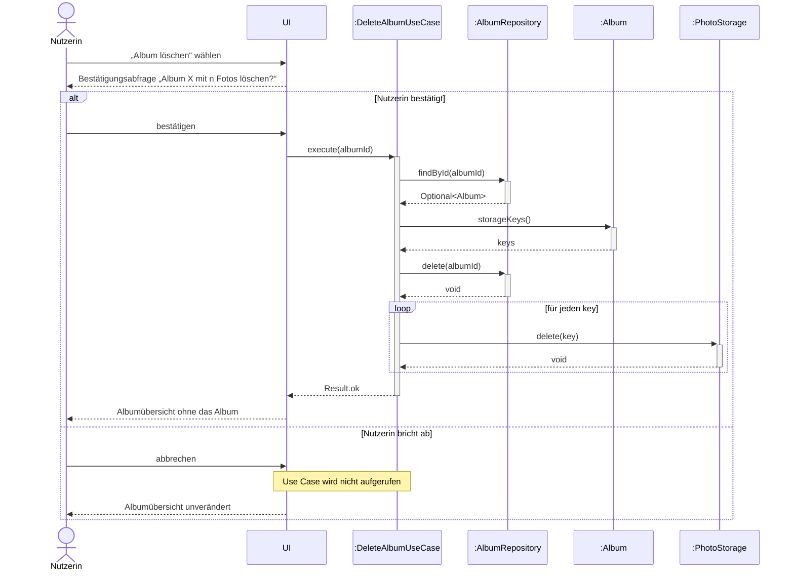

# Sequenzdiagramm „Album löschen“ (Block 3, Folie 25)

Grundlage ist die Auftraggeber-Entscheidung: Löschen eines Albums fragt nach und löscht die enthaltenen Fotos mit. Lebenslinien laut Folie: UI, DeleteAlbumUseCase, Album, AlbumRepository, PhotoStorage. Dazu kommt die Nutzerin als Akteur, weil sie die Bestätigung gibt.

## Erklärung in vier Punkten

1. **Die UI ruft nur den Use Case auf.** Sie kennt weder das Repository noch den Speicher (Folie 24, Controller-Prinzip Folie 21).
2. **Das Album liefert die Speicherschlüssel seiner Fotos.** Es kennt seine Fotos (Information Expert, Folie 21). Der Use Case koordiniert nur.
3. **Zuerst die Albumdaten löschen, dann die Bilddateien.** Schlägt das Löschen einer Datei fehl, ist das Album für die Nutzerin trotzdem vollständig weg. Es entsteht kein Album mit fehlenden Fotos („keine Teilzustände“, Folie 10). Verworfene Alternative: zuerst die Dateien löschen. Dann bliebe bei einem Fehler ein Album zurück, dessen Fotos fehlen.
4. **Fehler** (z. B. Album nicht gefunden, Speicher nicht erreichbar) übersetzt der Use Case in `Result.error`. Die UI zeigt dann eine fachliche Meldung (Folie 24). Das ist im Diagramm nicht gezeichnet, damit es übersichtlich bleibt.

## Plenumsfrage: Wer entscheidet über die Bestätigung, UI oder Use Case?

**Die UI.** Die Rückfrage ist Interaktion mit der Nutzerin und gehört in die Oberfläche. Bricht die Nutzerin ab, wird der Use Case gar nicht aufgerufen. Der Use Case bleibt dadurch unabhängig von der Oberfläche und ohne UI testbar.

Der Preis: Ein anderer Aufrufer könnte ohne Rückfrage löschen. Deshalb bekommt laut Folien ein KI-Agent bewusst keinen Zugriff auf DeleteAlbumUseCase.

## CRC-Abgleich und Änderungen am vorläufigen Klassendiagramm

| Nachricht | Karte / Verantwortung | Änderung nötig |
|-----------|-----------------------|----------------|
| `execute(albumId)` | DeleteAlbumUseCase: koordiniert das Löschen | – |
| `findById(albumId)` | AlbumRepository: findById (Folie 18) | Rückgabe als `Optional<Album>` wie auf Folie 9, im vorläufigen Team-Klassendiagramm stand `Album` (im Klassendiagramm v1 umgesetzt) |
| `storageKeys()` | Album: kennt seine Fotos | **neu im Klassendiagramm:** `Album.storageKeys()` |
| `delete(albumId)` | AlbumRepository: delete(id) (Folie 18) | – |
| `delete(key)` | PhotoStorage: Datei löschen | – |
| `Result.ok` / `Result.error` | DeleteAlbumUseCase: übersetzt Fehler | – |

Neue CRC-Karte **DeleteAlbumUseCase**:
- Verantwortlichkeiten: lädt Album, holt Speicherschlüssel, löscht Albumdaten und Dateien, übersetzt Fehler.
- Zusammenarbeit: AlbumRepository, Album, PhotoStorage.
