# Block 1: Einführung und Vorgehensmodelle

Software Engineering II.1 · DHBW Heilbronn · Ana · 29.09.2026

Quelle: [Originalfolien, 48 PDF-Seiten](Block_1_Vorgehsmodelle.pdf). Lesefassung mit zusammengeführten Wiederholungen, formatierten Übungen und Abbildungen aus den Folien. Seitenangaben beziehen sich auf die PDF-Seiten. Aussagen und Zahlen sind der Stand der Lehrunterlage.

## 1. Einordnung und Zweck von Vorgehensmodellen

*PDF-Seiten 1-4.*

Das Gruppenprojekt „Photo Album“ begleitet alle sieben Blöcke. Jeder Block liefert ein prüfbares Artefakt ins Repository; jeder Block umfasst laut Übersicht vier Unterrichtseinheiten.

| Block | Thema | Ergebnis |
| --- | --- | --- |
| 1 | Einführung und Vorgehensmodelle | Team, Repository, Vorgehen |
| 2 | Requirements Engineering | `REQUIREMENTS.md`, Use Cases, Akzeptanzkriterien, Prototyp |
| 3 | Entwurf und Entwurfsmuster | `ARCHITECTURE.md`, Klassen- und Sequenzdiagramm |
| 4 | Implementierung und Versionsmanagement | Build, Git, Pull Requests, Review, grüne CI |
| 5 | Blackbox-Tests | `TESTING.md`, Unit- und Integrationstests, Testverfahren |
| 6 | Whitebox, Wartung und Change Request | Coverage, Refactoring, Change Request |
| 7 | Management und Abschlusspräsentation | `RISK_ANALYSIS.md`, Präsentation |

Vorgehensmodelle helfen bei:

- **Komplexitätsbeherrschung:** Softwareprojekte übersteigen häufig die Möglichkeiten einer Einzelperson; der Lebenszyklus wird strukturiert.
- **Disziplin und Verbindlichkeit:** Rollen, Aktivitäten und Artefakte legen fest, was am Ende einer Phase vorliegen muss, etwa ein Lastenheft oder Architekturdiagramm.
- **Verlässlichkeit:** Die Folien nennen regulierte Branchen wie Medizintechnik und Luftfahrt als Beispiele für formale Prozessanforderungen.
- **Monitoring:** Meilensteine machen Fortschritt sichtbar.
- **Risikomanagement:** Wiederkehrende Aktivitäten in einer bekannten Reihenfolge erleichtern Vorhersagen.
- **Standardisierung und Skalierbarkeit:** Ein bekannter Prozess erleichtert den Wechsel zwischen Projekten und die Einarbeitung.

## 2. Experiment: Photo Management Challenge

*PDF-Seiten 5-12.*

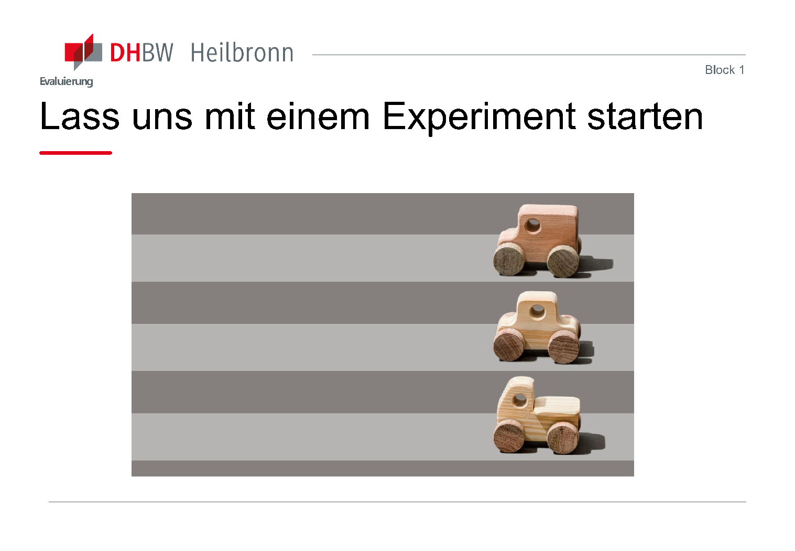

### Diskussionsfragen vor und nach dem Experiment

Begründe deine Zustimmung oder Ablehnung:

> „Je mehr wir zu Beginn analysieren, desto besser wird das entwickelte System.“

> „Es ist besser, den Kunden ein fertiges Produkt zu zeigen als Iterationen davon.“

### Wasserfall und agil im Überblick

| Wasserfall | Agil |
| --- | --- |
| Linear und sequenziell | Iterativ und inkrementell |
| Arbeit in festen Phasen | Flexibles Reagieren auf Änderungen |
| | Kontinuierliches Einbeziehen von Feedback |

### Teil 1: Anforderungen und erster Prototyp

1. **Gruppen bilden:** Gruppe 1 ist Auftraggeber, Gruppe 2 Auftragnehmer; alle anderen beobachten aktiv.
2. **Auftrag vorbereiten:** Gruppe 1 entwirft in 15 Minuten eine Vision für eine Fotoalbum-App für Jugendliche. Einige Anforderungen sollen ausdrücklich kommuniziert werden; andere wichtige Anforderungen werden nur genannt, wenn danach gefragt wird. Beispiele der Übung sind eine Druckintegration mit der DM-App und Skalierbarkeit. Währenddessen bereiten die anderen Gruppen Fragen vor.
3. **Anforderungen erheben:** Gruppe 2 hat 15 Minuten, Anforderungen bei Gruppe 1 zu sammeln. Die Beobachtenden notieren nicht gestellte Fragen.
4. **Prototypen erstellen:** Alle Gruppen arbeiten ausschließlich mit den von Gruppe 2 erhobenen Anforderungen. Nur Gruppe 1 erstellt einen Prototyp, der auch ihre nicht entdeckten Anforderungen enthält.
5. **Vorstellen:** Zwei Gruppen präsentieren ihre Prototypen. Gruppe 1 bewertet, ob sie ihren Vorstellungen entsprechen und angenommen würden.

### Teil 2: Feedback und Überarbeitung

1. Gruppe 1 gibt Feedback; die anderen überarbeiten ihre Prototypen. Diese Feedback-/Überarbeitungsrunde wird einmal wiederholt.
2. Zwei Gruppen präsentieren erneut. Gruppe 1 bewertet die Ergebnisse und zeigt ihren eigenen Prototyp.
3. Gemeinsam reflektieren: Haben die Iterationen geholfen? Wie war die Erfahrung? Haben sich die Antworten auf die Einstiegsfragen verändert?

## 3. Wasserfallmodell

*PDF-Seiten 13-19.*

Die Darstellung folgt den Phasen:

**Analyse → Design → Implementierung → Test → Betrieb**

Die Folie verweist auf Winston W. Royce, *Managing the development of large software* (1970). Die historischen Abbildungen bleiben erhalten, weil ihr Text nicht als durchsuchbarer PDF-Text vorliegt:

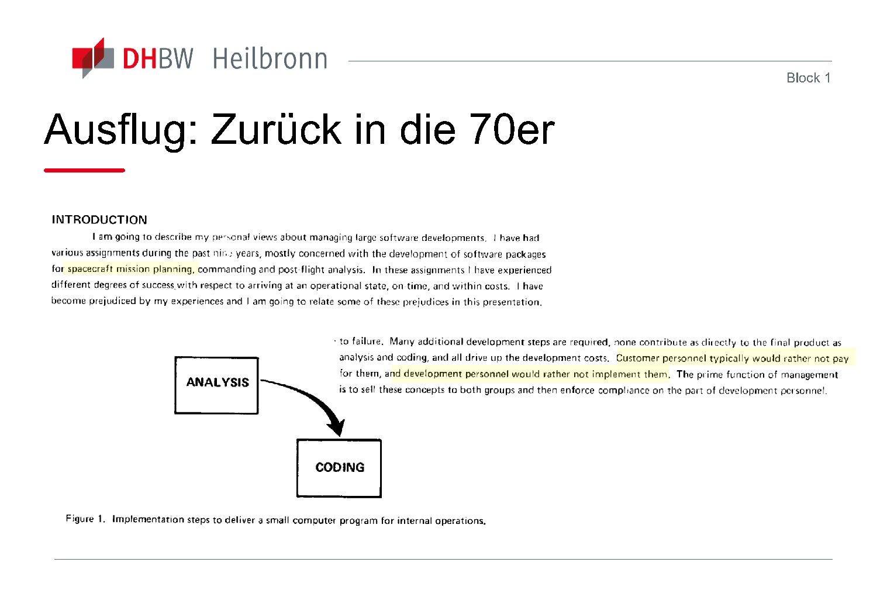

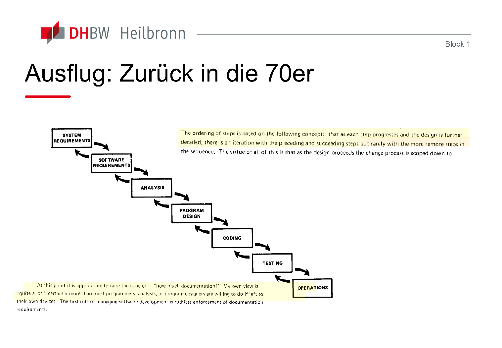

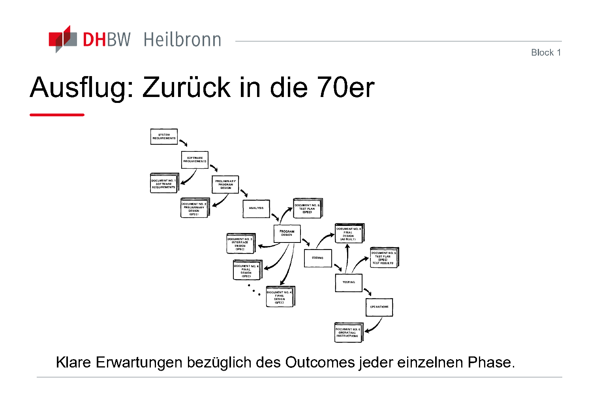

### Vorteile laut Folien

- Disziplin und Struktur
- Planbarkeit
- Einfachheit
- Qualitätskontrolle
- Stabilität

### Nachteile laut Folien

- **„Late Disaster“:** Eine Korrektur am Ende ist teuer.
- Unflexible Anforderungen
- Kein Prototyping im dargestellten Modell; Risiko, am Kunden vorbei zu entwickeln
- Phasenblockaden
- Hohe Dokumentationslast

### Genannte Einsatzgebiete

- Kurze, einfache Projekte
- Wettbewerbe mit festen Anforderungen
- Sicherheitskritische Systeme, etwa Medizintechnik, Luft- und Raumfahrt oder Kerntechnik

## 4. Inkrementelle und iterative Entwicklung

*PDF-Seite 20.*

| Inkrementell | Iterativ |
| --- | --- |
| Stück für Stück erweitern | Dasselbe schrittweise verbessern |

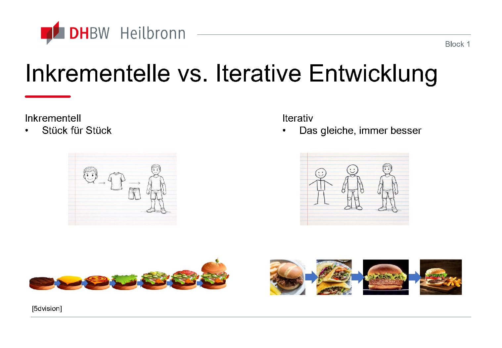

## 5. Prototyping

*PDF-Seiten 21-24.*

Ein Prototyp ist eine vorläufige, vereinfachte Version der Software. Er ermöglicht frühzeitig:

- Anforderungsklärung
- Machbarkeitsnachweise
- Feedback
- Prüfung der Akzeptanz

| Wegwerfprototyping | Evolutionäres Prototyping |
| --- | --- |
| Schnelle Erprobung („Quick and Dirty“), anschließend verwerfen | Ausbauen statt wegwerfen |

Genannte Werkzeuge für klickbare Prototypen: **Figma, ProtoPie, UXPin, Marvel und Uizard**.

Die Demonstration auf PDF-Seite 24 verlinkt einen [in Figma generierten Prototyp](https://www.figma.com/make/72F5odconlKEqYFqwzO525/Pawcation-web-app-design?t=nWHi53qZdKXOBFIw-1&preview-route=%2Fowner-home).

## 6. Agiles Manifest und Scrum

*PDF-Seiten 25-30.*

Das Agile Manifest von 2001 wird in den Folien als Abbildung gezeigt:

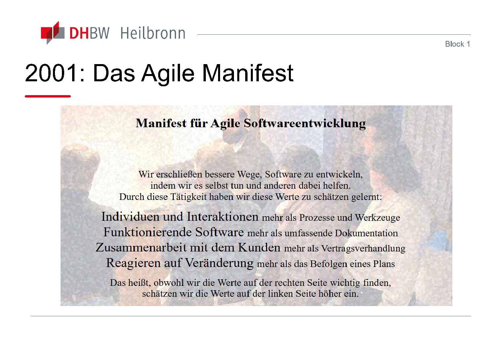

Die vier Werte aus der Abbildung:

| Höher gewichtet | Weiterhin wertvoll |
| --- | --- |
| Individuen und Interaktionen | Prozesse und Werkzeuge |
| Funktionierende Software | Umfassende Dokumentation |
| Zusammenarbeit mit dem Kunden | Vertragsverhandlung |
| Reagieren auf Veränderung | Befolgen eines Plans |

Das Manifest erklärt beide Seiten für wichtig und gewichtet jeweils die linke höher.

Der Scrum-Kreislauf ist ebenfalls grafisch dargestellt:

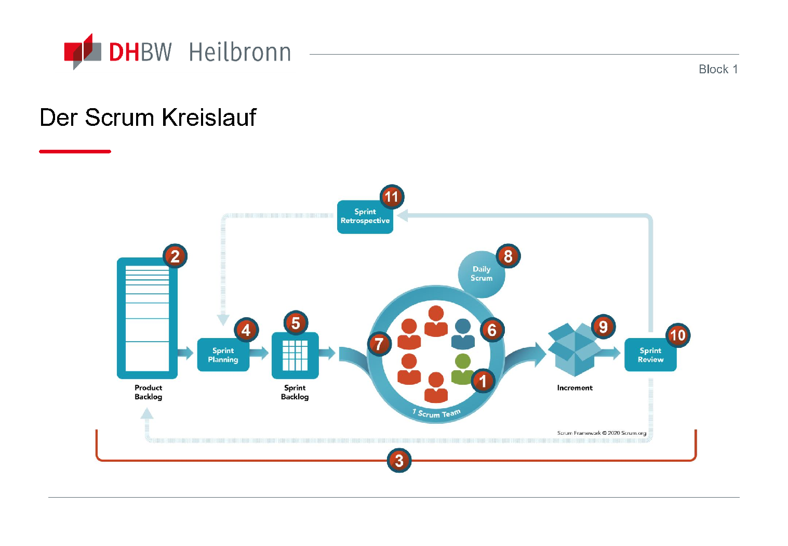

Der dargestellte Ablauf verbindet **Product Backlog → Sprint Planning → Sprint Backlog → Sprint → Inkrement → Sprint Review → Sprint Retrospective**. Im Sprint findet der Daily Scrum statt; Feedback fließt in die weitere Planung ein.

### Quiz 1: Produktverantwortung

Wer ist in Scrum primär dafür verantwortlich, den Produktwert zu maximieren und das Product Backlog zu verwalten?

- Scrum Master
- Developer
- Stakeholder
- Product Owner

**Auflösung der Folie:** Product Owner.

### Quiz 2: Nicht abgeschlossene Arbeit

Was passiert mit Product-Backlog-Einträgen, die am Sprintende nicht abgeschlossen sind?

- Sie wandern zurück in das Product Backlog.
- Sie werden automatisch in den nächsten Sprint übernommen.
- Sie zählen zum Inkrement, wenn sie fast richtig sind.
- Das Team muss den Sprint durch Überstunden verlängern.

**Auflösung der Folie:** Sie wandern zurück in das Product Backlog.

## 7. Kanban

*PDF-Seiten 31-36.*

**„Stop starting, start finishing.“** Kanban visualisiert und verbessert den Arbeitsfluss.

### Praktiken

- Workflow visualisieren.
- Parallele Arbeit begrenzen: **WIP = Work in Progress**.
- Flow steuern und Cycle Time reduzieren.
- Prozessregeln explizit machen.
- Feedbackschleifen und Kanban Cadences einführen.
- Kontinuierlich verbessern: **Kaizen**.

Die Folien nennen David Meyers Arbeiten zu Multitasking und den Zeigarnik-Effekt als Bezug zu mentaler Belastung durch unerledigte Arbeit.

### Prinzipien

- Dort beginnen, wo man jetzt steht.
- Inkrementell und evolutionär verändern: jeden Tag etwas besser, kein „Big Bang“.
- Führung auf allen Ebenen ermöglichen.

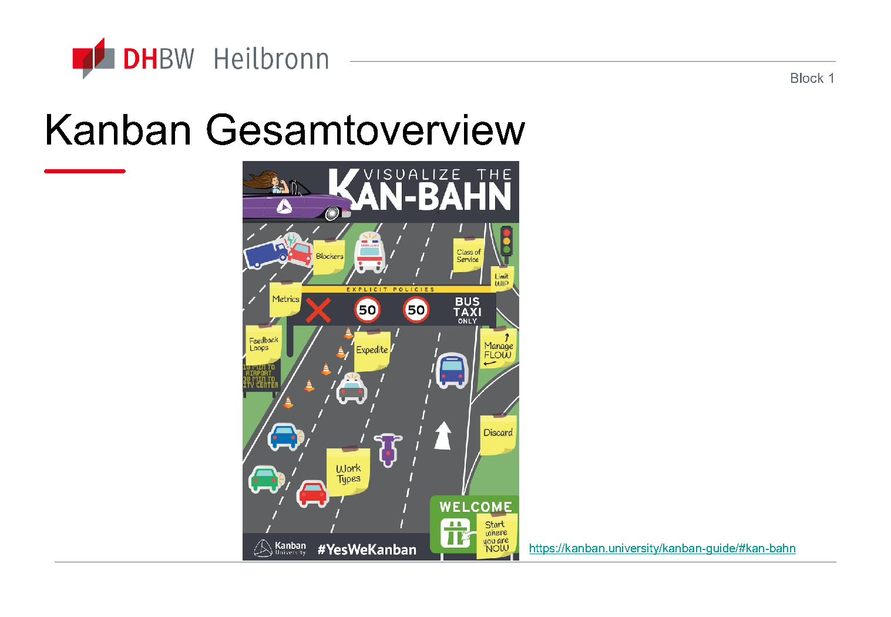

Quelle der Übersicht: [Kanban University](https://kanban.university/kanban-guide/#kan-bahn).

### Quiz 3: Arbeitsplanung

Was unterscheidet Scrum und Kanban grundsätzlich?

- Scrum hat keine Planung; Kanban plant täglich.
- Scrum arbeitet in festen Sprints; Kanban setzt auf kontinuierlichen Arbeitsfluss.
- Kanban-Sprints sind immer doppelt so lang wie Scrum-Sprints.
- Scrum erlaubt jederzeit neue Aufgaben im Zyklus; Kanban verbietet sie.

**Auflösung der Folie:** Feste Sprints in Scrum gegenüber kontinuierlichem Arbeitsfluss in Kanban.

### Quiz 4: Rollen

Welche Aussage ist korrekt?

- Kanban schreibt Service Request Manager und Service Delivery Manager zwingend vor.
- Scrum definiert Product Owner, Scrum Master und Developer; Kanban schreibt keine spezifischen Rollen vor.
- Beide benötigen zwingend einen Projektleiter.
- In Kanban übernimmt der Kunde die Rolle des Scrum Masters.

Die PDF enthält hierzu keine zusätzliche Lösungsfolie.

## 8. Skalierung: Scrum of Scrums und SAFe

*PDF-Seiten 37-40.*

### Scrum of Scrums

Wenn viele Personen agil zusammenarbeiten müssen, können kleinere Teams gebildet und miteinander koordiniert werden. Scrum of Scrums verbindet agile Teams mit einem gemeinsamen Ziel und unterstützt die Bereitstellung komplexer Lösungen.

### SAFe

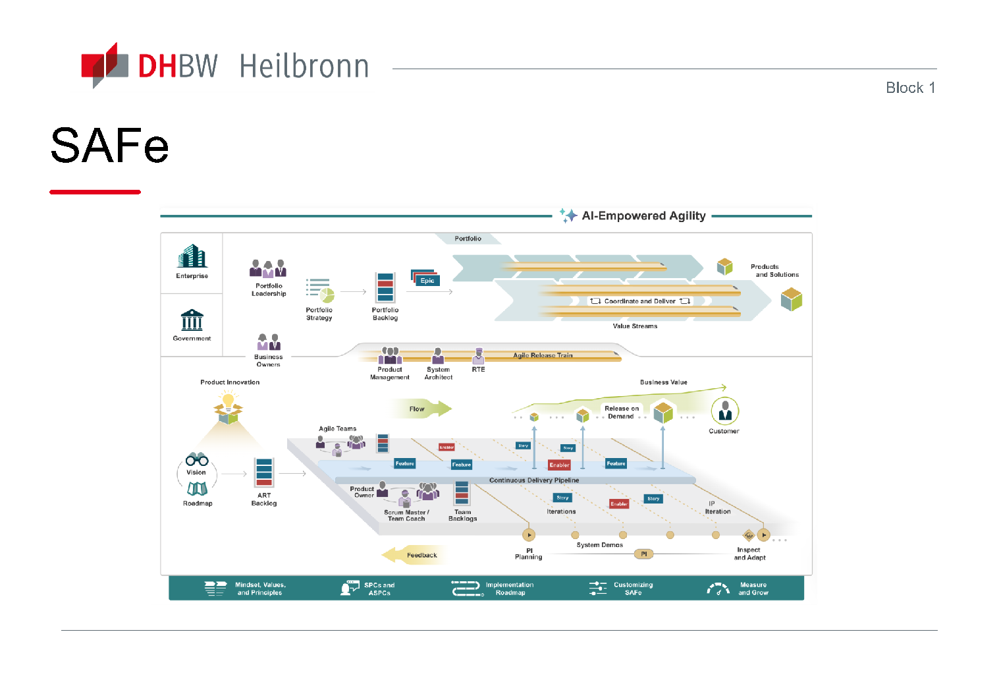

PDF-Seite 39 nennt folgende Zahlen: Einsatz in mehr als 100 Ländern, über eine Million zertifizierte Praktiker:innen, mehr als 500 Transformation and Platform Partners und einen Anteil von über 37 % bei skalierten agilen Methoden. Dies sind Angaben der Folie, keine hier aktualisierten Marktstatistiken.

SAFe kann laut den Folien mit Scrum und Kanban kombiniert werden:

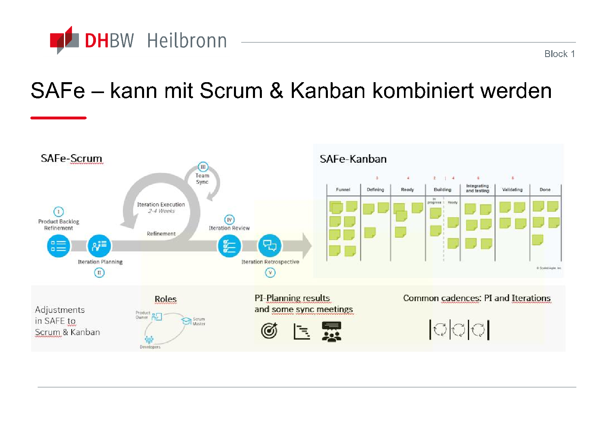

## 9. Vergleich und Diskussion

*PDF-Seiten 41-47; die schrittweise eingeblendete Vergleichstabelle wurde zusammengeführt.*

| Aspekt | Plangetrieben, z. B. Wasserfall | Änderungsgetrieben, z. B. Scrum |
| --- | --- | --- |
| Fokus | Prozessdisziplin und Vorhersagbarkeit | Flexibilität und Kundennutzen |
| Anforderungen | Zu Beginn stabil und klar definiert | Entwickeln sich während des Prozesses |
| Risikosteuerung | Detaillierte Planung und Reviews | Kurze Feedbackschleifen |
| Dokumentation | Umfangreich und formell | „Just enough“, Fokus auf Code |

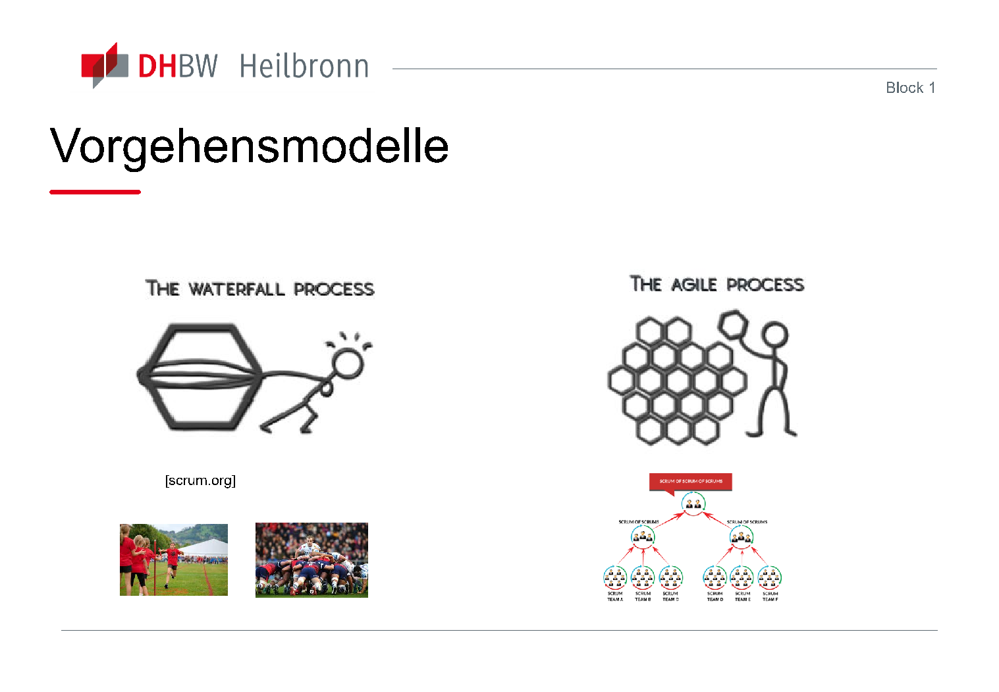

**Diskussion zu KI:** Welche Erfahrungen haben Organisationen und das eigene Team? Welche Rolle spielen Skills? Welche Herausforderungen entstehen? Brauchen wir weiterhin Prozesse, und welche passen für Agenten?

## 10. Referenzen der Folien

*PDF-Seite 48. Bibliografische Angaben werden aus der Vorlage übernommen; nicht vollständig bibliografisch geprüft.*

- **[Royce70]** Winston W. Royce: *Managing the development of large software*.
- **[Meadows97]** *Leverage Points: Places to Intervene in a System*.
- **[WikiVModell]** [Das V-Modell](https://de.wikipedia.org/wiki/V-Modell).
- **[Boehm1979]** Barry Boehm: *Guidelines for Verifying and Validating Software Requirements and Design Specifications*.
- **[Boehm1979]** Barry Boehm: *A spiral model of software development and enhancement*. Die Vorlage verwendet denselben Schlüssel für beide Einträge.
- **[scrum.org]** [What is Iterative, Incremental Delivery? The Hunt for the Perfect Example](https://www.scrum.org/resources/blog/what-iterative-incremental-delivery-hunt-perfect-example).
- **[5dvision]** [Incremental vs. Iterative](https://www.5dvision.com/post/incremental-vs-iterative/).
- **[RockPrototype]** [About Prototyping](https://rock-the-prototype.com/en/prototypes/).
- **[Nonaka1986]** Takeuchi und Nonaka: *The New New Product Development Game*.
- **[Sutherland1995]** Jeff Sutherland und Ken Schwabe: *Scrum Development Process* (Namensschreibweise der Vorlage).
- **[SoS]** [Scrum of Scrums](https://www.agilest.org/scaled-agile/scrum-of-scrums/).
- **[ScaledAgile]** [SAFe Big Picture](https://framework.scaledagile.com/#big-picture).
