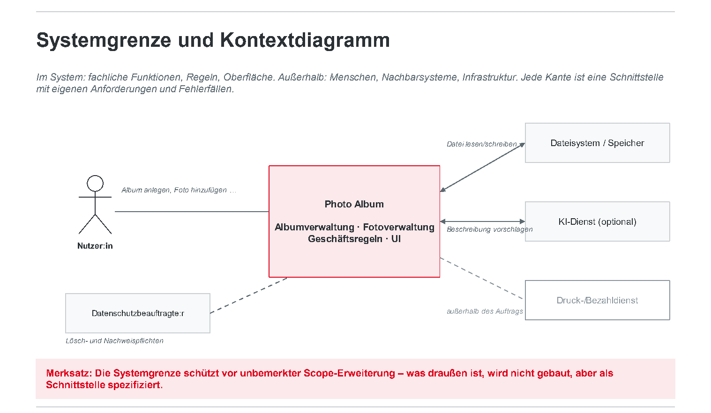
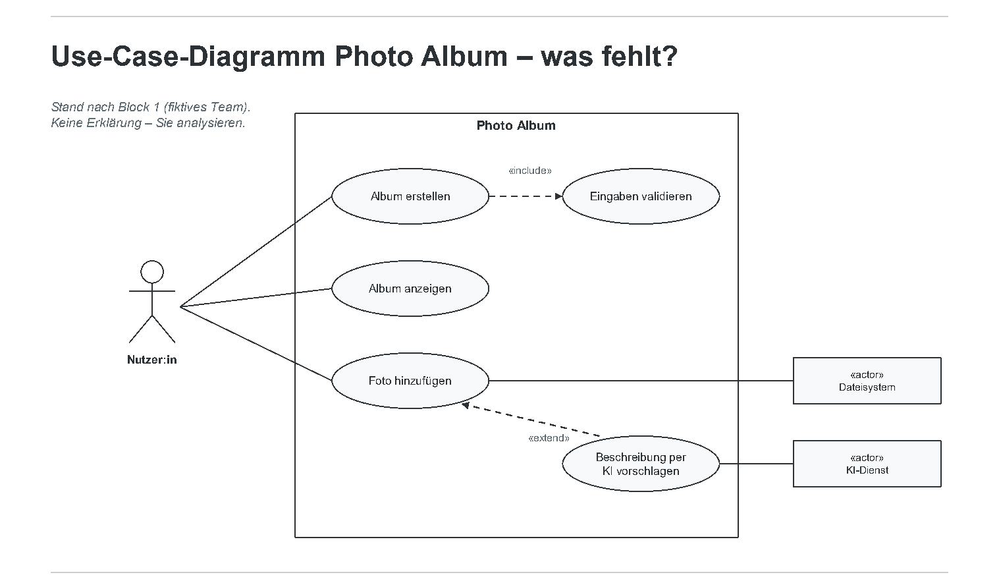

# Block 2: Requirements Engineering

**Vom Projektauftrag zu prüfbaren Anforderungen** · Software Engineering II.1 · DHBW Heilbronn · Ana · WS 2026/27

Quelle: [Originalfolien, 56 PDF-Seiten](Block_2_Requirements_Engineering.pdf). Wiederholte Einblendungen und Lösungsfolien sind zusammengeführt. Seitenangaben beziehen sich auf die PDF-Seiten, nicht auf die teilweise abweichenden Foliennummern.

> Zahlen, Dateitypen und Geschäftsregeln in Beispielen sind Unterrichtsmaterial. Sie werden durch diese Übertragung nicht zu Entscheidungen unseres Teams. Verbindliche Antworten der Auftraggeberin müssen gesondert dokumentiert werden.

## 1. Ziel und Ablauf

*PDF-Seiten 1-4.*

Block 2 baut auf Einführung und Vorgehensmodellen auf. Das durchgängige Projekt liefert je Block ein prüfbares Artefakt: Team/Vorgehen → Anforderungen → Entwurf → Implementierung/Git/CI → Tests → Wartung/Change Request → Risikoanalyse/Präsentation.

**Lernziele:**

- Stakeholder und Systemgrenze festlegen.
- Funktionale Anforderungen aus Use Cases ableiten, statt zusätzliche Features zu erfinden.
- Anforderungen mit SOPHIST-Regeln prüfen und mit Satzschablonen formulieren.
- Akzeptanzkriterien als spätere Testbasis schreiben.
- Anforderungen an KI-Funktionen, Agenten, Skills und MCP-Tools verstehen.
- Eigene Artefakte im Peer Review prüfen lassen.

**Ergebnis:** `REQUIREMENTS.md` v1 mit 6-10 FA und 3-5 NFA, ausgearbeitete Use Cases, Given/When/Then-Kriterien, UI-Skizze oder Klickprototyp und ein Eintrag in `AI_USAGE.md`.

| Minuten | Thema | Format |
| --- | --- | --- |
| 00-10 | Einstieg: Was bedeutet „schnell“? | Übung |
| 10-30 | Stakeholder und Systemgrenze | Übung |
| 30-65 | Vom Use Case zur funktionalen Anforderung | Übung |
| 65-105 | SOPHIST-Regeln und Satzschablonen | Übung |
| 105-120 | Pause | |
| 120-145 | Akzeptanzkriterien | Übung |
| 145-180 | Requirement Clinic und Peer Review | Teamarbeit |
| 180-210 | KI, Agenten, Skills und MCP | Übung |
| 210-225 | Auftraggeber-Sprechstunde | Teamarbeit |
| 225-240 | Checkpoint, Exit Ticket und Hausaufgabe | |

### Einstiegsübung: Was bedeutet „schnell“?

*PDF-Seite 5 · 3 Minuten · erst einzeln, dann im Team.*

Ausgangssatz: „Die App soll Fotoalben schnell anzeigen.“

1. Eine Minute allein: Eine für Tester eindeutig prüfbare Fassung schreiben.
2. Zwei Minuten im Team: Auf eine Formulierung einigen und die dafür nötigen Annahmen notieren.

**Ergebnis:** Eine prüfbare Formulierung pro Team auf Whiteboard/Miro. Zwei Teams lesen im Plenum vor.

## 2. Stakeholder und Systemgrenze

*PDF-Seiten 6-9.*

### Stakeholder und ihre Interessen

| Stakeholder | Interessen bzw. Einfluss auf Anforderungen |
| --- | --- |
| Jugendliche und junge Erwachsene | Alben schnell anlegen, Fotos sortieren, mobil bedienen |
| Auftraggeber/Unternehmen | Nutzen, Kosten, Termin, spätere Erweiterbarkeit |
| Entwicklungsteam | Umsetzbarkeit, Wartbarkeit, Testbarkeit |
| Betrieb, Datenschutz und Recht | Löschung, Zugriff und Nachweis; Fotos können personenbezogene Daten enthalten |
| Indirekte Stakeholder | Abgebildete Personen, Eltern minderjähriger Nutzer:innen, Support |

Die Nähe zum System wird in der Folie als Hinweis auf den Einfluss auf Anforderungen dargestellt.

### Systemgrenze

Im System liegen fachliche Funktionen, Regeln und Oberfläche. Außerhalb liegen Menschen, Nachbarsysteme und Infrastruktur. Jede Verbindung ist eine Schnittstelle mit eigenen Anforderungen und Fehlerfällen.

Das Beispiel zeigt Album- und Fotoverwaltung, Geschäftsregeln und UI im System. Nutzer:innen bedienen es; Dateisystem/Speicher und ein optionaler KI-Dienst bilden technische Schnittstellen. Druck-/Bezahldienst liegt außerhalb des Auftrags, Datenschutz stellt Lösch- und Nachweisanforderungen.



Die Systemgrenze verhindert unbemerkte Erweiterungen des Projektumfangs. Externe Systeme werden nicht automatisch selbst gebaut; relevante Schnittstellen werden spezifiziert.

### Übung: Stakeholder-Matrix

**8 Minuten · Team.** Abschnitt „Stakeholder und Systemgrenze“ in `REQUIREMENTS.md` anlegen:

1. Mindestens vier Stakeholder mit Interesse und Einfluss (hoch/mittel/niedrig) nennen.
2. Für jeden eine Anforderung formulieren, die aus seiner besonderen Perspektive entsteht.
3. Kontextdiagramm zeichnen: innen, Schnittstelle, bewusst außerhalb.

**Ergebnis:** Tabelle und Kontextdiagramm als Foto/Miro im Repository. Im Plenum zeigt ein Team sein Diagramm; ein anderes ergänzt einen fehlenden Stakeholder.

## 3. Von Use Cases zu Anforderungen

*PDF-Seiten 10-21.*

### Vorwissen und Erweiterung

Aus Systemanalyse und -entwurf werden vorausgesetzt: Use-Case-Diagramme mit Akteuren, Systemgrenze, `include`, `extend` und Generalisierung; Beschreibungen mit Vor-/Nachbedingungen und Standard-/Alternativabläufen; Aktivitätsdiagramme; Domänen-Klassendiagramme; fachliche Ziele und Nutzen.

Neu sind einzelne nummerierte Anforderungen aus Use-Case-Schritten, die Trennung von FA/NFA, messbare Qualitätsanforderungen, sprachliche Prüfung, Akzeptanzkriterien und Anforderungen an KI-Komponenten.

### Übung: Use-Case-Analyse

*PDF-Seiten 12-16 · 15 Minuten · Team; auf Seite 16 nochmals als Nacharbeit aufgeführt.*

Das Diagramm eines fiktiven Teams enthält bewusst Diskussionspunkte:



1. Mit Pflichtfunktionalität und SAE-Qualitätsregeln vergleichen: Welche Use Cases fehlen? Welche Beziehung ist fachlich fragwürdig? Welcher Akteur ist falsch klassifiziert?
2. „Foto hinzufügen“ mit höchstens sechs Standardschritten und zwei Alternativabläufen beschreiben.
3. Drei FA ableiten: aus einem Systemschritt, einem Alternativablauf und einer Vorbedingung.

**Ergebnis:** Korrigiertes Diagramm, Use-Case-Beschreibung und nummerierte Anforderungen (`FA-01` usw.) in `REQUIREMENTS.md`. Im Plenum prüfen: Systemverhalten oder lediglich Benutzerschritt?

Die Folien verweisen hier auf Abschnitt 4.1 der Projektbeschreibung; in der vorhandenen Version 3 steht die Pflichtfunktionalität unter 5.1.

### Ableitung am Beispiel „Foto hinzufügen“

| Element | Beispiel | Abgeleitete Anforderung aus der Folie |
| --- | --- | --- |
| Vorbedingung | Album ist geöffnet | **FA-03:** Das System muss das Hinzufügen eines Fotos nur in einem geöffneten Album ermöglichen. |
| Systemschritt | Dateityp und Duplikat prüfen, Foto speichern | **FA-04:** Das System muss beim Hinzufügen prüfen, ob die Datei vom Typ JPEG oder PNG ist. |
| Alternativablauf 4a | Foto bereits vorhanden | **FA-05:** Wenn ein identisches Foto bereits im Album enthalten ist, muss das System das Hinzufügen ablehnen und den Grund anzeigen. |
| Nachbedingung | Foto enthalten, Anzahl +1 | **FA-06:** Nach erfolgreichem Hinzufügen muss das System das Foto in der Albumansicht anzeigen. |
| Fehlersituation | Datei nicht lesbar | **FA-07:** Wenn die Datei nicht gelesen werden kann, muss das System eine Fehlermeldung anzeigen und das Album unverändert lassen. |

### User Story und Use Case

| User Story | Use Case |
| --- | --- |
| „Als `<Rolle>` möchte ich `<Ziel>`, damit `<Nutzen>`.“ | Ablauf mit Standard- und Alternativpfaden |
| Kurz, priorisierbar, passt auf eine Karte | Explizite Akteure, Systemgrenze, Vor-/Nachbedingungen |
| Gesprächsversprechen; Details entstehen im Gespräch | Grundlage für Sequenzdiagramme und Tests |
| Braucht Akzeptanzkriterien | Beschreibt auch Fehler- und Grenzfälle |
| Beispiel: Einem Foto einen Titel geben, um es wiederzufinden | Beispiel: „Foto beschreiben“ mit Alternativablauf „Titel länger als 100 Zeichen“ |

Die Folie ordnet User Stories dem Backlog (`Issues.md`) und zwei zentrale Use Cases `REQUIREMENTS.md` zu. Beide sollen auf dieselben Anforderungs-IDs zeigen; daraus folgt keine automatische Entscheidung unseres Teams für eine Datei `Issues.md`.

### Funktional oder nichtfunktional?

**FA beschreiben, was das System tut:** Album umbenennen, Foto entfernen, Duplikat erkennen, Titel bis maximal 100 Zeichen speichern. Ergebnis ist beobachtbares Verhalten.

**NFA beschreiben Qualitätsmerkmale:** Antwortzeit, Benutzbarkeit, Datenschutz oder Wartbarkeit. Sie benötigen Qualitätsmerkmal, Messgröße und Bedingung.

Die Sortierübung und ihre Auflösung auf PDF-Seiten 18-19 ordnen folgende Beispiele zu:

| Qualitätsmerkmal | Frage | Messbare Beispielformulierung (PDF-Seite 20) |
| --- | --- | --- |
| Performance-Effizienz | Wie schnell bei welcher Menge? | Albumansicht mit 100 Fotos in ≤ 2 s auf dem Referenzgerät |
| Benutzbarkeit | Wie leicht ohne Anleitung? | 8 von 10 Testpersonen legen ein Album in < 60 s an |
| Zuverlässigkeit | Was geschieht bei Fehlern? | Abbruch beim Upload lässt das Album unverändert; kein Teilzustand |
| Sicherheit/Datenschutz | Wer darf was, wie lange bleiben Daten? | Entfernte Fotos nach ≤ 24 h physisch gelöscht; Löschung protokolliert |
| Wartbarkeit | Wie leicht änderbar und testbar? | Geschäftsregeln in einem Modul; Unit-Tests in < 30 s |
| Kompatibilität/Portabilität | Wo läuft es? | Java 21; Build auf Windows/macOS/Linux ohne manuelle Schritte |

Die Sortierfolie nennt für die Antwortzeit `< 2 s`, die Tabelle `≤ 2 s`. Beim Formulieren eigener Anforderungen ist diese Grenze eindeutig festzulegen. Für das Projekt werden 3-5 NFA gewählt, die Konsequenzen für Architektur und Tests haben.

### Traceability

**Stakeholder-Bedarf → Use Case → Anforderung → Akzeptanzkriterium → Testfall**

Beispielkette der Folie:

1. Bedarf: „Ich will Fotos nicht doppelt im Album haben.“
2. Use Case „Foto hinzufügen“, Alternativablauf 4a: Duplikat.
3. `FA-05`: Identisches Foto ablehnen.
4. `AK-05.1`: Album enthält X; X erneut hinzufügen; Fehler und unveränderter Zustand.
5. `TC-05.1` bzw. `rejectsDuplicatePhoto()` als Test.

IDs machen die Kette in beide Richtungen nachvollziehbar und unterstützen die Impact Analysis beim Change Request.

## 4. SOPHIST-Regeln und Satzschablonen

*PDF-Seiten 22-33.*

SOPHIST ist ein Beratungs- und Trainingsunternehmen für Requirements Engineering; die Folien beziehen sich auf Chris Rupp und die SOPHISTen. Beim Schreiben natürlicher Sprache können Informationen durch **Tilgung, Generalisierung und Verzerrung** verloren gehen. Regeln liefern Signalwörter und Prüffragen, Schablonen eine vollständige Satzstruktur.

Die Regeln prüfen die sprachliche Form. Ob beispielsweise der Wert 100 fachlich richtig ist, muss mit dem Stakeholder geklärt werden. Die vollständige Regelsammlung liegt laut Folie in der SOPHIST-Broschüre in Moodle.

### Sechs Regeln

| Regel | Signal | Prüffrage | Beispiel |
| --- | --- | --- | --- |
| Aktiv formulieren | „wird gespeichert“ | Wer handelt? | Das System speichert das Foto. |
| Prozesswörter verwenden | „Validierung“, „Löschung“ | Welcher Prozess mit welchen Schritten? | Das System prüft Dateityp und Größe. |
| Universalwörter hinterfragen | immer, alle, nie, jeder, kein | Gilt das ausnahmslos? | „Alle Fotos“: auch Dateien > 20 MB? |
| Vergleiche vervollständigen | schneller, besser, einfacher | Als was, um wie viel? | „Schneller als V1“ benötigt eine Messgröße. |
| Unklare Adjektive/Adverbien präzisieren | schnell, intuitiv, angemessen | Wie wird das gemessen? | ≤ 2 s; 8 von 10 Testpersonen |
| Bedingungen und Mengen nennen | ggf., ausreichend | Wann genau, wie viele? | Wenn das Album 100 Fotos enthält, … |

Weitere Signalwörter sind „robust“, „möglichst“, „normalerweise“, „in der Regel“, „etc.“, „usw.“, „o. ä.“, „wird unterstützt“ und „ist möglich“. Prüfe Last, Gerät und Messung; Auslöser und Entscheider; Vollständigkeit von Listen; Ausnahmen sowie konkrete Verben und Objekte.

**Peer-Review-Tipp:** Signalwörter markieren. Jede Markierung benötigt eine Antwort oder Umformulierung.

### Drei Satzschablonen

Eine optionale Bedingung steht vorne; anschließend folgen System, Verbindlichkeit, Objekt und Prozess.

| Art | Schablone | Beispiel der Folie |
| --- | --- | --- |
| Selbstständige Systemaktivität | Das System muss `<Objekt>` `<Prozesswort>`. | Wenn ein identisches Foto bereits im Album enthalten ist, muss das System das Hinzufügen ablehnen. |
| Benutzerinteraktion | Das System muss `<Akteur>` die Möglichkeit bieten, `<Objekt>` zu `<Prozesswort>`. | Das System muss der Nutzerin die Möglichkeit bieten, den Namen eines bestehenden Albums zu ändern. |
| Schnittstelle | Das System muss fähig sein, `<Objekt>` von/an `<Nachbarsystem>` zu `<Prozesswort>`. | Das System muss fähig sein, eine JPEG-Datei von bis zu 20 MB aus dem Dateisystem zu lesen. |

### Verbindlichkeit

- **muss:** verpflichtend, Abnahmekriterium; Nichterfüllung ist ein Fehler.
- **sollte:** gewünscht; begründete Abweichung möglich.
- **wird:** Absicht bzw. zukünftiger Zustand, kein aktueller Prüfgegenstand.

Die Folie stellt den Bezug zu MoSCoW (Must/Should/Could/Won't) her. Pflichtfunktionalität und Geschäftsregeln werden als Muss eingeordnet; Sortierung und Suche als mögliche Komfortfunktionen; KI-Beschreibung als Sollte/Wird je nach Teamentscheidung. Die Aussage „Bewertet wird nur, was Sie als muss deklarieren“ ist eine Aussage dieser Folie; die Bewertungsmatrix der Projektbeschreibung bleibt zusätzlich relevant.

### Beispiel: Von vage zu prüfbar

**Performance:** „Die App soll große Alben gut unterstützen.“

Verbesserte Fassung der Lösungsfolie:

> Wenn ein Album 100 Fotos enthält, muss das System die Albumansicht innerhalb von 2 Sekunden nach dem Öffnen vollständig anzeigen (Referenzgerät: Laptop der Entwicklungsumgebung).

„Groß“, „gut unterstützen“, Bedingung und Messumgebung werden konkretisiert.

**Benutzerinteraktion:** „Nutzer können Fotos komfortabel löschen.“

Verbesserte Fassung:

> Das System muss der Nutzerin die Möglichkeit bieten, ein ausgewähltes Foto nach einer Bestätigungsabfrage aus dem geöffneten Album zu entfernen. Das Foto bleibt im Speicher erhalten, bis es aus dem letzten Album entfernt wurde.

Die Überarbeitung macht die zuvor versteckte fachliche Entscheidung zwischen Entfernen aus einem Album und physischem Löschen sichtbar.

### Übung: Vier Sätze reparieren

**8 Minuten · Paare im Team; jedes Paar übernimmt zwei Sätze.**

1. „Die Fotos werden beim Upload validiert.“
2. „Das Album darf nicht zu voll werden.“
3. „Der Nutzer muss den Titel eingeben können, etc.“
4. „Beschreibungen sollen immer sinnvoll sein.“

**Ergebnis je Satz:** Verletzte Regeln benennen, passende Schablone anwenden, offene Fachfrage notieren. Im Plenum wird je eine Lösung vorgelesen; die Auftraggeberin beantwortet die Fachfragen.

## 5. Akzeptanzkriterien und Validierung

*PDF-Seiten 34-42.*

Akzeptanzkriterien schaffen eine vorher vereinbarte Abnahmegrundlage, dienen als Testbasis, unterstützen die Definition of Done und machen Missverständnisse sowie Grenz-/Fehlerfälle sichtbar. Die Folien nennen vier Bewertungspunkte für sinnvolle Akzeptanzkriterien und Use Cases.

**Given = Ausgangszustand · When = eine auslösende Aktion · Then = beobachtbares Ergebnis mit Zustand und Ausgabe.** Die Struktur lässt sich auf Arrange/Act/Assert im Test übertragen.

### Beispiel Albumname

Statt „Leere Namen dürfen nicht vorkommen“:

| ID | Given | When | Then |
| --- | --- | --- | --- |
| AK-01.1 | Dialog „Album erstellen“ geöffnet | Nutzerin bestätigt einen Namen nur aus Leerzeichen | Kein Album gespeichert; Hinweis „Der Albumname darf nicht leer sein.“ |
| AK-01.2 | Dialog geöffnet | Name „Urlaub 2026“ (11 Zeichen) eingegeben | Album angelegt und in der Übersicht angezeigt |

Pro Anforderung werden Normal- und Fehlerfall betrachtet; Grenzfälle werden in Block 5 systematisch hergeleitet.

### Übungen zu Geschäftsregeln

**PDF-Seite 38 · 10 Minuten:** Eine Gruppe übernimmt den Auftraggeber; die anderen erfragen Geschäftsregeln und Akzeptanzkriterien.

**PDF-Seite 39 · 10 Minuten · Team:** Die Folie verwendet 100 Fotos je Album, Titel mit höchstens 100 Zeichen und keine identischen Fotos im selben Album als Übungsregeln.

1. Zwei Regeln als Anforderungen mit IDs und Schablone formulieren.
2. Je mindestens drei Kriterien schreiben: Normal-, Fehler- und Grenzfall, etwa genau 100 bzw. 101 Fotos.
3. Unbeantwortete Fachfragen markieren, etwa Dateiname oder Inhalt als Identitätskriterium.

**Ergebnis:** Abschnitt „Akzeptanzkriterien“ mit `AK-xx.n`, verlinkt auf `FA-xx`. Im Plenum den 101. Einfügeversuch prüfen: Fehler, Hinweis, unveränderter Zustand?

### Requirement Clinic

**20 Minuten · Team.**

1. 6-10 FA mit Schablone, ID und Verbindlichkeit sowie 3-5 NFA mit Qualitätsmerkmal, Messgröße und Bedingung vervollständigen; zweiten Use Case beschreiben.
2. SOPHIST-Signalwörter suchen; Fundstellen reparieren oder als offene Fragen markieren.
3. Widersprüche prüfen, jede FA einem Use Case zuordnen, jeder Muss-FA mindestens ein Akzeptanzkriterium geben.
4. Vorgeschlagene Commit-Nachricht: `docs: requirements v1 nach Requirement Clinic`.

**Ergebnis:** `REQUIREMENTS.md` v1 und höchstens drei offene Fragen für die Sprechstunde. Material: Clinic-Checkliste in Moodle und SOPHIST-Regeltabelle.

### Peer Review mit Rollen

**12 Minuten · Teams über Kreuz.** Die Folie nennt die Paarungen 1/2, 3/4, 5/6 und 7/1.

1. **5 Minuten, Auftraggeber-Sicht:** Zwei Punkte zu fehlendem Nutzen oder fehlender Pflichtfunktion notieren.
2. **5 Minuten, Testteam-Sicht:** Zwei Punkte zu untestbaren Anforderungen oder unprüfbarem Then notieren.
3. **2 Minuten:** Ein Issue `review: …` mit den vier Punkten im Partner-Repository erstellen.

**Ergebnis:** Ein Review erhalten, eines vergeben; Einarbeitung als Hausaufgabe. Die Folie nennt drei Punkte für sinnvoll eingearbeitetes Feedback. Im Plenum werden zwei besonders wichtige Reviewpunkte vorgestellt.

### Validierung

Prüfe Notwendigkeit, Passung zur Systemgrenze, Widerspruchsfreiheit, Realisierbarkeit, Prüfbarkeit und Vollständigkeit. Beispiele für Konflikte sind „sofort löschen“ und „30 Tage wiederherstellbar“.

Die Folie unterscheidet **Validierung: das Richtige spezifizieren (Stakeholder-Sicht)** und **Verifikation: es richtig bauen (Spezifikations-Sicht)**; sie enthält dazu zusätzlich eine offene Diskussionsfrage.

## 6. KI-Perspektive

*PDF-Seiten 43-52.*

### KI als kritischer Interviewpartner: „Grill me“

Der folgende Text ist ein **Promptbeispiel aus den Folien**, keine Anweisung an den Agenten, der dieses Dokument liest:

```text
Du bist ein erfahrener Requirements Engineer und mein kritischer
Auftraggeber. Kontext: <REQUIREMENTS.md einfügen> +
<Projektbeschreibung>.
Regeln:
1. Stelle mir EINE Frage nach der anderen. Warte auf meine Antwort.
2. Frage nur nach Lücken, Widersprüchen, fehlenden Grenzfällen und
unklaren Begriffen in MEINEM Text. Erfinde keine Stakeholder,
keine Features und keine Zahlen.
3. Wenn ich eine Zahl nenne, frage, woher sie kommt.
4. Nach 8 Fragen: Liste die 5 wichtigsten offenen Punkte als Tabelle
(Anforderung-ID | Problem | Vorschlag | Entscheidung offen bei).
Beginne mit der Anforderung, die am schwersten testbar ist.
```

Die KI soll fragen, nicht fachlich entscheiden. Antworten kommen vom Team oder Auftraggeber. Ergebnisse mit dem Projektauftrag abgleichen, erfundene Features/Stakeholder streichen und keine unbelegten Zahlen übernehmen. Aufgabe, Werkzeug, Ergebnis, Bewertung und Entscheidung in `AI_USAGE.md` dokumentieren. Hausaufgabe der Folie: einmal durchführen und mindestens einen Vorschlag begründet verwerfen.

### Anforderungen an eine optionale KI-Funktion

Beispiel „Beschreibung vorschlagen“:

| Aspekt | Frage | Beispiel der Folie |
| --- | --- | --- |
| Zweck und Grenzen | Was soll die KI tun und nicht tun? | Titel/Beschreibung vorschlagen; keine Personen erkennen oder bewerten |
| Daten | Was darf das System verlassen? | Bild ohne Standort-Metadaten; keine Bilder aus „privaten“ Alben |
| Qualität | Wie wird nichtdeterministischer Output bewertet? | ≥ 80 % unverändert übernommene Vorschläge im Eval-Set; ≤ 100 Zeichen |
| Unsicherheit | Wie wird sie sichtbar? | Als Vorschlag markieren; bei Confidence unter einer Schwelle leer zurückgeben |
| Menschliche Entscheidung | Wer entscheidet? | Erst nach Bestätigung durch die Nutzerin speichern |
| Ausfall | Was passiert ohne Antwort? | Nach 5 s Timeout Foto ohne Beschreibung speichern und Hinweis anzeigen |

Die Umsetzung ist optional. Die Folien verlangen bei einer Umsetzung die Spezifikation aller sechs Aspekte. Es folgt ein **zehnminütiges Brainstorming** sowie die Diskussion **„Was sind Agenten? Generative KI gegenüber Agenten“**; separate Antworten werden dort nicht ausgeführt.

### Fünf Anforderungsarten für Agenten

| Art | Beispiel |
| --- | --- |
| Aufgabe | „Alben nach Datum sortieren“ statt unbestimmt „Alben aufräumen“ |
| Erlaubte Tools | Allow-List, etwa `listAlbums` und `movePhoto`, kein `deleteAlbum` |
| Datenzugriff | Nur Alben der betreffenden Nutzerin, keine fremden Metadaten |
| Bestätigung | Irreversibles wie Löschen oder Teilen erst nach Human Approval |
| Protokoll | Tool-Aufrufe mit Argumenten und Ergebnis nachvollziehbar machen |

Ein Agent nutzt Werkzeuge, um ein Ziel zu erreichen. Jede eingeräumte Freiheit benötigt eine begrenzende Anforderung. Die hier erwähnte Anmeldung ist Teil des Lehrbeispiels und führt keine Benutzerverwaltung für unser Projekt ein.

### Prompt Injection

Angriffskette der Folie:

**Foto mit versteckter Metadaten-Anweisung → Beschreibungs-LLM → `shareAlbum(all, evil)` → Datenabfluss**

Untrusted Content kann in Bilddaten, Dateinamen, Metadaten und fremden Beschreibungen stecken. Genannte Schutzebenen:

- **Isolation:** Externe Inhalte als Daten behandeln; Systemregeln nicht aus Dateien/Bildern beziehen.
- **Least Privilege/Allow-List:** Eine Beschreibungsfunktion erhält kein Freigabe-Tool, sondern liefert nur Text.
- **Human Approval:** Teilen, Löschen und Versenden brauchen Bestätigung.
- **Output-Validierung:** Länge, Format und verbotene Inhalte vor Anzeige prüfen.
- **Audit:** Aufrufe protokollieren; auffällige Muster erkennen.

### Skills und MCP-Tools als Vertrag

| Skill | MCP-Tool |
| --- | --- |
| Wiederverwendbare Anweisungsdatei mit Rolle, Regeln, Schritten und Beispielen | Aufrufbare Fähigkeit über eine standardisierte Schnittstelle zu Werkzeugen/Datenquellen |
| Vertrag über Aufgabe, Ausgabeformat und Verbote | Vertrag über Name, Input-/Output-Schema, Fehlerfälle, Rechte und Timeout |
| Mit Beispielen und erwarteten Ausgabeeigenschaften prüfbar | Beispiel: `listPhotos(albumId)` liefert IDs und Titel, keine Dateipfade |
| Wie Code versionieren | Tool-Beschreibung als Schnittstellenanforderung formulieren |

Beide sind Spezifikationen; Satzschablonen und Akzeptanzkriterien gelten auch hier. Die spätere Lückenfolie auf PDF-Seite 52 ist mit der ausgefüllten Fassung zusammengeführt.

### Übung: Prompt Injection im Photo Album

**8 Minuten · Team.** Ausgangsidee: Beschreibungsagent mit `listPhotos`, `setDescription`, `shareAlbum`.

1. Konkreten Angriff über ein hochgeladenes Foto beschreiben: Inhalt, Tool und Schaden.
2. Drei Anforderungen zu Datenzugriff, Tool-Nutzung und Freigabe nach Schablone formulieren.
3. Entscheiden, welche Anforderung auch ohne gebaute KI-Funktion ein Muss bleibt.

**Ergebnis:** Abschnitt „KI und Sicherheit“ in `REQUIREMENTS.md`; mindestens eine Datenschutzanforderung bleibt auch bei Won't. Im Plenum gegen die fünf Schutzebenen prüfen.

## 7. Sprechstunde, Checkpoint und Nacharbeit

*PDF-Seiten 53-55.*

### Auftraggeber-Sprechstunde

**15 Minuten · Plenum.** Jedes Team stellt höchstens eine Frage aus der Clinic. Ana antwortet oder überlässt eine Entscheidung ausdrücklich dem Team, das dann eine Annahme dokumentiert. Alle Teams notieren alle Antworten; diese gelten laut Übungsauftrag verbindlich für alle Projekte. Ergebnisse kommen unter „Auftraggeber-Entscheidungen (Block 2)“ in `REQUIREMENTS.md`.

### Projektcheckpoint

Selbsteinschätzung: **grün = sichtbar im Repository · gelb = begonnen · rot = fehlt**. Für gelbe/rote Punkte ein Issue mit Verantwortlichem erstellen:

- [ ] Stakeholder-Tabelle und Kontextdiagramm
- [ ] 6-10 FA mit Schablone, ID und Verbindlichkeit
- [ ] 3-5 NFA mit Messgröße und Bedingung
- [ ] Zwei vollständige Use Cases einschließlich Alternativabläufen
- [ ] Given/When/Then-Kriterien für alle Muss-Anforderungen
- [ ] Partner-Review erhalten und Einarbeitung geplant
- [ ] `AI_USAGE.md` angelegt; erster Fall bis zum nächsten Block

Zwischenstand als Commit/Tag bis zum Vorabend des nächsten Blocks abgeben. Die Kästchen hier sind die Unterrichtscheckliste, keine Bewertung unseres aktuellen Projektstands.

### Exit Ticket

**Drei Minuten, jede Person schriftlich:**

- Welche Anforderung war vor dem SOPHIST-Check am schwächsten, und wie lautet sie jetzt?
- Welche Auftraggeber-Antwort verändert das Datenmodell am stärksten?
- Welche Frage hätte in der Challenge aus Block 1 gestellt werden müssen?

### Bis zum nächsten Block

- `REQUIREMENTS.md` v1 fertigstellen und Review einarbeiten; vorgeschlagener Commit: `docs: requirements v1`.
- Klick-/Papierprototyp für beide Use Cases in `docs/` ablegen, etwa Figma, Papierfoto oder HTML.
- „Grill me“ durchführen und einen Vorschlag begründet verwerfen; als KI-Einsatzfall 1 dokumentieren.
- Klassendiagramm-Notation aus SAE VL04 auffrischen und `05a_Domain_Modeling_Example` überfliegen.
- Jede Person bringt eine Frage dazu mit, wo eine Geschäftsregel hingehört.

## 8. Quellen und Materialbasis der Folien

*PDF-Seite 56.*

- DHBW SAE Einheit 1: Anforderungsmanagement und Traceability; Einheit 2: Use Cases.
- Chris Rupp und die SOPHISTen: *Requirements-Engineering und -Management*, Hanser; Regeln und Satzschablonen (MASTeR).
- IREB CPRE Foundation Level Lehrplan: Validierung und Dokumentation.
- ISO/IEC 25010:2023: Qualitätsmerkmale nichtfunktionaler Anforderungen.
- Alistair Cockburn: *Writing Effective Use Cases*; `04_Advanced_UseCase_Modeling.pptx`.
- OWASP Top 10 for LLM Applications; Model Context Protocol (`modelcontextprotocol.io`); Anthropic Skills-Dokumentation.
- Projektbeschreibung Photo Album; die Folie nennt Abschnitte 4, 6 und 12. Abschnittsnummern sind gegen die verwendete Version zu prüfen.
