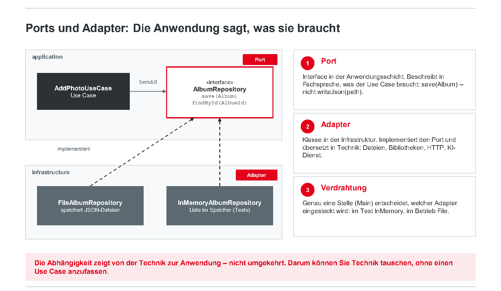
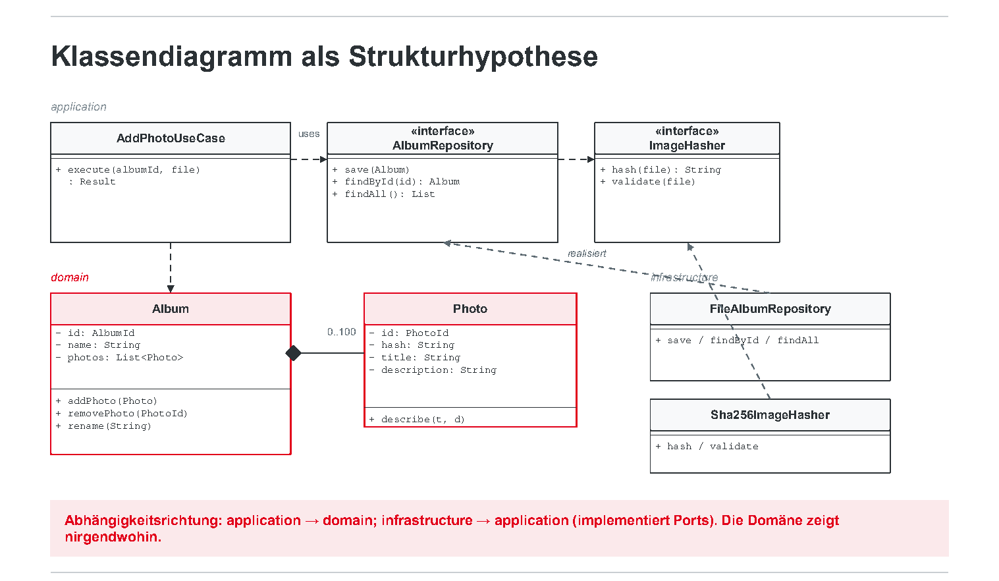
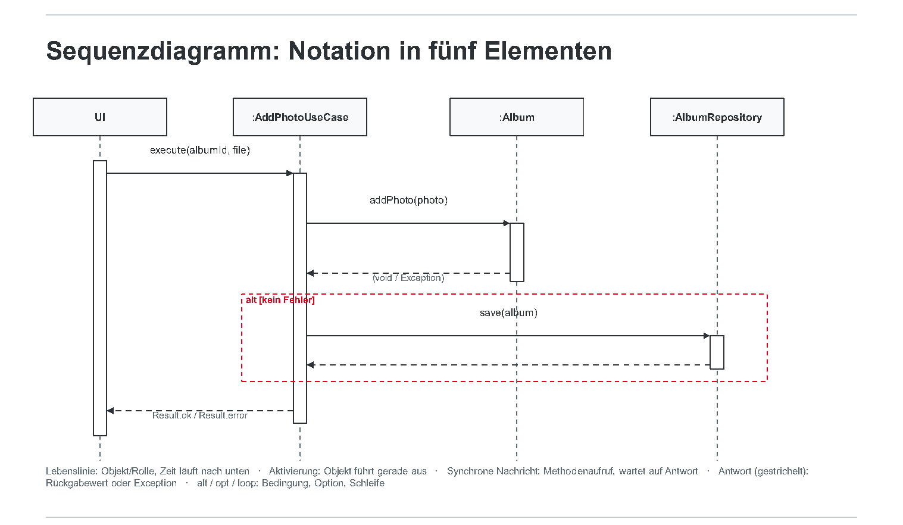

# Block 3: Entwurf und Entwurfsmuster

**Verantwortlichkeiten sichtbar und Änderungen beherrschbar machen** · Software Engineering II.1 · DHBW Heilbronn · Ana · WS 2026/27

Quelle: [Originalfolien, 53 PDF-Seiten](Block_3_Entwurf_und_Entwurfsmuster.pdf). Wiederholte Einblendungen sind zusammengeführt, Tabellen und Java-Ausschnitte formatiert. Seitenangaben beziehen sich auf die PDF-Seiten, nicht auf die teilweise abweichenden Foliennummern.

> Die gezeigte Architektur, Zahlen und Geschäftsregeln sind Lehrbeispiele, keine automatisch übernommenen Teamentscheidungen. Codeausschnitte sind didaktisch verkürzt; fehlende Klassen, Methoden, Imports und Fehlerbehandlung werden nicht als fertige Implementierung ergänzt.

## 1. Ziel und Ablauf

*PDF-Seiten 1-4.*

Nach den Anforderungen aus Block 2 folgt der Entwurf; danach kommen Implementierung/Git/CI, Tests, Wartung/Change Request und Abschluss. Jeder Block liefert ein prüfbares Artefakt ins Repository.

**Lernziele:**

- Geschäftsregeln und Verantwortlichkeiten zuordnen.
- Kohäsion, Kopplung, Kapselung und Schnittstellen als Entscheidungskriterien nutzen.
- Mit Nomen-Analyse und CRC-Karten von Use Cases zu Klassen gelangen.
- Den Entwurf durch Sequenzdiagramme prüfen.
- Strategy, Factory, Observer und Adapter nur für konkrete Probleme einsetzen.
- Business-Logik, KI, Tools und Daten in Agentensystemen trennen.
- Entscheidungen als ADR festhalten.

**Ergebnis:** `ARCHITECTURE.md` mit begründeter Architektur, Komponenten, Verantwortlichkeiten und Schnittstellen; Klassen- und Sequenzdiagramm „Foto hinzufügen“; mindestens ein ADR.

| Minuten | Thema | Format |
| --- | --- | --- |
| 00-10 | Wo gehört die Regel hin? | Übung |
| 10-45 | Schichten, Ports/Adapter, Kohäsion und Kopplung | Übung |
| 45-75 | Nomen-Analyse und CRC-Karten | Übung |
| 75-100 | Sequenzdiagramme und „Foto hinzufügen“ | Übung |
| 100-115 | Pause | |
| 115-150 | Entwurfsmuster und Risiken | Übung |
| 150-190 | Agentenschleife, Tool Calling und Freigabe | Übung |
| 190-215 | Architecture Studio und ADR | Teamarbeit |
| 215-235 | Diagramm-Review und Checkpoint | Teamarbeit |
| 235-240 | Exit Ticket und Hausaufgabe | |

### Einstiegsübung: Wo gehört die Regel hin?

*PDF-Seite 5 · 6 Minuten · erst einzeln, dann im Team.*

Beispielregel: „Ein Album darf höchstens 100 Fotos enthalten.“ Wo wird sie geprüft?

- A: Oberfläche
- B: Service/Use Case
- C: Klasse `Album`
- D: Datenbank

Eine Minute allein entscheiden, dann drei Minuten diskutieren: Was passiert bei einer zweiten Oberfläche, etwa einer REST-API, oder bei einer Grenze von 200? Auf eine Antwort mit Begründung in einem Satz einigen. Im Plenum abstimmen; die Auflösung folgt nach der Theorie.

## 2. Entwurfskonzepte

*PDF-Seiten 6-17.*

### Schichten verteilen Verantwortung

| Schicht | Beispiele | Aufgabe |
| --- | --- | --- |
| Oberfläche | JavaFX, Swing, Konsole, im Beispiel auch REST | Anzeigen, Eingaben entgegennehmen; keine Persistenz kennen |
| Anwendung | `AddPhotoUseCase`, `CreateAlbumUseCase` | Ablauf koordinieren, Ports definieren, Fehler übersetzen |
| Domäne | `Album`, `Photo`, Geschäftsregeln | Invarianten prüfen, etwa Kapazität, Duplikate und Namenslänge |
| Infrastruktur | `FileAlbumRepository`, `ImageHasher`, KI-Adapter | Ports implementieren; technisch austauschbar und im Test ersetzbar sein |

**Abhängigkeiten zeigen nach innen.** Die Domäne kennt weder UI noch Datei noch KI. Die genannten Grenzwerte (100 Fotos, Name 1-50 Zeichen) gehören zum Folienbeispiel.

### Ports und Adapter



1. **Port:** Interface in der Anwendungsschicht, in fachlicher Sprache: `save(Album)` statt `writeJson(path)`.
2. **Adapter:** Infrastrukturklasse, die den Port implementiert und in Dateien, Bibliotheken, HTTP oder einen KI-Dienst übersetzt.
3. **Verdrahtung:** Eine Stelle, etwa `Main`, wählt den Adapter; im Test beispielsweise In-Memory, im Betrieb Dateispeicher.

Die Technik hängt von der Anwendung ab. Ein Technikwechsel soll keine Änderung des Use Cases verlangen.

### Codebeispiel: vier Teile, eine Verdrahtung

*PDF-Seite 9; Ausschnitte in fachlicher Reihenfolge angeordnet.*

**Port (`application`):**

```java
public interface AlbumRepository {
    Optional<Album> findById(AlbumId id);
    void save(Album album);
}
```

**Use Case, kennt nur den Port:**

```java
public class AddPhotoUseCase {
    private final AlbumRepository albums;

    public AddPhotoUseCase(AlbumRepository albums) {
        this.albums = albums;
    }

    public void execute(AlbumId id, Photo photo) {
        Album a = albums.findById(id).orElseThrow();
        a.addPhoto(photo);      // Regel: Domäne
        albums.save(a);
    }
}
```

**Adapter (`infrastructure`):**

```java
public class FileAlbumRepository implements AlbumRepository {
    public void save(Album album) {
        String json = toJson(album);
        Files.writeString(fileFor(album), json);
    }

    public Optional<Album> findById(AlbumId id) { ... }
}
```

**Verdrahtung:**

```java
// Main (Betrieb)
new AddPhotoUseCase(new FileAlbumRepository(dir));

// Test
new AddPhotoUseCase(new InMemoryAlbumRepository());
```

Das Beispiel zeigt Tests ohne Dateisystem, austauschbaren Speicher und eine Domäne ohne Technik. `new FileAlbumRepository(...)` steht im Composition Root, nicht im Use Case.

### Entwurfsziele aus NFA ableiten

| NFA | Entwurfskonsequenz | Folienbeispiel |
| --- | --- | --- |
| Änderbarkeit/Wartbarkeit | Module, stabile Schnittstellen, Regeln an einem Ort | Regeln in der Domäne; Speicher hinter Repository-Interface |
| Testbarkeit | Dependency Injection, keine statischen Zugriffe | Repository und Hasher im Konstruktor; In-Memory im Test |
| Performance | Bewusstes Caching oder zusätzliche Kopplung | Vorschaubilder cachen statt wiederholt 20-MB-Dateien laden |
| Sicherheit/Datenschutz | Vertrauensgrenzen, Eingabeprüfung, minimale Rechte | Metadaten im Adapter vor KI-Aufruf entfernen |
| Zuverlässigkeit | Fehler im Vertrag, keine Teilzustände | Atomare Operation mit abgestimmtem Prüfen, Speichern und Ändern |

**Unstimmigkeit der Vorlage:** Die Zuverlässigkeitszeile nennt „erst prüfen, dann speichern, dann Album ändern“. Der Code auf PDF-Seite 9 und der Ablauf auf Seite 26 ändern das Album vor `save`. Die atomare Fehlerbehandlung muss im eigenen Entwurf ausdrücklich geklärt werden; die Folien sind hierfür keine vollständige Transaktionslösung.

### Begriffe auf einen Blick

| Konzept | Leitfrage | Beispiel |
| --- | --- | --- |
| Abstraktion | Was ist für diese Aufgabe relevant? | `Photo` kennt ID, Hash und Titel, nicht die Pixel |
| Modularisierung/Dekomposition | Welche Teile haben einen eigenen Zweck? | `domain`, `application`, `infrastructure`, `ui` |
| Kapselung | Welche Daten dürfen nur kontrolliert verändert werden? | Private Fotoliste, Änderungen über Methoden |
| Schnittstellen | Welchen Vertrag biete ich? | Repository mit `save`, `findById`, `findAll` |
| Verantwortlichkeiten | Wer entscheidet was? | Album prüft Regeln, Use Case koordiniert, UI zeigt |
| Kohäsion | Gehört alles in einer Einheit zusammen? | Hasher berechnet Hashes, verwaltet keine Dateien |
| Kopplung | Wie viele andere Teile muss ich kennen oder ändern? | UI kennt Use Case, nicht Repository |
| Wiederverwendbarkeit/Erweiterbarkeit | Kann ich ergänzen, ohne umzubauen? | Neue Sortierung als Strategy |
| Testbarkeit | Kann ich isoliert und schnell prüfen? | Domäne ohne UI und Datei testen |

### Hohe Kohäsion, geringe Kopplung

**Hohe Kohäsion:** Eine Einheit hat eine benennbare Aufgabe; Daten und zuständige Methoden liegen zusammen. Warnsignale der Folie sind unspezifische Namen wie `Manager`, `Helper`, `Util` oder Methoden, die völlig verschiedene Felder verwenden. Beispiel: Das Album kennt seine Fotos und prüft seine Kapazität.

**Geringe Kopplung:** Wenige stabile Abhängigkeiten, möglichst auf Schnittstellen. Eine Änderung in A soll nicht zwangsläufig B ändern. Warnsignale: Dateiimporte in der UI und zyklische Abhängigkeiten. Beispiel: Use Case kennt `AlbumRepository`, nicht dessen Dateiimplementierung.

### Kapselung schützt Invarianten

*PDF-Seite 14.*

```java
public class Album {
    public static final int MAX_PHOTOS = 100;
    private final String name;
    private final List<Photo> photos = new ArrayList<>();

    public Album(String name) {
        if (name == null || name.isBlank() || name.length() > 50)
            throw new InvalidAlbumNameException(name);
        this.name = name;
    }

    public void addPhoto(Photo photo) {
        if (photos.size() >= MAX_PHOTOS)
            throw new AlbumFullException(name, MAX_PHOTOS);
        boolean duplicate = photos.stream()
                .anyMatch(p -> p.hash().equals(photo.hash()));
        if (duplicate) throw new DuplicatePhotoException(photo);
        photos.add(photo);
    }

    public List<Photo> photos() { return List.copyOf(photos); }
}
```

- `photos` bleibt privat; kein Setter und keine veränderbare Referenz nach außen.
- Invarianten werden an einer Stelle geprüft.
- Fachliche Exceptions werden vom Use Case für die UI übersetzt.
- `Photo` kennt seinen Hash, nicht die Bildbytes.
- Die Klasse lässt sich ohne UI, Datei und Framework testen.

### Vererbung oder Benutzung?

**Vererbung („is a“) sparsam:** Nur bei echter Ist-ein-Beziehung und Substituierbarkeit. Reine Codeersparnis oder geerbte Methoden, die `UnsupportedOperationException` werfen, sind Warnsignale. Ein Album ist kein Foto; ein Foto ist keine Datei.

**Benutzung („has a“/„uses“) als Ausgangspunkt:** Album hat Fotos; Use Case verwendet Repository und Hasher. Komposition und Delegation erleichtern den Austausch von Abhängigkeiten und vermeiden Kopplung an Oberklasseninternas. Wird nur ein Vertrag geteilt, genügt häufig ein Interface. Bezug der Folie: „Favor composition over inheritance“ aus `02_Inheritance`.

### Übung: Kopplungs-Check

**5 Minuten · Paare.** Je Aussage „in Ordnung/problematisch“ und das betroffene Konzept nennen:

1. JavaFX-UI ruft direkt `FileAlbumRepository.save()` auf.
2. `AddPhotoUseCase` erhält Repository und Hasher über den Konstruktor.
3. `Album` importiert `javax.imageio`, um die Bildgröße zu prüfen.
4. `Photo` speichert einen Pfad und liest beim Anzeigen selbst aus dem Dateisystem.

## 3. Vom Use Case zu Klassen

*PDF-Seiten 18-23.*

### Nomen-Analyse

1. Nomen aus Use Cases und Anforderungen sammeln: Album, Foto, Nutzerin, Titel, Datei, Hash, Fehlermeldung, Vorschlag.
2. Irrelevantes, Instanzen („Urlaub 2026“) und Synonyme aussortieren. Die Folie ordnet „Fehlermeldung“ der UI zu und setzt Bild/Foto gleich.
3. Attribute von Klassen unterscheiden: Titel, Hash und Beschreibung als Fotoattribute; Album als Klasse.
4. Beziehungen aus Verben ableiten: Album enthält Fotos, Nutzerin besitzt Alben.
5. Verantwortungen zuordnen: Wer prüft Kapazität, wer berechnet Hashes? Mit CRC-Karten bearbeiten.

Das Ergebnis ist eine Hypothese, die durch ein Sequenzdiagramm geprüft wird. Die Nomen-Analyse nennt als Beispiel `1..100` Fotos; das spätere Klassendiagramm zeigt `0..100`. Die passende Multiplizität muss aus den eigenen Anforderungen folgen.

### CRC-Karten

CRC steht für **Class, Responsibilities, Collaborators**.

| Klasse/Port | Verantwortlichkeiten im Beispiel | Zusammenarbeit |
| --- | --- | --- |
| `Album` | Name/Fotos kennen; Kapazität, Duplikate und Namen prüfen; hinzufügen, entfernen, umbenennen | `Photo` |
| `AddPhotoUseCase` | Album laden; Datei prüfen/hashen lassen; Domäne aufrufen; speichern; Fehler übersetzen | Repository, Hasher, Album |
| `ImageHasher` | Inhaltshash berechnen; Dateityp und Größe prüfen | Dateisystem-Port |
| `AlbumRepository` | `save`, `findById`, `findAll`, `delete` | Wird von Infrastruktur implementiert |

**Faustregel der Folie:** Bei mehr als fünf Verantwortlichkeiten oder mehr als drei Kooperationspartnern eine Aufteilung prüfen.

### Übung: CRC-Karten

**15 Minuten · Team.** Ausgangspunkt sind die beiden eigenen Use Cases und Geschäftsregeln.

1. **5 Minuten:** Nomen sammeln, Attribute abtrennen, Synonyme streichen.
2. **8 Minuten:** Je Klasse eine Karte; Domäne, Anwendung und Ports abdecken. Jede Geschäftsregel steht auf genau einer Karte.
3. **2 Minuten:** „Foto hinzufügen“ durchspielen. Jede Person hält eine Karte und meldet sich bei Aufruf: Bleibt eine stumm, übernimmt eine alles?

**Ergebnis:** Fotografierte Karten in `docs/design/`. Material: zehn Karteikarten je Team und Stifte. Im Plenum die Karte mit den meisten Einträgen auf Kohäsion prüfen.

### Klassendiagramm als Strukturhypothese



Gezeigt werden:

- **Anwendung:** `AddPhotoUseCase.execute(albumId, file): Result`; Ports `AlbumRepository` und `ImageHasher`.
- **Domäne:** `Album` mit ID, Name, Fotoliste und `addPhoto`, `removePhoto`, `rename`; `Photo` mit ID, Hash, Titel, Beschreibung und `describe`.
- **Infrastruktur:** `FileAlbumRepository` und `Sha256ImageHasher` als Portimplementierungen.

Abhängigkeiten: `application → domain`, `infrastructure → application`. Die Domäne hängt von keiner der äußeren Schichten ab.

### Vier Entwurfsfragen

| Frage | Leitgedanke der Folie |
| --- | --- |
| Wer kennt die fachliche Information? | Information Expert: Album kennt und zählt seine Fotos |
| Wer entscheidet über die Regel? | Die Klasse, deren Invariante betroffen ist, nicht die UI |
| Wer koordiniert den Use Case? | Anwendungsklasse/Controller; die UI ruft sie auf |
| Was soll austauschbar bleiben? | Interface/Port für Speicher, Hashing, KI oder Uhrzeit |

Die Folie bezieht sich auf GRASP und Larmans *Applying UML and Patterns*.

## 4. Sequenzdiagramme

*PDF-Seiten 24-27.*

Sequenzdiagramme prüfen zur Laufzeit, ob die Verantwortungsverteilung funktioniert.

| Element | Bedeutung |
| --- | --- |
| Lebenslinie | Objekt/Rolle; Zeit verläuft nach unten |
| Aktivierung | Objekt führt gerade aus |
| Synchrone Nachricht | Methodenaufruf wartet auf Antwort |
| Gestrichelte Antwort | Rückgabewert oder Exception |
| `alt` / `opt` / `loop` | Alternative, Option, Schleife |



### Beispiel: Foto hinzufügen

**Entwurf A, UI macht alles:** Datei lesen, Hash berechnen, Duplikate und Kapazität prüfen, Datei schreiben und Fotoliste direkt verändern. Folge laut Folie: Ohne UI nicht isoliert testbar; jede weitere Oberfläche dupliziert die Regeln.

**Entwurf B, Verantwortungen verteilt:**

1. UI ruft `AddPhotoUseCase.execute(albumId, file)` auf.
2. Use Case lässt `ImageHasher` validieren und hashen.
3. Album wird über `AlbumRepository` geladen.
4. `album.addPhoto(photo)` prüft Kapazität und Duplikate.
5. Anschließend wird gespeichert.
6. Fachliche Exceptions werden vom Use Case in ein `Result` für die UI übersetzt.

Konsistenzprüfung: Zu jeder Nachricht im Sequenzdiagramm muss eine passende Operation im Klassendiagramm existieren.

### Übung: Album löschen

**10 Minuten · Team.** Die Übung setzt die Entscheidung voraus, dass beim Löschen eines Albums nachgefragt und die enthaltenen Fotos mitgelöscht werden. Dies ist die Vorgabe der Übung, keine hier dokumentierte Antwort für unser Team.

1. Standardablauf mit UI, `DeleteAlbumUseCase`, `Album`, `AlbumRepository` und `PhotoStorage` als Datei-Port zeichnen.
2. `alt`-Fragment für Abbruch der Bestätigung ergänzen.
3. Jede Nachricht gegen eine Verantwortung auf einer CRC-Karte prüfen; bei Abweichungen Karte oder Diagramm ändern.

Plenumsfrage: Wer entscheidet über die Bestätigung, UI oder Use Case?

## 5. Entwurfsmuster

*PDF-Seiten 28-37.*

Ein Pattern beschreibt **Problem, Kontext, Lösung und Konsequenzen**, nicht nur Klassen. Die Folien nennen die Gang of Four (Gamma, Helm, Johnson, Vlissides, 1994).

| Kategorie | Beispiele |
| --- | --- |
| Erzeugung | Factory, Singleton, Builder |
| Struktur | Adapter, Composite, Facade |
| Verhalten | Strategy, Observer, Template Method, Iterator |

Patterns geben ein gemeinsames Vokabular und bekannte Abwägungen. Sie werden nicht wegen ihrer Anzahl positiv bewertet.

### Auswahl: erst Problem, dann Name

1. Wahrscheinliche Änderung benennen: Speicher, Sortierung, UI-Technik oder KI-Anbieter.
2. Konkretes Problem beschreiben, etwa sieben betroffene Klassen beim Speicherwechsel.
3. Lösung ohne Pattern prüfen: direkte Abhängigkeit, `if/else`, Kopie; tatsächlichen Aufwand bewerten.
4. Pattern mit Folgen abwägen: zusätzliche Klassen/Indirektionen gegen Austauschbarkeit/Testbarkeit.
5. ADR mit Kontext, Entscheidung, Alternativen und Konsequenzen schreiben.

### Strategy: Verhalten austauschen

**Problem:** Verhalten variiert und wird zur Laufzeit gewählt. **Lösung:** Gemeinsames Interface, austauschbare Implementierungen, delegierender Context. Beispielstruktur: `Album → SortStrategy ← ByDate/ByTitle`.

```java
interface SortStrategy {
    List<Photo> sort(List<Photo> photos);
}
class ByDate implements SortStrategy { ... }
class ByTitle implements SortStrategy { ... }

// Album (Context)
public List<Photo> photosSorted(SortStrategy s) {
    return s.sort(photos());
}
```

Vorteile: neue Varianten ergänzbar, einzeln testbar. Kosten: mehr Klassen; Client wählt eine Strategie. Alternative: `switch` über zwei feste Varianten oder ein `Comparator`. Die Folie empfiehlt Strategy bei erwarteter Variantenvielfalt bzw. entsprechender Auswahl.

### Factory: Objekterzeugung kapseln

*Die Folie heißt „Factory Method“; ihr Beispiel verwendet eine statische Fabrikmethode.*

**Problem:** Wo wird über die konkrete Implementierung entschieden? **Lösung:** Erzeugung zentralisieren; Aufrufer arbeitet mit dem Interface.

```java
class RepositoryFactory {
    static AlbumRepository create(Config cfg) {
        return switch (cfg.storage()) {
            case FILE   -> new FileAlbumRepository(cfg.dir());
            case MEMORY -> new InMemoryAlbumRepository();
        };
    }
}

// Composition Root (main)
var repo = RepositoryFactory.create(config);
var hasher = new Sha256ImageHasher();
var addPhoto = new AddPhotoUseCase(repo, hasher);
var ui = new AlbumWindow(addPhoto, ...);
```

Vorteile: zentrale Konfiguration, gezielte Testimplementierung. Kosten: zusätzliche Klasse, bei nur einer Konfiguration möglicherweise unnötig. Oft genügt ein Composition Root mit allen `new`-Aufrufen in `main`; Factory erst bei tatsächlich nötiger konfigurierbarer Auswahl.

### Observer: Änderungen verteilen

**Problem:** Eine Änderung hat mehrere Interessenten, ohne dass das Modell alle Empfänger kennen soll. **Lösung:** Listener registrieren und bei Änderungen benachrichtigen.

```java
interface AlbumListener { void onAlbumChanged(AlbumId id); }

class AlbumEvents {
    private final List<AlbumListener> listeners = ...;

    void subscribe(AlbumListener l) { listeners.add(l); }

    void publish(AlbumId id) {
        listeners.forEach(l -> l.onAlbumChanged(id));
    }
}

// Use Case nach save: events.publish(album.id())
// UI: events.subscribe(id -> listView.refresh())
```

Vorteil: lose Kopplung. Kosten: versteckter Kontrollfluss, unklare Reihenfolge, vergessene Abmeldung und mögliche Memory Leaks. Ein direkter UI-Aufruf aus der Anwendung würde deren Schichtabhängigkeit verletzen. Bei einer einzigen Ansicht kann ein Rückgabewert reichen; die Folie nennt auch JavaFX-Properties als Alternative.

### Adapter: fremde Schnittstellen übersetzen

**Problem:** Fremdschnittstelle passt nicht zum eigenen Port. **Lösung:** Adapter implementiert den eigenen Vertrag und delegiert an das Fremdsystem. Struktur: Use Case → `DescriptionSuggester` ← `OpenAiSuggester` → HTTP-Client/SDK.

```java
// Port (application)
interface DescriptionSuggester {
    Optional<String> suggest(Path image);
}

// Adapter (infrastructure)
class OpenAiSuggester implements DescriptionSuggester {
    public Optional<String> suggest(Path image) {
        byte[] stripped = Exif.strip(image);  // vor der Anfrage
        var resp = client.describe(stripped, TIMEOUT_5S);
        return resp.map(Output::sanitize)     // nach der Antwort
                .filter(t -> t.length() <= 100);
    }
}

// Test: FakeSuggester implementiert denselben Port.
```

Vorteile: austauschbares Fremdsystem, Fake-Adapter im Test, zentrale Fehler-/Timeout-/Guardrail-Behandlung. Kosten: eine zusätzliche Klasse. Mögliche Einsatzorte sind Dateisystem, Hashing-Bibliothek und KI-Dienst.

### Template Method, Repository und Singleton

- **Template Method:** Fester Ablauf in einer Oberklasse, variable Schritte abstrakt. Beispiel: Import mit Validieren → Hashen → Speichern und formatspezifischem Vorschaubild. Alternative: Strategy für den variablen Schritt, wenn sonst keine Vererbung nötig ist.
- **Repository:** Kein GoF-Pattern; fachliche Sammlung hinter einem Interface, unabhängig von Datei, Datenbank oder Speicher. Beispielmethoden: `save`, `findById`, `findAll`, `delete`. Keine Geschäftsregeln im Repository.
- **Singleton:** Im Projekt laut Folien meist ungünstig wegen globaler Abhängigkeiten und erschwerter Tests. Composition Root bevorzugen.

### Risiken

Zu frühe Abstraktion, unnötige Indirektionen, versteckte Observer-Abläufe, globale Singleton-Zustände und Namen wie `AbstractAlbumFactoryProvider` können Wartbarkeit verschlechtern. Ein Pattern muss durch eine konkrete wahrscheinliche Änderung und eine verworfene Alternative im ADR begründet sein. Die Folien ordnen begründeten Entwurfsentscheidungen fünf Bewertungspunkte zu.

### Übung: Pattern-Gericht

**10 Minuten · zwei Seiten und Jury.** Anklage: Ein Repository-Interface mit Factory sei für ausschließlich geforderte Dateispeicherung unnötig komplex.

1. Teams 1/3/5 verteidigen, 2/4/6 klagen an, Team 7 ist Jury. Vier Minuten Vorbereitung mit je zwei Argumenten und konkreten Änderungsszenarien.
2. Je 90 Sekunden Plädoyer.
3. Jury benennt die Bedingungen, unter denen das Pattern gerechtfertigt ist oder nicht.

**Ergebnis:** Muster-ADR „Repository-Interface: ja/nein, weil …“ für alle Teams.

## 6. KI-Perspektive: Agenten und Grenzen im Code

*PDF-Seiten 38-47.*

### Ein Agent als Schleife

**Agent = LLM + Tool-Liste + Schleife im eigenen Code.** Ein LLM-Aufruf ist ein Schritt; der eigene Code führt Tool-Wünsche aus und gibt Ergebnisse in den Verlauf zurück. Antwortet das Modell mit Text ohne Tool-Wunsch, endet die Schleife. Das Beispiel begrenzt einen Lauf auf 20 Runden.

Das Modell wünscht einen Aufruf wie `movePhoto("p7", "a3")`; die tatsächliche Ausführung und Abbruchentscheidung bleiben beim Anwendungscode.

### Beispiel: `SortingAgent` in `application`

```java
public class SortingAgent {
    private final LlmClient llm; // Port
    private final ToolDispatcher tools;
    private static final List<ToolSpec> TOOLS = List.of(
        new ToolSpec("listPhotos",
            "Listet die Fotos eines Albums mit Datum",
            "{albumId: string}"),
        new ToolSpec("movePhoto",
            "Verschiebt ein Foto in ein anderes Album",
            "{photoId: string, targetAlbumId: string}"));

    public String run(String task) {
        var history = new ArrayList<Message>();
        history.add(Message.user(task));
        for (int step = 0; step < 20; step++) {
            LlmResponse r = llm.ask(history, TOOLS);
            if (!r.hasToolCall()) return r.text();
            String result = tools.dispatch(r.toolCall());
            history.add(Message.toolResult(result));
        }
        throw new AgentDidNotFinishException();
    }
}
```

Die Tool-Liste beschreibt Name, Aufgabe und Parameter. Pro Runde gibt es im vereinfachten Beispiel einen Modellaufruf und höchstens ein Tool. `LlmClient` ist ein Port, sein HTTP-Adapter liegt in der Infrastruktur. Das Rundenlimit begrenzt Schleifen und Kosten; Tool-Ergebnisse beeinflussen die nächste Runde.

### Beispielablauf: „Sortiere Unsortiert nach Monat“

| Runde | Modellantwort | Ausführung | Zurück in den Verlauf |
| --- | --- | --- | --- |
| 0 | `listPhotos("unsortiert")` | `ListPhotosUseCase` | p1 Januar, p2 Januar, p3 Februar |
| 1 | `movePhoto("p1", "januar")` | `MovePhotoUseCase`, Album prüft Regeln | `ok` |
| 2 | `movePhoto("p2", "januar")` | Wie Runde 1 | `ok` |
| 3 | `movePhoto("p3", "februar")` | Zielalbum enthält im Beispiel bereits 100 Fotos; Exception | `error: Album voll` |
| 4 | Text: p1/p2 verschoben, p3 wegen vollem Februar nicht | Kein Tool-Wunsch; Ende | |

Das LLM wählt anhand Aufgabe, Tool-Beschreibungen und Verlauf eine Reihenfolge. Der Code erzwingt Geschäftsregeln unabhängig vom Aufrufer. Fehler werden als Information zurückgegeben.

### `ToolDispatcher`: Allow-List in Java

```java
public class ToolDispatcher {
    private final ListPhotosUseCase listPhotos;
    private final MovePhotoUseCase movePhoto;
    // bewusst KEIN DeleteAlbumUseCase

    public String dispatch(ToolCall call) {
        return switch (call.name()) {
            case "listPhotos" -> json(listPhotos.execute(
                    AlbumId.of(call.arg("albumId"))));
            case "movePhoto" -> {
                var photo = PhotoId.of(call.arg("photoId"));
                var target = AlbumId.of(call.arg("targetAlbumId"));
                try {
                    movePhoto.execute(photo, target);
                    yield "ok";
                } catch (DomainException e) {
                    yield "error: " + e.getMessage();
                }
            }
            default -> throw new UnknownToolException(call.name());
        };
    }
}
```

- Nur injizierte Use Cases sind über diesen Dispatcher erreichbar.
- Jeder `case` erlaubt ein Tool; `default` lehnt unbekannte Aufrufe ab.
- `PhotoId.of(...)` und `AlbumId.of(...)` prüfen Eingaben.
- Der Use Case ruft die Domäne auf; Regeln gelten auch für Agenten.
- `yield` liefert den Wert eines `switch`-Blocks, nicht den Rückgabewert der umgebenden Methode (Switch Expressions, Java 14+).

Die zentrale Aussage der Folie: Verbote müssen durch fehlende Fähigkeiten und Prüfungen im Code durchgesetzt werden; ein Prompt allein genügt nicht.

### Tool-Wahl beeinflussen und begrenzen

| Gute Wahl wahrscheinlicher machen | Falsche Wahl begrenzen |
| --- | --- |
| Konkrete Aufgabe | Allow-List |
| Präzise Tool-Beschreibung | Argument- und Domänenprüfung |
| Vorgehen im Systemprompt, etwa IDs nicht raten | Freigabe für irreversible Aktionen |
| Ergebnisse und Fehlermeldungen im Verlauf | Rundenlimit und Protokoll |

**Schwach:**

```java
new ToolSpec("move", "moves it", "{a: string, b: string}")
```

**Präziser:**

```java
new ToolSpec("movePhoto",
    "Verschiebt ein Foto in ein anderes Album. "
    + "Scheitert, wenn das Ziel 100 Fotos hat.",
    "{photoId: string, targetAlbumId: string}")
```

Modellantworten sind nicht garantiert korrekt; der Entwurf muss auch fehlerhafte Tool-Wünsche abfangen.

### Menschliche Freigabe: zwei getrennte Abläufe

```java
// im ToolDispatcher
case "shareAlbum" -> {
    var id = approvals.request("shareAlbum", call.args());
    yield "pending: wartet auf Freigabe (" + id + ")";
}
```

Dieses Beispiel-Tool teilt nichts. Es legt einen Antrag in einer `ApprovalQueue` ab und liefert sofort `pending` zurück. `yield` wartet nicht auf einen Menschen.

1. **Agentenlauf:** Modell wünscht Teilen → Antrag #17 ist `PENDING` → Modell erhält `pending` → Endantwort „Freigabe angefragt“.
2. **Spätere UI-Aktion:** Offene Anträge anzeigen → Nutzerin klickt Freigeben → UI ruft `ShareAlbumUseCase` auf → Antrag wird `APPROVED`.

Der Agent erhält keine direkte Freigabefähigkeit. Beide Abläufe sind durch den gespeicherten Antrag verbunden.

### Wo stehen Guardrails?

| Sicherung | Stelle im Code | Beispiel |
| --- | --- | --- |
| Kleine Tool-Liste | `TOOLS` im Agenten | Nur `listPhotos`/`movePhoto`, kein `executeSql` |
| Allow-List | Dispatcher-`switch` und `default` | Kein `deleteAlbum`-Zweig |
| Argumentprüfung | ID-Konstruktion/Validierung | Erfundenes bzw. ungültiges Argument zurückweisen |
| Geschäftsregeln | Use Case → Domäne | Kapazität und Duplikate für jeden Aufrufer |
| Ausgabeprüfung | LLM-Adapter | Vorschlag ≤ 100 Zeichen, keine URLs |
| Freigabe | `ApprovalQueue` und UI | Teilen erst nach Nutzeraktion |
| Limit und Audit | `step < 20`, Log pro Aufruf | Begrenzte und nachvollziehbare Ausführung |

Diese Stellen lassen sich testen; reine Promptregeln bilden keine gleichwertige technische Grenze.

### Architekturzuordnung

| Schicht | Folienbeispiel |
| --- | --- |
| `ui` | `PhotoAlbumView`, `ApprovalView` |
| `application` | Use Cases; `SortingAgent`, `ToolDispatcher`, `ApprovalQueue`; Ports für Repository, LLM und Beschreibungsvorschläge |
| `domain` | `Album`, `Photo`, Geschäftsregeln; keine KI-Abhängigkeit |
| `infrastructure` | `FileAlbumRepository`, `ClaudeLlmClient`/`OpenAiLlmClient` |

Der Agent ist ein weiterer Client derselben Use Cases, mit weniger Rechten als die Nutzerin. Die Folien erläutern MCP als offenen Standard für Toolverträge über Prozessgrenzen hinweg und Skills als versionierte Anweisungsdateien/Systemprompt-Bausteine.

### Übung: KI-Funktion und Agent entwerfen

**10 Minuten · Team.** „Beschreibung vorschlagen“ ist zunächst eine einzelne LLM-Anfrage, kein Agent.

1. `DescriptionSuggester` als Anwendungs-Port und einen Infrastrukturadapter zeichnen; zwei Prüfungen vor bzw. nach der Anfrage nennen.
2. Für „Fotos aufräumen“ höchstens vier `ToolSpec`s mit Beschreibungen notieren. `deleteAlbum`, `removePhoto`, `renameAlbum`, `shareAlbum` einordnen: direkt ausführen, nur nach Freigabe oder nicht anbieten.
3. KI-Funktion als Won't (nur Entwurf) oder Should (mit `FakeSuggester` in Tests) einordnen.

**Ergebnis:** Klassendiagramm ergänzen und fünf Zeilen „KI-Komponente“ in `ARCHITECTURE.md`. Im Plenum prüfen, ob eine Grenze nur im Prompt statt im Dispatcher steht.

## 7. ADR, Studio und Projektcheckpoint

*PDF-Seiten 48-52.*

### Architecture Decision Record

Ein ADR hält folgende Punkte knapp fest:

| Feld | Folienbeispiel |
| --- | --- |
| Titel, Status, Datum | ADR-001: Speicher hinter `AlbumRepository`-Interface; akzeptiert |
| Kontext | Testbarkeit als NFA; Dateispeicher gefordert, Datenbank denkbar |
| Entscheidung | Port in Anwendung, Dateiadapter in Infrastruktur, In-Memory in Tests |
| Verworfene Alternativen | Direkter Dateizugriff im Use Case; zusätzliche Factory bei nur einer Konfiguration |
| Konsequenzen | Tests ohne Dateien, austauschbarer Speicher; zusätzliches Interface und Mapping-Code |

Die Folie nennt `docs/adr/ADR-001-repository.md` als Beispielpfad. Mindestens ein ADR ist Pflicht; drei bis vier werden als realistisch genannt, etwa zu Speicher, Fehlerbehandlung, UI und KI-Port.

### Architecture Studio

**25 Minuten · Team.** Die Folie schlägt zwei Personen für Diagramme und zwei für Architekturtext/ADR vor; das ist keine Rollenverteilung unseres fünfköpfigen Teams.

1. Vier Schichten mit Klassen und Abhängigkeitsrichtung skizzieren.
2. Klassendiagramm aus CRC-Karten ableiten: Domäne, Anwendung, Ports, Multiplizitäten und entscheidungsrelevante Methoden.
3. Sequenz „Foto hinzufügen“ mit Duplikat-Fehlerpfad als `alt` und Konsistenzprüfung zeichnen.
4. ADR zur wichtigsten Entscheidung schreiben.
5. Vorgeschlagener Commit `docs: architecture v1`; Diagramme als PlantUML oder Bild in `docs/design/` ablegen.

**Ergebnis:** `ARCHITECTURE.md` v1 mit Diagramm- und ADR-Verweisen.

### Diagramm-Review

**10 Minuten · Teams über Kreuz.** PDF-Seite 50 nennt die Reihenfolge `1 → 2 → 3 → 4 → 5 → 1`, obwohl Block 2 eine andere Zuordnung zeigt. Die tatsächliche Zuordnung ist im Unterricht zu klären.

1. **3 Minuten Regel-Check:** Wo wird jede Geschäftsregel geprüft? Fehlt eine, liegt eine in der UI?
2. **3 Minuten Konsistenz-Check:** Passt zu jeder Sequenznachricht eine Klassenoperation?
3. **2 Minuten Kopplungs-Check:** Welche Klasse hat die meisten Abhängigkeiten und warum?
4. **2 Minuten:** Issue `review: architecture v1` mit drei Punkten im Partner-Repository.

**Ergebnis:** Ein Review erhalten, eines vergeben; Einarbeitung als Hausaufgabe.

### Projektcheckpoint

Selbsteinschätzung mit grün/gelb/rot; für offene Punkte Issues mit Verantwortlichem erstellen:

- [ ] Begründete Schichten/Komponenten und Verantwortlichkeiten in `ARCHITECTURE.md`
- [ ] Relevante Ports benannt: Repository, Hasher/Storage, gegebenenfalls KI
- [ ] Klassendiagramm konsistent mit CRC-Karten; Regeln in der Domäne
- [ ] Sequenz „Foto hinzufügen“ mit Fehlerpfad und konsistenten Operationen
- [ ] Mindestens ein ADR mit verworfener Alternative
- [ ] Patterns nur für benannte Probleme oder bewusst kein Pattern
- [ ] Review erhalten; KI-Einsatzfall 1 aus Block 2 vorhanden

Zwischenstand als Commit/Tag bis zum Vorabend des nächsten Blocks. Die Kästchen geben den Folienauftrag wieder, nicht unseren aktuellen Erledigungsstand.

### Exit Ticket

**Drei Minuten, jede Person schriftlich:**

- Wichtigste Entwurfsentscheidung: Wovor schützt sie, was kostet sie?
- Welche Verantwortung wurde verschoben und warum?
- Welches Pattern wurde bewusst nicht eingesetzt?

### Bis zum nächsten Block

- Review einarbeiten, Architektur v1 finalisieren und `block-3` taggen.
- Maven-/Gradle-Gerüst mit `domain/application/infrastructure/ui`, `Album` und `Photo` samt Konstruktoren und Invarianten anlegen.
- Teamzugriff auf GitHub und Branch-Schutz für `main` mit verpflichtendem PR einrichten.
- Java 21, IDE und Git je Person lauffähig machen; `mvn verify` bzw. `gradle build` soll auch ohne Tests erfolgreich laufen.
- KI-Einsatzfall 2: Klassendiagramm-Review durch KI; einen Vorschlag übernehmen und einen verwerfen, jeweils begründen.

## 8. Quellen und Materialbasis der Folien

*PDF-Seite 53.*

- SAE Einheit 4: Klassendiagramme; `01_Foundations.pptx`: Kapselung und ADT; `02_Inheritance.pptx`: Benutzung, Vererbung und Substitution.
- `05_Domain_Modeling.pptx`, `05a_Domain_Modeling_Example.pptx`: Nomen-Analyse und CRC-Karten.
- `12_Design_Patterns_long.pptx`; Gamma, Helm, Johnson, Vlissides: *Design Patterns* (1994).
- Craig Larman: *Applying UML and Patterns*; GRASP, unter anderem Information Expert, Controller und Protected Variations.
- Seidl et al.: *UML@Classroom*; Rupp: *UML 2 glasklar*.
- Michael Nygard: *Documenting Architecture Decisions*; Robert C. Martin: *Clean Architecture*.
- OWASP Top 10 for LLM Applications; MCP Security Best Practices; Anthropic: *Building effective agents*.
- Alistair Cockburn: *Hexagonal Architecture (Ports and Adapters)* (2005); Robert C. Martin: *Clean Architecture* (2017).
- Java Language Specification und JEP 361: Switch Expressions (`yield`), Java 14.
