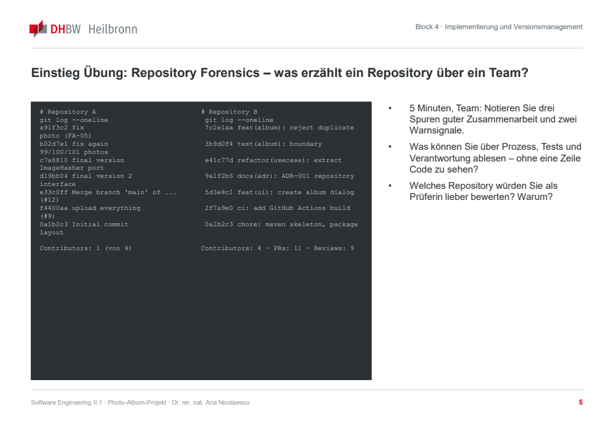
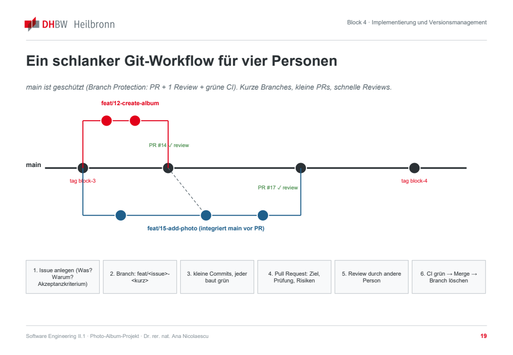

# Block 4: Implementierung und Versionsmanagement

**Zusammenarbeit, Build und KI nachvollziehbar organisieren** · Software Engineering II.1 · DHBW Heilbronn · Ana · WS 2026/27

Quelle: [Originalfolien, 32 PDF-Seiten](Block_4_Implementierung_und_Versionsmanagement.pdf). Wiederholte Einblendungen sind zusammengeführt, Tabellen und Codebeispiele formatiert. Seitenangaben beziehen sich auf die PDF-Seiten; die gedruckten Foliennummern weichen teilweise davon ab.

> Architektur, Versionen, Grenzwerte, Anforderungs-IDs und Workflow-Einstellungen sind Beispiele der Folien. Sie werden nicht automatisch zu Teamentscheidungen. Die Codebeispiele sind didaktisch verkürzt und werden nicht als fertige Projektimplementierung ergänzt.

## 1. Ziel und Einstieg

*PDF-Seiten 1–4.*

Nach dem Entwurf folgt die ausführbare Anwendung. Jeder Kursblock liefert einen prüfbaren Zwischenstand ins Repository.

**Lernziele:**

- Reproduzierbaren Build mit Maven oder Gradle einrichten und Abhängigkeiten bewusst verwalten.
- Debugging als Hypothesentest statt als Raten verstehen.
- Git als Teamprotokoll nutzen: Branches, kleine Commits, PRs und fachlich gelöste Konflikte.
- Code Review als Quality Gate und Lernwerkzeug einsetzen.
- Build und Tests automatisiert in CI ausführen; Releases und Versionen nachvollziehen.
- Coding Agents durch Repository-Regeln begrenzen und Prompts, Skills und Modelle versionieren.

**Projektergebnis laut Einstiegsfolie:**

- Lauffähiger Kern „Album erstellen und anzeigen“ über UI → Use Case → Domäne → Repository.
- Build auf jedem Rechner mit einem Befehl.
- Mindestens ein PR mit dokumentiertem Review und eine grüne CI-Pipeline.
- Bewerteter Coding-Agent-Einsatz in `AI_USAGE.md`, in der Folie als Fall 3 bezeichnet.

### Übung: Repository Forensics

*PDF-Seite 4 · 5 Minuten · Team.*

Zwei Git-Historien vergleichen: Repository A zeigt unklare Nachrichten wie `fix`, `fix again`, `final version`, einen Sammel-Upload und nur einen von vier Mitwirkenden. Repository B zeigt fachliche Commits mit Anforderungs-/Issue-Bezug, Tests, Refactoring, ADR, CI, vier Mitwirkende sowie PRs und Reviews.



1. Drei Spuren guter Zusammenarbeit und zwei Warnsignale notieren.
2. Was lässt sich über Prozess, Tests und Verantwortung erkennen, ohne Code zu lesen?
3. Welches Repository wäre als Prüfer besser zu bewerten und warum?

## 2. Repository, Build und Dependencies

*PDF-Seiten 5–11.*

### Eine kleine Repository-Struktur genügt

Die Pakete spiegeln die Architektur aus Block 3. Dokumente liegen gemäß Projektbeschreibung auf oberster Ebene; Tests spiegeln die Produktionspakete. Build-Ausgaben und IDE-Dateien gehören in `.gitignore`, etwa `target/`, `build/`, `.idea/` und `*.iml`.

**Strukturbeispiel aus der Folie:**

```text
photo-album/
├── README.md
├── REQUIREMENTS.md
├── ARCHITECTURE.md
├── TESTING.md
├── AI_USAGE.md
├── RISK_ANALYSIS.md
├── AGENTS.md
├── pom.xml | build.gradle.kts
├── .github/workflows/ci.yml
├── docs/
│   ├── adr/ADR-001-repository.md
│   ├── design/*.puml | *.png
│   └── prototype/
├── src/main/java/de/dhbw/photoalbum/
│   ├── domain/          Album, Photo, Exceptions
│   ├── application/     AddPhotoUseCase, ports
│   ├── infrastructure/  FileAlbumRepository, Sha256ImageHasher
│   └── ui/              AlbumWindow oder ConsoleUi
└── src/test/java/de/dhbw/photoalbum/  (Spiegel von main)
```

Die genannten Klassen, das Hash-Verfahren und die Oberfläche sind Beispiele, keine Auswahl für unser Projekt.

### Maven oder Gradle?

| Maven | Gradle mit Kotlin DSL |
| --- | --- |
| Deklarative `pom.xml`, feste Verzeichniskonventionen. | Build-Skript in Kotlin/Groovy, flexibel und oft kürzer. |
| Lebenszyklus: validate → compile → test → package → verify → install. | Inkrementelle Builds und Build-Cache können größere Projekte beschleunigen. |
| Umfangreiches Plugin-Ökosystem und IDE-Unterstützung. | Mehr Gestaltungsspielraum, damit auch mehr Möglichkeiten für unnötige Komplexität. |
| Empfehlung der Folie, wenn niemand Gradle-Erfahrung hat. | Sinnvoll bei vorhandener Gradle- oder Android-Erfahrung. |

Beide erfüllen die Anforderungen an JUnit 5, JaCoCo und CI. Einmal entscheiden und als ADR dokumentieren; laut Folie genügen dafür zwei begründende Sätze.

### Reproduzierbarer Build

| Schritt | Erwartung |
| --- | --- |
| 1. Checkout | Alles Notwendige liegt im Repository. |
| 2. Dependencies auflösen | Feste Abhängigkeitsversionen; der Wrapper legt die Build-Tool-Version fest. |
| 3. Compile | Java 21 ist in der Build-Datei festgelegt, nicht nur in der IDE. |
| 4. Test | JUnit 5 läuft automatisch; ein fehlgeschlagener Test bricht den Build ab. |
| 5. Artefakt | JAR in `target/` bei Maven beziehungsweise `build/libs/` bei Gradle. |

Prüfung: Ein Teammitglied klont das Repository in ein leeres Verzeichnis und führt `./mvnw verify` aus. Es darf keine versteckte lokale Vorbereitung erforderlich sein.

### Beispiel: minimale `pom.xml`

*PDF-Seite 9.*

```xml
<project>
  <modelVersion>4.0.0</modelVersion>
  <groupId>de.dhbw</groupId>
  <artifactId>photo-album</artifactId>
  <version>0.1.0-SNAPSHOT</version>
  <properties>
    <maven.compiler.release>21</maven.compiler.release>
    <project.build.sourceEncoding>UTF-8</project.build.sourceEncoding>
    <junit.version>5.11.4</junit.version>
  </properties>
  <dependencies>
    <dependency>
      <groupId>org.junit.jupiter</groupId>
      <artifactId>junit-jupiter</artifactId>
      <version>${junit.version}</version>
      <scope>test</scope>
    </dependency>
  </dependencies>
  <build>
    <plugins>
      <plugin>
        <groupId>org.apache.maven.plugins</groupId>
        <artifactId>maven-surefire-plugin</artifactId>
        <version>3.5.2</version>
      </plugin>
      <plugin>
        <groupId>org.jacoco</groupId>
        <artifactId>jacoco-maven-plugin</artifactId>
        <version>0.8.12</version>
        <executions>
          <execution>
            <goals><goal>prepare-agent</goal></goals>
          </execution>
          <execution>
            <id>report</id>
            <phase>verify</phase>
            <goals><goal>report</goal></goals>
          </execution>
        </executions>
      </plugin>
    </plugins>
  </build>
</project>
```

Die Versionen stammen aus der Folie. Keine Versionsbereiche und kein `LATEST`; `release` legt das Java-Ziel fest. JUnit gehört nur in den Test-Scope. Surefire führt Tests aus, JaCoCo misst Coverage. Bis zum ersten Release bleibt die Projektversion ein `SNAPSHOT`.

### Dependency Management

- Jede Bibliothek bedeutet Kopplung an fremden Code mit eigenem Lebenszyklus, Sicherheitslücken und Lizenz.
- Direkte und transitive Abhängigkeiten unterscheiden; `mvn dependency:tree` zeigt den tatsächlichen Baum.
- Versionen festlegen und Updates bewusst durchführen: Release Notes lesen, eigener Branch, Tests ausführen.
- Hinweise von Dependabot bewerten und nicht blind mergen.
- Unnötige Bibliotheken entfernen: weniger Angriffsfläche und weniger Build-Aufwand.
- Wiederverwendung lohnt sich, wenn gesparter Aufwand die Integrations- und Wartungskosten übersteigt. Die Folie nennt JUnit, JaCoCo und gegebenenfalls JavaFX als ausreichenden Ausgangspunkt.

Für jede Dependency soll es laut Folie eine Begründung im ADR geben.

### Übung: Build-Check

*PDF-Seite 11 · 30 Minuten · Team.*

1. Gerüst anlegen; jedes Teammitglied klont in ein neues Verzeichnis.
2. `./mvnw verify` beziehungsweise `./gradlew build` ausführen.
3. Bei Fehlern Ursache notieren und als Issue mit Fix-Commit beheben: etwa fehlender Wrapper, falsche Java-Version, IDE-Abhängigkeit oder absoluter Pfad.

**Ergebnis:** Grüner Build aus frischem Clone, gegebenenfalls mit `build: …`-Commit. Im Plenum die Ursachen vergleichen.

## 3. Git-Workflow

*PDF-Seiten 12–16; PDF-Seiten 14 und 15 zeigen denselben Inhalt.*

Die Folie zeigt einen geschützten `main` mit PR, einem Review und grüner CI. Kurze Branches und kleine PRs sollen schnelle Reviews ermöglichen. Die Zahl der Freigaben im Bild ist keine Änderung unseres vereinbarten Branch-Schutzes.



1. Issue mit Problem, Begründung und Akzeptanzkriterium anlegen.
2. Branch nach dem Beispiel `feat/<issue>-<kurz>` erstellen.
3. Kleine Commits erstellen; jeder soll bauen.
4. PR mit Ziel, Prüfung und Risiken öffnen.
5. Andere Person reviewt.
6. Bei grüner CI mergen und den Branch löschen.

### Commit und Pull Request

| Commit: atomare Änderung | Pull Request: fachliche Einheit |
| --- | --- |
| Betreff höchstens 72 Zeichen, Imperativ, Typ wie `feat`, `fix`, `test`, `refactor`, `docs`, `ci`, `chore`. | Aussagekräftiger Titel; Ziel und Umsetzung kurz beschreiben. |
| Bezug auf Anforderungs- oder Issue-ID, zum Beispiel `feat(album): reject duplicate photo (FA-05, #15)`. | Prüfung durch Tests oder manuell und offene Risiken nennen. |
| Optionaler Body erklärt das Warum; das Was zeigt der Diff. | Klein halten; die Folie nennt weniger als 400 geänderte Zeilen als Orientierung. |
| Jeder Commit baut grün, damit etwa `git bisect` sinnvoll bleibt. | Issue und gegebenenfalls ADR verlinken; `closes #15` ist ein Beispiel. |
| Keine bloßen Nachrichten wie `WIP`, `fix` oder `final`. | PR-Template mit Tests, Dokumentation und gegebenenfalls `AI_USAGE.md`; Review-Kommentare beantworten oder umsetzen. |

### Konflikte fachlich lösen

Ein Konflikt zeigt unterschiedliche Entscheidungen. Zuerst verstehen, was beide Änderungen erreichen sollen; nicht mechanisch „accept both“ wählen. Kurze Branches und häufige Integration von `main` halten die Konfliktfläche klein. Nach jeder Auflösung Build und Tests ausführen; ein Drei-Wege-Merge-Tool kann helfen.

**Konfliktbeispiel aus der Folie:**

```java
    <<<<<<< HEAD (main)
    if (photos.size() >= MAX_PHOTOS)
        throw new AlbumFullException(name, MAX_PHOTOS);
    =======
    if (photos.size() >= maxPhotos) // aus feat/20-configurable-limit
        throw new AlbumFullException(name, maxPhotos);
    >>>>>>> feat/20-configurable-limit
```

```bash
git switch feat/20-configurable-limit
git merge main          # alternativ zeigt die Folie: git rebase main
# Fachlich klären, welche Regel gelten soll; Konflikt auflösen.
./mvnw verify
git add Album.java && git commit
```

Das ist ein Lehrbeispiel für Konfliktauflösung, kein unmittelbar auszuführender Auftrag.

## 4. Code Review und Continuous Integration

*PDF-Seiten 17–23.*

### Reihenfolge im Code Review

| Ebene | Leitfrage | Folienbeispiel |
| --- | --- | --- |
| 1. Fachliche Korrektheit | Erfüllt der Code Anforderung und AK, auch an den Grenzen? | Ablehnung bei genau 100 oder erst beim 101. Foto? |
| 2. Verantwortlichkeiten | Liegt die Logik in der richtigen Schicht; wie ist die Kopplung? | Namensprüfung in der UI statt in `Album`. |
| 3. Tests | Prüfen die Tests das Risiko und beobachtbares Verhalten? | Duplikat-Test berücksichtigt nur denselben Dateinamen. |
| 4. Fehler und Sicherheit | Was geschieht bei `null`, leer, zu groß oder nicht lesbar? | `readAllBytes` ohne vorherige Größenprüfung. |
| 5. Verständlichkeit | Versteht jemand ohne Kontext in zwei Minuten die Absicht? | `processStuff()` mit 60 Zeilen. |
| 6. Stil | Welche Konventionen lassen sich automatisieren? | Einrückung und Imports durch Formatter/Checkstyle. |

Ein guter Kommentar nennt Fundstelle, Anforderung oder Prinzip, Auswirkung und Vorschlag. Fragen statt bloßer Befehle; die Entscheidung bleibt beim Autor.

**Wenig hilfreich:** „Das ist falsch“, „Bitte umschreiben“, `LGTM` ohne geöffneten Diff oder viele Leerzeichenkommentare ohne Prüfung der Logik.

**Hilfreiche Beispiele:**

- „Bei genau 100 Fotos lässt `>` das 101. Foto noch zu – AK-06.2 verlangt Ablehnung ab dem 101. Meinst du `>=`? Ein Test mit 100/101 würde das absichern.“
- „Die Namensprüfung liegt hier in der UI; nach ADR-002 gehört sie in Album. Soll ich ein Issue dafür anlegen, oder passt es in diesen PR?“

**Verkürzter Codevergleich der Folie, kein kompilierbarer Ausschnitt:**

```java
if (photos.size() > MAX_PHOTOS) throw ...;  // 100 > 100: false
photos.add(photo);                        // jetzt 101 Fotos

if (photos.size() >= MAX_PHOTOS) throw ...; // 100 >= 100: true
```

### CI als automatisches Quality Gate

Push/PR → Checkout mit festgelegtem Java → Build und Tests → Ergebnis im PR → Artefakt und Coverage-Report.

Eine frische Maschine prüft Reproduzierbarkeit. Rot soll den Merge blockieren; JAR und JaCoCo-Report sollen herunterladbar sein. Die allgemeine Ablaufgrafik spricht von jedem Push auf jedem Branch; das folgende konkrete YAML-Beispiel löst bei Push auf `main` und bei PRs aus.

### Beispiel: `.github/workflows/ci.yml`

*PDF-Seite 21.*

```yaml
name: CI
on:
  push:
    branches: [main]
  pull_request:

jobs:
  build:
    runs-on: ubuntu-latest
    steps:
      - uses: actions/checkout@v4
      - uses: actions/setup-java@v4
        with:
          distribution: temurin
          java-version: '21'
          cache: maven
      - name: Build and test
        run: ./mvnw --batch-mode verify
      - name: Upload coverage report
        if: always()
        uses: actions/upload-artifact@v4
        with:
          name: jacoco-report
          path: target/site/jacoco/
```

Die Java-Version entspricht der Build-Datei. Maven-Cache spart Laufzeit; `verify` erzeugt den JaCoCo-Report. In der Branch Protection den Job `build` als erforderliche Statusprüfung setzen. Für Gradle nennt die Folie `./gradlew build` und `build/reports/jacoco/`.

### DevOps und DevSecOps

| DevOps | DevSecOps |
| --- | --- |
| Gemeinsame Verantwortung von Entwicklung und Betrieb. | Sicherheitsprüfungen früh in die Pipeline einbauen („shift left“). |
| Kurze Feedbackschleifen durch CI, automatische Lieferung und Monitoring. | Abhängigkeiten prüfen, etwa mit Dependabot oder OWASP Dependency-Check. |
| Kleine, häufige Änderungen begrenzen das Risiko. | Keine Secrets im Repository; `.env` ignorieren, CI-Secrets separat verwalten. |
| DORA-Metriken: Lead Time, Deployment Frequency, Change Failure Rate, Time to Restore. | Statische Analyse, etwa SpotBugs oder Checkstyle, kann einen weiteren Job bilden. |

Die Folie empfiehlt Dependabot und eine Secrets-Regel in der README; SpotBugs ist optional. In der Nacharbeit wird Dependabot ebenfalls als optional bezeichnet.

### Release Management

- Semantic Versioning: `MAJOR.MINOR.PATCH` identifiziert einen Stand.
- Folienbeispiele: `0.1.0` lauffähiger Kern, `0.2.0` Fotos, `1.0.0` vollständige Pflichtfunktionalität, `1.1.0` Change Request.
- Ein annotierter Tag verbindet Quellcode und Release, beispielsweise `git tag -a v0.1.0 -m "…"`; die Folie zeigt anschließend `git push --tags`.
- `CHANGELOG.md` erklärt relevante Änderungen für Menschen; genannt wird „Keep a Changelog“.
- Release Candidates erlauben gezielte Prüfung, zum Beispiel `1.0.0-rc1`.
- Hotfix: Branch vom Tag, Fix und Test, neuer Patch-Tag.
- Bekannte Einschränkungen dokumentieren; sie gehören zur späteren Release-Entscheidung.

**Abweichung in den Unterlagen:** Diese Folie nennt Block-Tags `block-2` bis `block-7`. Die [Projektbeschreibung, §15](../task_description/Projektbeschreibung_Photo_Album.md) verlangt `block-1` bis `block-6` und `final`; die Abweichung wird hier nicht stillschweigend vereinheitlicht.

## 5. KI-Perspektive

*PDF-Seiten 24–29.*

### Coding Agents bleiben überprüfungspflichtig

Ein Assistent schlägt vor; ein Agent kann Dateien ändern, Builds und Tests ausführen und PRs öffnen. Kontext und Grenzen müssen ausdrücklich benannt sein: Architektur, Konventionen und verbotene Bereiche. Kleine Änderungspakete wie für Menschen vereinbaren.

Jede Änderung fachlich sowie auf Tests und Sicherheit prüfen. Risiken sind unter anderem erfundene APIs, unzulässig kopierter Code, Secrets im Prompt und Tests, die trotz falschen Verhaltens grün bleiben. Mögliche Einsätze: Boilerplate, Tests aus AK, Refactoring-Vorschläge und Dokumentation. Ergebnis und kritische Bewertung gehören in `AI_USAGE.md`.

### Sicherer Ablauf

| Schritt | Inhalt |
| --- | --- |
| 1. Aufgabe begrenzen | Issue mit AK; kleiner Scope, etwa eine Klasse oder ein Use Case. |
| 2. Plan prüfen | Plan zuerst lesen und gegen Architektur/ADRs prüfen. |
| 3. Kleiner Diff | Eigener Branch; Agent ändert nicht direkt `main`. |
| 4. Tests ausführen | Build ausführen und neue Tests lesen, nicht nur zählen. |
| 5. Review und Merge | Menschliches Review; Übernahme, Anpassung oder Verwerfung begründen. |

### Beispiel für Repository-Regeln

*PDF-Seite 27; die Vorlage ist keine Änderung unserer lokalen `AGENTS.md`.*

```markdown
# AGENTS.md – Regeln für KI-Coding-Agents in diesem Repository

## Build & Test
- Build: ./mvnw verify (muss grün sein, bevor ein PR geöffnet wird)
- Tests: JUnit 5 in src/test/java, Spiegel von src/main/java

## Architektur (siehe ARCHITECTURE.md, docs/adr/)
- Schichten: ui -> application -> domain; infrastructure implementiert Ports
- Geschäftsregeln NUR in domain (Album, Photo). Nie in ui oder infrastructure.
- Keine neuen Dependencies ohne ADR.

## Verboten
- Direkte Commits auf main; Änderungen an .github/workflows ohne Rückfrage
- Löschen oder Abschwächen bestehender Tests
- Secrets, absolute Pfade, System.exit, Thread.sleep in Produktionscode

## Definition of Done für einen PR
- Anforderungs-ID im Titel, Tests für Normal-/Fehler-/Grenzfall, Doku aktualisiert
- AI_USAGE.md-Eintrag, wenn der Agent beteiligt war
```

Repository-Regeln werden laut Folie wie Code versioniert und per PR geändert. Sie enthalten das Wissen, das ein neues Teammitglied am ersten Tag benötigt. Die Folie nennt `AGENTS.md`, `CLAUDE.md` und `.github/copilot-instructions.md` als werkzeugbezogene Regelformate; die genaue Unterstützung ist vom jeweiligen Werkzeug abhängig.

### Prompts, Skills und Modelle versionieren

| Was? | Beispielort aus der Folie | Warum? |
| --- | --- | --- |
| Prompt-Vorlagen | `prompts/describe-photo.md` | Wortlaut beeinflusst Verhalten; Änderungen brauchen Review. |
| Skills | `skills/grill-me/SKILL.md`, `skills/test-from-ac/SKILL.md` | Wiederverwendbar, teilbar und an Beispielen prüfbar. |
| Modellkennung und Parameter | `config/ai.yml`, Beispiel: `claude-sonnet-4-5`, Temperatur `0.2` | Änderungen müssen nachvollziehbar bleiben. |
| MCP-/Tool-Konfiguration | `mcp.json`: erlaubte Tools, Rechte, Timeouts | Allow-List ist eine Sicherheitsentscheidung. |
| Evaluation Set | `eval/describe-photo/cases.yml` | Regression bei Prompt- und Modelländerungen. |
| Änderungsgrund | Commit-Nachricht und Changelog | Verhalten und Evaluationsergebnisse einordnen. |

Grundsatz der Folie: Alles, was das Systemverhalten beeinflusst, liegt im Repository und durchläuft Review; Prompts werden wie Code behandelt.

### Übung: `AGENTS.md` für das eigene Repository

*PDF-Seite 29 · 8 Minuten · Team.*

Ein Agent soll „Foto entfernen“ implementieren. Was muss er wissen und was darf er nicht?

1. Vorlage an Build-Befehle, Paketnamen und Architektur anpassen.
2. Drei projektspezifische Verbote ergänzen, etwa den Foto-Hash nicht aus dem Dateinamen abzuleiten.
3. Kennzeichnung mit `ai-assisted` und Inhalt des AI-Usage-Eintrags festlegen.

**Ergebnis:** Versionierte `AGENTS.md`; Beispielcommit `docs: add AGENTS.md`. Im Plenum drei Verbote vorlesen.

## 6. Checkpoint und Nacharbeit

*PDF-Seiten 30–31.*

Selbsteinschätzung: grün = im Repository sichtbar, gelb = begonnen, rot = fehlt. Gelbe und rote Punkte benötigen ein Issue mit Verantwortlichem. Die folgende Liste gibt die Unterrichtsfolie wieder, nicht unseren aktuellen Erledigt-Stand.

- [ ] Build aus frischem Clone mit einem Befehl; Wrapper und Java 21 festgelegt.
- [ ] Struktur nach Schichten, `.gitignore` und README mit Build-/Run-Anleitung.
- [ ] „Album erstellen und anzeigen“ auf `main` lauffähig.
- [ ] Mindestens ein PR mit dokumentiertem Review der Ebenen 1–3 und beantworteten Kommentaren.
- [ ] Grüne CI und aktiver Schutz von `main`.
- [ ] Commit-Konvention und PR-Template im Repository; keine bloßen `fix`-/`WIP`-Nachrichten.
- [ ] `AGENTS.md` und dokumentierter Coding-Agent-Einsatz, in der Folie Fall 3.

**Bis zum nächsten Block:**

- Pflichtfunktionalität fertigstellen: Fotos hinzufügen/anzeigen/entfernen, Titel/Beschreibung, Album umbenennen/löschen; jeweils Issue → Branch → PR → Review → CI. Stand als `block-4` taggen.
- Jede Geschäftsregel in der Domäne umsetzen und mit mindestens einem Test absichern.
- `v0.1.0` mit Changelog und bekannten Einschränkungen taggen.
- AK für Block 5 mitbringen; JUnit-5-Grundlagen zu `assertThrows` und `@ParameterizedTest` auffrischen.
- Reflektieren, welche KI-Ausgabe verworfen wurde und woran der Fehler erkennbar war.
- Optional Dependabot über `.github/dependabot.yml` aktivieren.

Abgabe des Zwischenstands laut Folie bis zum Vorabend des nächsten Blocks.

## 7. Quellen und Materialbasis der Folien

*PDF-Seite 32.*

- Chacon und Straub: *Pro Git* – Branching, Rebasing, Workflows.
- GitHub Docs: GitHub Flow, Pull Requests, Java/Maven-CI, Copilot Coding Agent, Repository Custom Instructions.
- Apache-Maven-, Gradle-, JaCoCo-Maven-Plugin-Dokumentation und JUnit 5 User Guide.
- Google Engineering Practices: *Code Review Developer Guide*; Conventional Commits, Semantic Versioning und Keep a Changelog.
- Zeller: *Why Programs Fail* – Scientific Debugging.
- Kim, Humble, Debois und Willis: *The DevOps Handbook*; OWASP DevSecOps Guideline und Dependency-Check.
- Anthropic: *Claude Code Best Practices*; `agents.md`.
