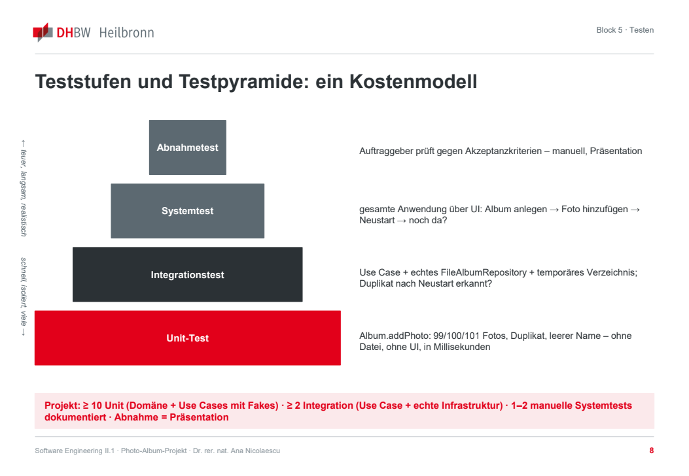
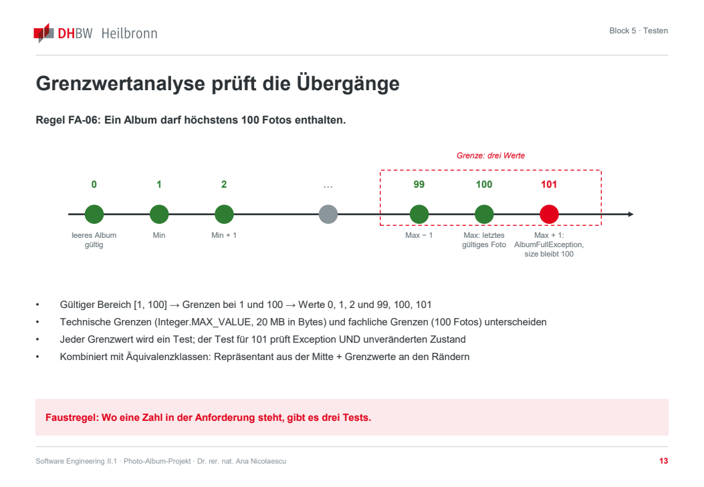
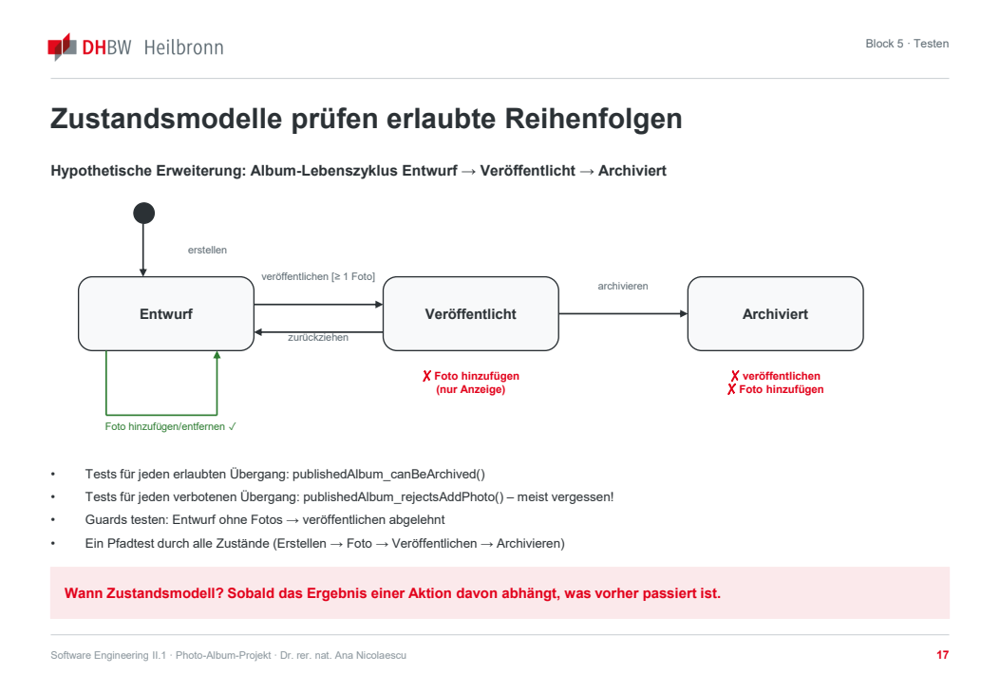

# Block 5: Testen – Blackbox

**Risiken systematisch in aussagekräftige Tests übersetzen** · Software Engineering II.1 · DHBW Heilbronn · Ana · WS 2026/27

Quelle: [Originalfolien, 30 PDF-Seiten](Block_5_Testen_Blackbox.pdf). Wiederholte Einblendungen sind zusammengeführt, Tabellen und Java-Beispiele formatiert. Seitenangaben beziehen sich auf die PDF-Seiten.

> Zahlen, Regeln, Anforderungs-IDs und Klassen der Folien sind Lehrbeispiele, keine automatisch bestätigten Festlegungen für unser Projekt. Insbesondere wird die Beispielgrenze von 100 Fotos nicht in unsere Requirements übernommen. Die Java-Ausschnitte sind keine vollständige, getestete Implementierung.

## 1. Ziel und Einstieg

*PDF-Seiten 1–4.*

Nach Implementierung und Git-Workflow werden Anforderungen systematisch in Testfälle übersetzt. Die Coverage-Interpretation folgt in Block 6.

**Lernziele:**

- Verifikation und Validierung sowie statische und dynamische Prüfung unterscheiden.
- Teststufen und Testpyramide als Kostenmodell verstehen.
- Tests mit klarer Absicht, Arrange–Act–Assert und verständlichen Namen schreiben.
- Äquivalenzklassen, Grenzwertanalyse, Entscheidungstabellen und Zustandsmodelle anwenden.
- Sinnvolle Integrationstests sowie Usability-, Security- und Performance-Prüfungen entwerfen.
- Nichtdeterministische KI mit Evaluation Sets statt nur mit Einzelassertionen prüfen.

**Ergebnis laut Einstiegsfolie:** `TESTING.md` mit Teststrategie und dokumentiertem Blackbox-Verfahren, mindestens zehn Unit- und zwei Integrationstests, Coverage-Report und Mini-Evaluation-Set. Im späteren Test Design Lab und Checkpoint werden zwei Blackbox-Verfahren verlangt.

### Übung: Würden Sie releasen?

*PDF-Seite 4 · 5 Minuten · Team.*

Ausgangslage: „Alle 37 Tests sind grün. Coverage: 92 %. Wir sind fertig.“

1. Eine Minute über Release ja/nein abstimmen.
2. Drei Minuten lang drei fehlende Informationen notieren.
3. Eine Minute lang die entscheidende Rückfrage an das Team formulieren.

**Ergebnis:** Drei fehlende Informationen und eine Frage pro Team. Im Plenum Gründe und tatsächliche Aussagekraft der Tests diskutieren.

## 2. Grundbegriffe und Teststufen

*PDF-Seiten 5–10; PDF-Seiten 8 und 9 zeigen dieselbe Tabelle.*

### Verifikation und Validierung

| Begriff | Frage und Mittel |
| --- | --- |
| Verifikation | Bauen wir es richtig? Gegen Spezifikation, Anforderungen und AK prüfen; durch Reviews, statische Analyse, Unit- und Integrationstests. |
| Validierung | Bauen wir das Richtige? Gegen den tatsächlichen Nutzerbedarf prüfen; durch Auftraggeber-Abnahme, Usability-Test und Prototyp-Feedback. |
| Statische Prüfung | Ohne Programmausführung, etwa Code-/Anforderungsreview oder Checkstyle/SpotBugs. |
| Dynamische Prüfung | Ausführung mit Testdaten; erwartetes Ergebnis als Testorakel mit beobachtetem Verhalten vergleichen. |

Ein System kann die Spezifikation erfüllen und trotzdem den Bedarf verfehlen, etwa wenn der Nutzer die Löschfunktion nicht findet. Die Folie ordnet das Peer Review aus Block 2 der Validierung und die Unit-Tests der Verifikation zu.

Die Folie erinnert mit Dijkstra daran, dass Tests Fehler nachweisen, aber keine vollständige Fehlerfreiheit beweisen. Risiken priorisieren und keine Vollständigkeit vortäuschen.

### Teststufen und Testpyramide



| Stufe | Beispiel aus den Folien |
| --- | --- |
| Unit-Test | `Album.addPhoto`: Grenzwerte, Duplikat, leerer Name; ohne Datei und UI, schnell ausführbar. |
| Integrationstest | Use Case mit echtem `FileAlbumRepository` und temporärem Verzeichnis; Duplikat nach Neustart erkannt? |
| Systemtest | Ganze Anwendung über die UI: Album anlegen → Foto hinzufügen → Neustart → Foto noch vorhanden? |
| Abnahmetest | Auftraggeber prüft gegen AK; manuell, etwa in der Präsentation. |

Projektumfang der Folie: mindestens zehn Unit-Tests für Domäne und Use Cases mit Fakes, mindestens zwei Integrationstests mit echter Infrastruktur, ein bis zwei dokumentierte manuelle Systemtests; Abnahme durch Präsentation.

### Testarten folgen dem Risiko

| Testart | Frage | Beispiel aus den Folien |
| --- | --- | --- |
| Funktional | Tut die Anwendung, was gefordert ist? | FA und AK prüfen. |
| Regression | Funktioniert Bestehendes nach einer Änderung? | Gesamte Suite bei jedem PR, später Change Request. |
| Sicherheit | Was geschieht bei bösartiger oder unerwarteter Eingabe? | `.jpg`-Endung mit PNG-Inhalt, Pfad `../../etc`, 200-MB-Datei. |
| Performance | Wie schnell unter welcher Last? | Beispiel-NFA: Album mit 100 Fotos in höchstens zwei Sekunden; messen statt schätzen. |
| Usability | Kann eine echte Person die Aufgabe lösen? | Album ohne Anleitung anlegen. |
| Kompatibilität | Läuft es in den vorgesehenen Umgebungen? | Linux-CI und Windows/macOS; Pfadtrennzeichen beachten. |

### Arrange–Act–Assert

Ein Testname beschreibt Verhalten und Bedingung, nicht `test1`. Den AK-Bezug im Kommentar oder in `@DisplayName` nennen. Nur nötige Daten vorbereiten, genau eine Aktion ausführen und Ergebnis **sowie Zustand** prüfen. Ein Test sollte eine Absicht haben, damit ein Fehler verständlich bleibt.

**Folienbeispiel, PDF-Seite 10:**

```java
class AlbumTest {

    @Test
    void rejectsDuplicatePhoto_andLeavesAlbumUnchanged() { // AK-05.1
        // Arrange
        Album album = new Album("Urlaub 2026");
        Photo photo = new Photo(PhotoId.next(), "abc123hash");
        album.addPhoto(photo);

        // Act + Assert (Fehlerfall)
        assertThrows(DuplicatePhotoException.class,
                () -> album.addPhoto(photo));

        // Assert (Zustand unverändert)
        assertEquals(1, album.photos().size());
    }

    @ParameterizedTest
    @ValueSource(strings = {"", "   ", "\t"})
    void rejectsBlankName(String name) { // AK-01.1
        assertThrows(InvalidAlbumNameException.class,
                () -> new Album(name));
    }
}
```

## 3. Äquivalenzklassen und Grenzwertanalyse

*PDF-Seiten 11–14.*

### Äquivalenzklassen

Eingaben mit gleichem erwartetem Verhalten zu Klassen zusammenfassen und je Klasse einen Repräsentanten wählen.

**Beispielregel der Folie:** Albumname mit 1–50 Zeichen, nicht ausschließlich Leerzeichen.

| Klasse | Typ | Beschreibung | Repräsentant | Erwartung |
| --- | --- | --- | --- | --- |
| ÄK1 | gültig | 1–50 Zeichen, mindestens ein Nicht-Leerzeichen | `Urlaub 2026` | Album wird angelegt. |
| ÄK2 | ungültig | Leerer Name | `""` | `InvalidAlbumNameException`, kein Album. |
| ÄK3 | ungültig | Nur Whitespace | `"   "` | `InvalidAlbumNameException`. |
| ÄK4 | ungültig | Mehr als 50 Zeichen | 51-mal `a` | `InvalidAlbumNameException`. |
| ÄK5 | ungültig | `null` | `null` | Fachliche Exception, keine unbeabsichtigte NPE. |
| ÄK6 | unklar | Sonderzeichen, Emoji, äußere Leerzeichen | `"🎉 Party "` | Auftraggeber fragen und Ergebnis dokumentieren. |

So entstehen überschaubare Tests und gegebenenfalls neue Fachfragen. Tabellen in `TESTING.md` ablegen.

### Grenzwertanalyse

Die Übergänge zwischen gültigen und ungültigen Bereichen prüfen. Im Beispiel mit höchstens 100 Fotos werden 0, 1, 2 sowie 99, 100 und 101 betrachtet. Ein leeres Album ist erlaubt; beim Versuch, ein weiteres Foto über die Kapazität hinaus hinzuzufügen, muss der Zustand unverändert bleiben.



- Fachliche Grenzen wie maximale Fotoanzahl von technischen Grenzen wie `Integer.MAX_VALUE` unterscheiden.
- Zu jedem Grenzfall erwartetes Verhalten und Zustand prüfen.
- Äquivalenzklassen mit Werten aus der Mitte und an den Rändern kombinieren.
- Die Folie nennt als Faustregel drei Werte je numerischer Grenze: darunter, genau darauf und darüber.

Die Werte hier beschreiben die Folienübung. Für unsere Tests werden später die tatsächlich bestätigten Requirements verwendet.

### Übung: Fototitel und Beschreibung

*PDF-Seite 14 · 15 Minuten · Paare.*

**Beispielregel:** Titel optional mit höchstens 100 Zeichen, Beschreibung optional mit höchstens 500 Zeichen.

1. Gültige, ungültige und unklare Äquivalenzklassen für den Titel mit Repräsentanten bilden.
2. Grenzwerte für Titel und Beschreibung bestimmen.
3. Mindestens eine offene Fachfrage notieren, besonders zur Bedeutung von „optional“ und „leer“.

**Ergebnis:** Tabelle, Grenzwertliste und Fachfrage. Im Plenum eine Frage an den Auftraggeber richten. Auch wenn die Folie „Auftraggeber, Block 2“ nennt, dokumentiert sie damit nicht automatisch eine Entscheidung unseres Teams.

## 4. Entscheidungstabellen und Zustandsmodelle

*PDF-Seiten 15–20.*

### Entscheidungstabellen

Wenn mehrere Bedingungen gemeinsam das Ergebnis bestimmen, Kombinationen tabellarisch prüfen. Jede Regelspalte liefert einen Testfall. Die Reihenfolge der Prüfungen kann eine fachliche Entscheidung sein: Welche Meldung erscheint beispielsweise, wenn das Album voll und das Foto bereits enthalten ist?

**Beispiel „Foto hinzufügen“ aus PDF-Seite 16:** J = ja, N = nein, – = für die Regel irrelevant, X = Aktion ausführen.

| Bedingung oder Aktion | R1 | R2 | R3 | R4 |
| --- | :---: | :---: | :---: | :---: |
| B1: Dateityp gültig; Beispiel JPEG/PNG, höchstens 20 MB | N | J | J | J |
| B2: Album hat weniger als 100 Fotos | – | N | J | J |
| B3: Foto bereits im Album, im Beispiel anhand Hash | – | – | J | N |
| A1: Speichern und anzeigen | | | | X |
| A2: Fehler „ungültige Datei“ | X | | | |
| A3: Fehler „Album voll (100/100)“ | | X | | |
| A4: Fehler „bereits enthalten“ | | | X | |
| A5: Album unverändert | X | X | X | |

Irrelevante Bedingungen reduzieren im Beispiel acht Kombinationen auf vier Regeln. Den unveränderten Zustand in jedem Fehlerfall prüfen. Tabelle und Zuordnung Regel → Testmethode gehören in `TESTING.md`.

### Zustandsmodelle

Ein Zustandsmodell hilft, wenn das Ergebnis von vorherigen Aktionen abhängt.

**Ausdrücklich hypothetische Erweiterung der Folie:** Entwurf → Veröffentlicht → Archiviert. Diese Funktionen gehören damit nicht automatisch zum Projektumfang.



- Im Entwurf Fotos hinzufügen und entfernen.
- Veröffentlichen nur mit mindestens einem Foto; Zurückziehen führt zurück zum Entwurf.
- Ein veröffentlichtes Album erlaubt im Beispiel nur Anzeige und kann archiviert werden.
- Ein archiviertes Album kann im Beispiel weder erneut veröffentlicht noch um Fotos ergänzt werden.
- Erlaubte und verbotene Übergänge sowie Guards testen, nicht nur den Erfolgsweg.
- Einen Pfad durch mehrere Zustände prüfen: Erstellen → Foto → Veröffentlichen → Archivieren.

Beispielnamen: `publishedAlbum_canBeArchived()` und `publishedAlbum_rejectsAddPhoto()`.

### Welches Verfahren wann?

| Verfahren | Leitfrage | Beispiel | Liefert |
| --- | --- | --- | --- |
| Äquivalenzklassen | Welche Eingaben verhalten sich gleich? | Albumname, Titel, Dateityp. | Repräsentanten gültiger und ungültiger Klassen. |
| Grenzwertanalyse | Wo steht eine Zahl? | Maximale Anzahl, Textlänge, Dateigröße. | Werte unter, auf und über der Grenze. |
| Entscheidungstabelle | Wirken mehrere Bedingungen zusammen? | Dateityp × Kapazität × Duplikat. | Regeln, Tests und Prüfungsreihenfolge. |
| Zustandsmodell | Hängt das Ergebnis von der Vorgeschichte ab? | Lebenszyklus oder Bestätigungsdialog. | Übergangs- und Verbotstests. |

Die Überblicksfolie nennt mindestens ein dokumentiertes Verfahren und empfiehlt zwei. Das anschließende Lab und der Checkpoint verlangen zwei; auch die Meilensteintabelle der [Projektbeschreibung](../task_description/Projektbeschreibung_Photo_Album.md) nennt zwei.

### Test Design Lab

*PDF-Seite 19 · 30 Minuten · Team.*

Eine Geschäftsregel und einen Use Case aus der eigenen `REQUIREMENTS.md` wählen.

1. Äquivalenzklassen und Grenzwerte auf die Regel anwenden; Tabelle in `TESTING.md`.
2. Entscheidungstabelle oder Zustandsmodell auf den Use Case anwenden; Tabelle beziehungsweise Diagramm dokumentieren.
3. Jede Zeile, Regel oder jeden Übergang in einen benannten JUnit-Test übersetzen. Normal-, Fehler- und Grenzfall per `@Tag` oder Kommentar kennzeichnen.
4. AK-ID → Verfahren → Testmethode dokumentieren.
5. Branch und PR erstellen; CI muss grün sein. Review über Kreuz ist Hausaufgabe.

**Ergebnis:** Zwei dokumentierte Verfahren und mindestens sechs neue Tests im PR. Materialien: Moodle-Vorlage für `TESTING.md` und JUnit-5-Spickzettel.

### Übung: Mutation ohne Werkzeug

*PDF-Seite 20 · 10 Minuten · Team.*

Gedanklich oder auf einem Wegwerf-Branch drei Änderungen durchführen:

1. In der Kapazitätsprüfung `>=` durch `>` ersetzen. Welcher Test schlägt fehl? Falls keiner: Grenztest ergänzen; die Folie verwendet 100/101.
2. Duplikatprüfung entfernen. Welcher Test wird rot?
3. Reihenfolge von Kapazitäts- und Duplikatprüfung vertauschen. Bemerkt ein Test das, und sollte er es bemerken?

## 5. Sinnvolle Integrationstests

*PDF-Seite 21.*

Mehrere echte Komponenten gemeinsam prüfen: Use Case, Datei-Repository und Hasher. Damit werden Persistenz, Serialisierung und Pfade geprüft, die reine Unit-Tests nicht abdecken.

**Folienbeispiel:**

```java
class AddPhotoIntegrationTest {

    @TempDir Path tempDir; // Frisches Verzeichnis je Test

    @Test
    void duplicateIsDetectedAfterRestart() throws IOException {
        // Arrange: echte Infrastruktur, kein Fake
        var repo = new FileAlbumRepository(tempDir);
        var hasher = new Sha256ImageHasher();
        var addPhoto = new AddPhotoUseCase(repo, hasher);
        var albumId = new CreateAlbumUseCase(repo).execute("Urlaub");
        Path jpg = copyResource("sample.jpg", tempDir);
        addPhoto.execute(albumId, jpg);

        // Act: Ein neues Repository-Objekt liest von der Platte.
        var repoAfterRestart = new FileAlbumRepository(tempDir);
        var addPhotoAgain = new AddPhotoUseCase(repoAfterRestart, hasher);

        // Assert
        assertThrows(DuplicatePhotoException.class,
                () -> addPhotoAgain.execute(albumId, jpg));
        assertEquals(1, repoAfterRestart.findById(albumId).photos().size());
    }
}
```

`@TempDir` isoliert Tests und räumt Testdateien auf. Ein weiterer sinnvoller Test kann UI-Adapter und Use Case verbinden, etwa Controller-Logik ohne echtes Fenster. Ein bloßes „Repository speichert und lädt“ ohne fachliche Frage genügt laut Folie nicht.

## 6. Usability, Security und Performance

*PDF-Seiten 22–23.*

### Usability-Kreuztest

- Konkrete Aufgabe geben: Album „Sommer“ anlegen und ein bereitgestelltes Foto hinzufügen.
- Nicht erklären oder helfen; beobachten und notieren, wo der Nutzer zögert oder falsch klickt.
- Beobachtungen statt Urteile: beispielsweise 20 Sekunden Suche nach dem Hinzufügen-Knopf statt „unübersichtlich“.
- Nach Auswirkung priorisieren: Aufgabe nicht lösbar → verzögert → kosmetisch.

Die Folie nennt als Orientierung nach Nielsen, dass fünf Testpersonen ungefähr 80 % der Probleme finden. Das ist keine Garantie für unsere Anwendung.

### Security und Performance

- Dateieingaben testen: falsche Endung, leere Datei, übergroße Datei, `../` im Pfad, Steuerzeichen im Dateinamen.
- Bildmetadaten als mögliche Prompt-Injection-Eingabe berücksichtigen; bei entsprechendem Adapter prüfen, ob sie entfernt werden.
- Die tatsächlich vereinbarte Performance-NFA mit echten Daten messen und Ergebnis in `TESTING.md` festhalten. Die Folie verwendet beispielhaft 100 Fotos und zwei Sekunden.
- Verhalten unter zusätzlicher Last dokumentieren: große oder viele Alben, parallele Aufrufe. Die Folie nennt 1.000 Fotos als Überschreitung ihres Beispiel-Limits; unser vereinbartes Limit ist ein anderes.

## 7. KI-Perspektive

*PDF-Seiten 24–27.*

### Klassischer Test und LLM-Evaluation

| Klassische Funktion, etwa `Album.addPhoto` | LLM-Funktion, etwa Beschreibung vorschlagen |
| --- | --- |
| Gleiche Eingabe führt zu gleichem Ergebnis. | Ergebnisse können mit Modell und Temperatur variieren. |
| Eine harte Assertion, etwa `assertEquals`. | Mehrere Kriterien: Länge, Sprache, keine Personennamen, fachliche Passung. |
| Reproduzierbares Grün oder Rot für einen Lauf. | Wiederholte Läufe und begründete Erfolgsquote über viele Fälle. |
| Fehler lässt sich gezielt reproduzieren. | Fehler kategorisieren: Halluzination, Formatfehler, Verweigerung, erfolgreiche Injection. |

Die Folie nennt eine Pass-Rate von mindestens 85 % als **Beispiel**, nicht als gesetzten Projektwert. Evaluation Sets versionieren und bei Prompt-/Modelländerungen als Regression prüfen.

### Agententests prüfen Aktionen

- Wählt der Agent das richtige Tool mit richtigen Argumenten, beispielsweise `movePhoto` statt `deleteAlbum`?
- Werden nicht erlaubte Tools abgelehnt und protokolliert?
- Hält der Agent bei irreversiblen Aktionen für menschliche Freigabe an?
- Führen Anweisungen in fremden Daten zu unzulässigen Tool-Aufrufen oder Datenabfluss?
- Greifen Grenzen für Tool-Aufrufe, Timeouts und Terminierung?

Im Test können Fake-Tools eingesetzt und ihre protokollierten Aufrufe mit der Erwartung verglichen werden.

### Übung: Mini-Evaluation-Set

*PDF-Seite 27 · 10 Minuten · Team.*

Angenommen, eine KI schlägt Bildbeschreibungen vor, auch wenn die Funktion nicht gebaut wird:

1. Fünf konkrete Eingaben festlegen: normal, mehrdeutig, sensibel, adversarial und fehlerhaft.
2. Pro Fall zwei bis drei prüfbare Kriterien formulieren, möglichst regelbasiert.
3. Freigabe-Pass-Rate festlegen und begründen.

**Ergebnis:** Die Folie nennt `eval/describe-photo/cases.md`, ausdrücklich auch für eine nicht umgesetzte Funktion. Im Plenum den adversarialen Fall vorstellen.

## 8. Checkpoint, Exit Ticket und Nacharbeit

*PDF-Seiten 28–29.*

Grün = im Repository sichtbar, gelb = begonnen, rot = fehlt. Für gelbe und rote Punkte ein Issue mit Verantwortlichem führen. Die Liste ist die Unterrichtsvorgabe, keine Bewertung unseres aktuellen Stands.

- [ ] `TESTING.md` mit Teststrategie sowie zwei dokumentierten Blackbox-Verfahren und Tabellen.
- [ ] Mindestens zehn Unit-Tests; Fälle gekennzeichnet, Fehlerfälle prüfen den Zustand.
- [ ] Mindestens zwei Integrationstests mit echter Infrastruktur und fachlicher Frage.
- [ ] Traceability AK-ID → Verfahren → Testmethode.
- [ ] Usability-Protokoll und drei Issues; Security-Dateifälle als Tests geplant.
- [ ] Mini-Evaluation-Set in `eval/`.

**Abweichung:** Der Checkpoint bezeichnet das Mini-Evaluation-Set als optional. Die Übung davor und die [Projektbeschreibung, §10](../task_description/Projektbeschreibung_Photo_Album.md), verlangen ein Set auch für eine nur entworfene KI-Funktion.

**Exit Ticket, drei Minuten, jeder schriftlich:**

1. Welcher eigene Test findet am wahrscheinlichsten einen echten Fehler, und warum?
2. Welches Risiko ist noch ungetestet?
3. Welche Zahl allein beweist keine Qualität, und welche Aussage fehlt dazu?

**Bis zum nächsten Block:**

- Mindestens zehn Unit- und zwei Integrationstests vervollständigen, grüne CI und Review über Kreuz; Tag `block-5`.
- Security-Tests für falsche Endung, leere und übergroße Dateien implementieren.
- Performance-NFA messen und in `TESTING.md` dokumentieren.
- Im JaCoCo-Report die drei Klassen mit der niedrigsten Branch Coverage notieren.
- Mindestens ein Usability-Issue per PR beheben.
- KI Tests aus einem AK generieren lassen und kritisch prüfen, ob die Assertions das Kriterium tatsächlich prüfen; als weiterer Einsatzfall dokumentieren, in der Folie Fall 4.

Abgabe des Zwischenstands laut Folie bis zum Vorabend des nächsten Blocks.

## 9. Quellen und Materialbasis der Folien

*PDF-Seite 30.*

- ISTQB Certified Tester Foundation Level Syllabus v4.0: Teststufen, Testarten, Blackbox-Verfahren.
- Spillner und Linz: *Basiswissen Softwaretest*.
- Khorikov: *Unit Testing Principles, Practices, and Patterns*; JUnit 5 User Guide; PIT Mutation Testing.
- Cohn: *Succeeding with Agile*; Nielsen Norman Group: *Usability Testing 101*.
- OWASP *File Upload Cheat Sheet* und *Top 10 for LLM Applications*.
- Anthropic: *Building Effective Agents*; Zheng et al. (2023): *Judging LLM-as-a-Judge*.
