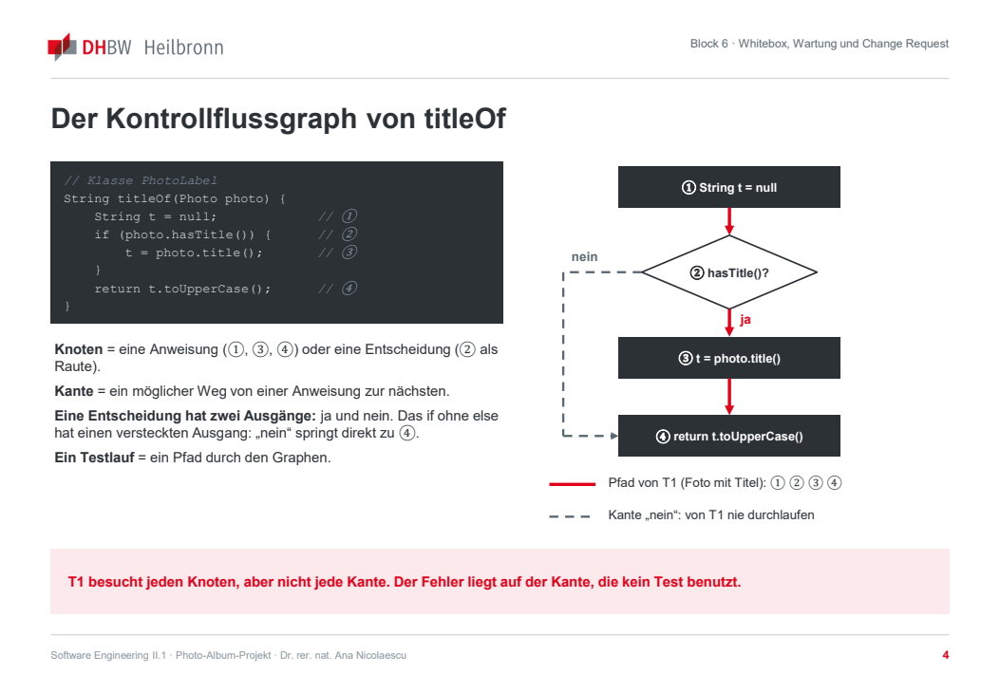
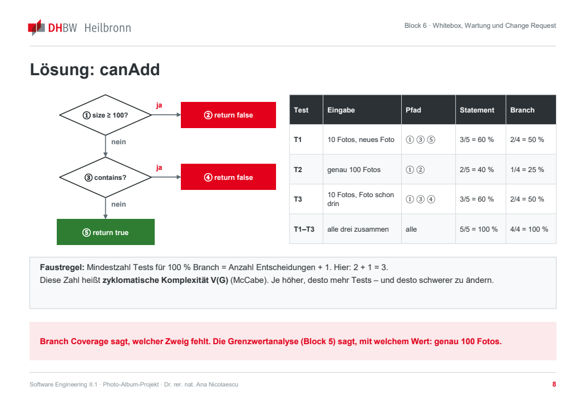

# Block 6: Whitebox, Wartung und Change Request

**Code verstehen, sicher ändern und eine Änderung des Auftraggebers kontrolliert umsetzen** · Software Engineering II.1 · DHBW Heilbronn · Ana · WS 2026/27

Quelle: [Originalfolien, 14 PDF-Seiten](Block_6_Whitebox_Wartung_Change_Request_final.pdf). Tabellen und Codebeispiele sind formatiert, Kontrollflussgraphen als Abbildungen übernommen. Seitenangaben beziehen sich auf die PDF-Seiten.

> Die folgenden Inhalte übertragen die Unterrichtsunterlagen. Beispielwerte, Klassen, Tests und der dort formulierte Change Request ändern nicht automatisch unsere aktuellen Requirements oder den Bearbeitungsstand. Insbesondere bleibt unsere bestätigte Grenze von 10.000 Fotos pro Album bestehen; die Folie verwendet 100. Aussagen und Faustregeln werden als Folieninhalt wiedergegeben.

## 1. Einordnung und Einstieg

*PDF-Seiten 1–3.*

Nach den Blackbox-Verfahren aus Block 5 folgen Whitebox-Analyse, Coverage, Wartung, Refactoring und kontrollierte Weiterentwicklung. Danach stehen Risiken, Release-Entscheidung und Abschlusspräsentation an.

**Hinweis zur Vorlage:** Auf PDF-Seite 2 steht im Seitenkopf „Block 7 · Management und Abschlusspräsentationen“, obwohl die Kursübersicht Block 6 hervorhebt und die Datei Block 6 behandelt.

### Übung: Ist dieser Code getestet?

*PDF-Seite 3 · 3 Minuten · Plenum.*

Die Methode und ihr einziger Test aus der Folie:

```java
// Klasse PhotoLabel
String titleOf(Photo photo) {
    String t = null;             // ①
    if (photo.hasTitle()) {       // ②
        t = photo.title();       // ③
    }
    return t.toUpperCase();      // ④
}
```

```java
@Test
void titleIsUppercase() {
    Photo p = new Photo("strand.jpg", "Sommer");
    assertEquals("SOMMER", label.titleOf(p));
} // grün
```

1. Welche der markierten Anweisungen führt T1 aus?
2. Ist `titleOf` damit vollständig getestet?
3. Welche Eingabe lässt die Methode abstürzen?

**Auflösung:** T1 führt alle vier markierten Anweisungen aus. Ohne Titel bleibt `t` jedoch `null`; `toUpperCase()` löst eine `NullPointerException` aus.

## 2. Kontrollfluss, Statement und Branch Coverage

*PDF-Seiten 4–6.*

### Kontrollflussgraph von `titleOf`



- **Knoten:** Anweisung oder Entscheidung; Entscheidungen erscheinen als Raute.
- **Kante:** Möglicher Weg zur nächsten Anweisung.
- **Entscheidung:** Zwei Ausgänge, ja und nein. Auch ein `if` ohne `else` hat einen Nein-Ausgang.
- **Testlauf:** Ein Pfad durch den Graphen.

T1 durchläuft ① → ② → ③ → ④. Der Nein-Zweig springt von ② direkt zu ④. T1 besucht damit jeden Knoten, aber nicht jede Kante; der Fehler liegt auf dem unbenutzten Zweig.

### Zwei Überdeckungsmaße

| Maß | Berechnung im Folienbeispiel | Leitfrage |
| --- | --- | --- |
| Statement Coverage, C0 | Ausgeführte Anweisungen ÷ alle Anweisungen. | Wurde jede Anweisung mindestens einmal ausgeführt? |
| Branch Coverage, C1 | Durchlaufene Entscheidungsausgänge ÷ alle Entscheidungsausgänge. | Wurde jede Entscheidung mit ja und nein durchlaufen? |

Die Folie zählt bei `titleOf` vier markierte Anweisungen und zwei Ausgänge der Entscheidung ②.

| Test | Eingabe | Pfad | Statement | Branch | Fehler gefunden? |
| --- | --- | --- | --- | --- | --- |
| T1 | Foto mit Titel „Sommer“ | ① ② ③ ④ | 4/4 = 100 % | 1/2 = 50 % | Nein. |
| T2 | Foto ohne Titel | ① ② ④ | 3/4 = 75 % | 1/2 = 50 % | Ja, `NullPointerException`. |
| T1 + T2 | Beide Eingaben | Alle Kanten | 4/4 = 100 % | 2/2 = 100 % | Ja. |

100 % Statement Coverage allein verdecken hier den fehlenden Fall „ohne Titel“.

### Zusammenhang und JaCoCo

Die Folie formuliert: 100 % Branch Coverage implizieren 100 % Statement Coverage; die Umkehrung gilt nicht. Als Gegenbeispiel dient das `if` ohne `else`: Der Ja-Ausgang kann bereits alle Anweisungen erreichen, während der Nein-Ausgang ungetestet bleibt.

Im JaCoCo-Report unter `target/site/jacoco/` verweist die Folie auf `Lines / Instructions` und `Branches` sowie folgende Farben:

| Farbe | Bedeutung laut Folie |
| --- | --- |
| Grün | Ausgeführt und alle Zweige durchlaufen. |
| Gelb | Ausgeführt, aber nicht alle Zweige durchlaufen. |
| Rot | Nicht ausgeführt. |

Die Anweisungszählung der Lehrbeispiele und die konkreten JaCoCo-Zähler sind bei der Auswertung auseinanderzuhalten. Für Domänenklassen soll insbesondere Branch Coverage gemessen und erklärt werden.

## 3. Übung und Lösung: `canAdd`

*PDF-Seiten 7–8.*

**5 Minuten · Paare.** Darf ein Foto noch in das Album?

```java
// Klasse Album
boolean canAdd(Photo photo) {
    if (photos.size() >= 100) {    // ①
        return false;             // ②
    }
    if (photos.contains(photo)) { // ③
        return false;             // ④
    }
    return true;                  // ⑤
}
```

T1 verwendet ein Album mit zehn Fotos und ein neues Foto; erwartet wird `true`.

1. Kontrollflussgraphen zeichnen: Knoten ① bis ⑤, Entscheidungen ① und ③ als Rauten.
2. Pfad von T1 sowie Statement und Branch Coverage berechnen.
3. Zusätzliche Eingaben für vollständige Branch Coverage nennen.

**Lösung aus der Folie:**



| Test | Eingabe | Pfad | Statement | Branch |
| --- | --- | --- | --- | --- |
| T1 | Zehn Fotos, neues Foto. | ① ③ ⑤ | 3/5 = 60 % | 2/4 = 50 % |
| T2 | Genau 100 Fotos. | ① ② | 2/5 = 40 % | 1/4 = 25 % |
| T3 | Zehn Fotos, gewähltes Foto bereits enthalten. | ① ③ ④ | 3/5 = 60 % | 2/4 = 50 % |
| T1–T3 | Alle drei Tests. | Alle | 5/5 = 100 % | 4/4 = 100 % |

Die Folie nennt „Anzahl Entscheidungen + 1“ als Faustregel für die Mindestzahl an Tests und verbindet die Zahl im Beispiel mit der zyklomatischen Komplexität V(G) nach McCabe: 2 + 1 = 3. Diese Angabe wird hier als Folienaussage wiedergegeben, nicht als allgemeiner Nachweis für beliebige Kontrollflussgraphen.

Branch Coverage zeigt den fehlenden Zweig; Grenzwertanalyse bestimmt eine fachlich passende Eingabe, im Beispiel genau 100 Fotos.

## 4. Vier Arten der Wartung

*PDF-Seite 9 · Einteilung nach ISO/IEC 14764.*

| Art | Auslöser | Beispiel der Folie | Absicherung |
| --- | --- | --- | --- |
| Korrektiv | Fehler im Betrieb. | Hash über Pfad statt Dateiinhalt verhindert korrekte Duplikaterkennung. | Reproduzierender Regressionstest bleibt erhalten. |
| Adaptiv | Geänderte Umgebung. | Neue Java-Version oder neues Bildformat wie HEIC. | Gesamte CI-Suite und Kompatibilitätstests. |
| Perfektiv | Neue oder bessere Funktion. | Titelsuche, schnellere Albumansicht, Change Request. | Neue Tests und bestehende Regressionstests. |
| Präventiv | Risiko vor Eintritt senken. | Große Klasse zerlegen, Abhängigkeit aktualisieren. | Verhalten vor der Änderung mit Tests festhalten. |

Die Folie nennt als ungefähre Praxisanteile 50 % perfektiv, 25 % adaptiv, 20 % korrektiv und 5 % präventiv. Nicht eingeplante Wartung kann zu technischen Schulden führen; die Zahlen sind keine Verteilung für unser Team.

## 5. Refactoring in sicheren Schritten

*PDF-Seite 10.*

| Schritt | Vorgehen |
| --- | --- |
| 1. Verhalten fixieren | Tests müssen vorhanden und grün sein. Sonst Charakterisierungstests schreiben, die das aktuelle Verhalten festhalten, auch wenn es fragwürdig wirkt. |
| 2. Kleine Änderung | Eine Umstrukturierung, etwa Extract Method oder Rename, möglichst IDE-gestützt. Die Folie nennt weniger als zehn Minuten als Orientierung. |
| 3. Tests ausführen | Bei Rot die Änderung zurücknehmen und Ursache verstehen; nicht nebenbei fachlich reparieren. |
| 4. Diff prüfen | Nur Struktur geändert? Fachliche Änderungen gehören in eigene Commits. |
| 5. Commit | Aussagekräftiger Refactoring-Commit, etwa `refactor(usecase): extract validation (no behavior change)`. |

Bei Legacy-Code zuerst verstehen: Call Hierarchy, Abhängigkeitsgraph und Tests als Dokumentation nutzen. Die Folie beschreibt Reverse Engineering als Verstehen ohne Änderung und Reengineering als gezielte Verbesserung: Verhalten absichern, Nahtstellen schaffen und schrittweise umbauen. Ein vollständiges Neuschreiben auf einmal wird als meist teurer eingeordnet.

**Kernpunkt:** Refactoring verändert die Struktur und erhält das Verhalten. Werden gleichzeitig fachliche Änderungen gemacht, lässt sich ein fehlgeschlagener Test schwerer zuordnen.

## 6. Change Request CR-1 aus den Folien

*PDF-Seite 11.*

**Fotos in mehreren Alben und Tags** · Auftraggeber · Priorität hoch · Ziel laut Folie: Release `1.1.0` zu Block 7.

Die folgende Tabelle überträgt den in den Unterlagen beschriebenen CR. Sie ist noch keine Impact Analysis unseres Projekts und löst keine Umsetzung aus.

| ID | Anforderung aus der Folie |
| --- | --- |
| CR-1.1 | Ein Foto muss gleichzeitig in mehreren Alben enthalten sein können. Die Datei wird nur einmal gespeichert. Titel und Beschreibung gehören zum Foto, nicht zum Album. |
| CR-1.2 | Entfernen aus einem Album darf das Foto in anderen Alben nicht verändern. Ist es in keinem Album mehr enthalten, muss es nach Bestätigung endgültig gelöscht werden können. |
| CR-1.3 | Ein Nutzer muss einem Foto bis zu fünf Tags zuweisen und diese entfernen können. Jeder Tag hat 1–20 Zeichen; Tags sind je Foto ohne Beachtung der Groß-/Kleinschreibung eindeutig. |
| CR-1.4 | Der Nutzer muss die Fotos eines Albums nach einem Tag filtern können. Die Albumansicht zeigt die Trefferzahl. |

**Als unverändert bezeichnet die Folie:** maximal 100 Fotos je Album; ein Foto zählt in jedem Album, in dem es enthalten ist. Duplikatregel gilt je Album; bisherige AK bleiben gültig.

**Abgleich mit unserem Projekt:** Die Folienzahl 100 ersetzt nicht unsere bestätigten 10.000 Fotos pro Album. Vor der späteren Anwendung des CR müssen die Angaben mit unserem Stand und Ana abgeglichen werden.

**Arbeitsauftrag der Folie:** Zunächst Impact Analysis in `CHANGE_REQUEST.md`, noch nicht programmieren. Umsetzung bis Block 7 mit Tag `v1.1.0`.

### Mini-Impact-Analysis

*PDF-Seite 12 · 4 Minuten · Team.*

Vor jeder Codeänderung Antworten mit echten IDs und Namen aus dem eigenen Projekt formulieren:

1. Welche Anforderung aus `REQUIREMENTS.md` widerspricht CR-1?
2. Welche Klasse ändert sich am stärksten? Hinweis: Wo liegt derzeit die Fotoliste?
3. Welcher vorhandene Test wird rot? Konkreten Testnamen nennen.

**Ergebnis:** Drei erste Stichpunkte in `CHANGE_REQUEST.md`. Im Plenum zwei Antworten zur dritten Frage vergleichen; der Rest ist Hausaufgabe.

## 7. Nacharbeit bis zum nächsten Block

*PDF-Seite 13.*

Die folgende Liste beschreibt den Unterrichtsauftrag, nicht den aktuellen Bearbeitungsstand des Teams.

- [ ] Mit `./mvnw verify` den JaCoCo-Report erzeugen und `target/site/jacoco/index.html` öffnen.
- [ ] Statement- und Branch-Werte je Schicht in `TESTING.md` notieren; gelbe Zeilen der Domäne erklären und mindestens zwei Tests für fehlende Zweige ergänzen.
- [ ] `CHANGE_REQUEST.md` fertigstellen: Anforderungen, Klassen und Tests mit IDs, Risiken, Aufwand und Plan.
- [ ] Change Request umsetzen, Regressionstests grün halten und `v1.1.0` veröffentlichen.
- [ ] Ein Refactoring nach den fünf Schritten mit Begründung in `REFACTORING.md` dokumentieren. Der Ablageort laut Projektbeschreibung ist `docs/REFACTORING.md`.
- [ ] Storyboard für höchstens acht Abschlussfolien erstellen.
- [ ] Nach Abschluss der Hausaufgabe den Tag `block-6` setzen.

**Merksätze der Folie:** Statement Coverage fragt nach ausgeführten Anweisungen, Branch Coverage nach durchlaufenen Entscheidungsausgängen. Die Folie wiederholt die Beziehung Branch → Statement und die Faustregel „Entscheidungen + 1“ aus den Beispielen.

## 8. Quellen und Materialbasis der Folien

*PDF-Seite 14.*

- Spillner und Linz: *Basiswissen Softwaretest*; ISTQB Foundation Level zu Whitebox-Verfahren und Überdeckungen.
- McCabe (1976): *A Complexity Measure*; Rapps und Weyuker (1985): *Selecting Software Test Data Using Data Flow Information*.
- ISO/IEC 14764; Lientz und Swanson (1980): *Software Maintenance Management*.
- Fowler: *Refactoring*, 2. Auflage; Cunningham (1992) zu technischen Schulden; Fowler: *Strangler Fig Application*.
- Feathers (2004): *Working Effectively with Legacy Code*; Chikofsky und Cross (1990) zu Reverse Engineering.
- JaCoCo-Dokumentation zu Coverage Counters; Vorwissen aus Block 5 und Block 3.
