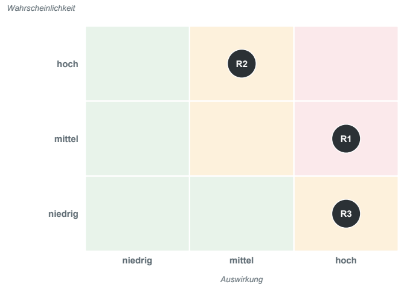

# Block 7: Management und Abschlusspräsentationen

**Release verstehen, Risiken bewerten, Entscheidung begründen - danach die Präsentationen** · Software Engineering II.1 · DHBW Heilbronn · Ana · WS 2026/27

Quelle: [Originalfolien, 18 PDF-Seiten](Block_7_Management_und_Abschlusspraesentationen_final.pdf). Tabellen und Abläufe sind formatiert, die Risikomatrix ist als Abbildung übernommen. Die Lösungsfolien auf PDF-Seiten 5–7 sind zusammengeführt. Seitenangaben beziehen sich auf die PDF-Seiten, nicht auf die teilweise abweichenden Foliennummern.

> Diese Fassung überträgt die Unterrichtsunterlagen. Beispiele, Quality Gates und KI-Szenarien sind keine automatisch übernommenen Teamentscheidungen. Abweichungen zur Projektbeschreibung sind an den jeweiligen Stellen gekennzeichnet.

## 1. Release und Versionsnummern

*PDF-Seiten 1–3.*

### Was ist ein Release?

Ein Release ist ein fester, getesteter Stand des Projekts, den die Nutzer bekommen. Auf `main` entstehen laufend neue Commits, darunter auch halbfertige Stände. Die Abbildung der Folie markiert einzelne Commits mit `v1.0.0` und `v1.1.0`.

Ein **Tag** ist das Etikett auf einem Commit. Es ändert keinen Code; der bezeichnete Commit bleibt derselbe, auch wenn `main` weiterläuft. Ein **Release** ist ein getesteter Stand, der ein solches Etikett trägt.

Damit lässt sich später genau dieser Stand wieder bauen. Meldet ein Nutzer einen Fehler in `1.0.0`, kann das Team `v1.0.0` holen und den Fehler dort nachstellen.

### MAJOR.MINOR.PATCH

Die Folie erklärt die Bestandteile am Beispiel `1.1.0`:

| Bestandteil | Wann erhöhen? | Beispiel Photo Album | Ausgehend von `1.0.0` |
| --- | --- | --- | --- |
| **MAJOR** | Etwas Altes passt nicht mehr; Nutzer müssen etwas tun. | Neues Dateiformat: Alte Alben lassen sich nicht mehr öffnen. | `2.0.0` |
| **MINOR** | Neue Funktion; alles Alte funktioniert weiter. | Tags für Fotos, Change Request CR-1. | `1.1.0` |
| **PATCH** | Nur ein Fehler behoben, keine neue Funktion. | Duplikaterkennung repariert. | `1.0.1` |

Eine Zahl wird erhöht, die Zahlen rechts davon werden auf `0` gesetzt: `1.0.1` → `1.1.0` → `2.0.0`.

### Übung: Welche Versionsnummer?

*PDF-Seiten 4–7.*

**Ausgangslage:** Das aktuelle Release ist `1.0.0`. Welche Nummer bekommt das nächste? Zur Wahl stehen jeweils `1.0.1`, `1.1.0` und `2.0.0`.

Erst allein entscheiden, dann gemeinsam die erste, zweite oder dritte Nummer zeigen.

| Fall | Änderung | Lösung der Folien |
| --- | --- | --- |
| a | Fehler in der Duplikaterkennung behoben, sonst keine Änderung. | **`1.0.1`** |
| b | Neue Tags für Fotos; alte Alben funktionieren unverändert. | **`1.1.0`** |
| c | Neues Dateiformat; alte Alben lassen sich nicht mehr öffnen und der Nutzer muss sie selbst konvertieren. | **`2.0.0`** |

Die Lösungen sind im Original nacheinander grün hervorgehoben. Der zusätzliche Hinweis lautet: Neue Funktion mit automatischer Umstellung der Alben ergibt `1.1.0`; müsste der Nutzer selbst etwas tun, wäre es `2.0.0`.

## 2. Vom Commit zum Release

*PDF-Seite 8.*

| Schritt | Tätigkeit | Ergebnis bzw. Prüfung |
| --- | --- | --- |
| 1 | Fertig auf `main` | Alle Pull Requests gemergt, CI grün. |
| 2 | Kandidat prüfen | Quality Gates abhaken, Migration auf einer Kopie testen. |
| 3 | Tag setzen | Dieser Commit heißt jetzt `v1.1.0`. |
| 4 | Ausliefern | `CHANGELOG` schreiben; Nutzer bekommen genau diesen Stand. |

**Schritt 3 im Terminal:**

```bash
git tag -a v1.1.0 -m "Release 1.1.0"
git push origin v1.1.0
```

Die erste Zeile legt das Tag lokal an, die zweite lädt es ins Remote hoch. Ohne den Push sieht das Team das Tag nicht.

Wird später ein Fehler behoben, folgen ein neuer Commit und ein neues Tag, beispielsweise `v1.1.1`. Das alte Tag bleibt bestehen. Ein Tag ist kein Branch; es benennt einen Commit, damit man ihn später wiederfindet.

## 3. Rollout

*PDF-Seiten 9–10.*

**Release:** Einen Stand durch ein Tag festlegen. **Rollout:** Diesen Stand an die Nutzer verteilen.

### Vier Wege zu den Nutzern

| Strategie | Verteilung laut Beispiel | Passt bei | Risiko laut Folie |
| --- | --- | --- | --- |
| Big Bang | Alle 5.000 Nutzer am ersten Tag. | Kleiner, gut getesteter Änderung. | Fehler trifft alle, kein Zurück. |
| Pilotbetrieb | Erst 100 Nutzer, dann alle. | Datenmigration wie bei `1.1.0`. | Pilotgruppe nicht repräsentativ. |
| Stufenweise | Wellen mit 20 %, 50 % und 100 %. | Großer Nutzerbasis. | Lange Übergangszeit; alte und neue Version müssen zusammenpassen. |
| Parallelbetrieb | Alte und neue Version laufen nebeneinander. | Kritischen Systemen. | Doppelte Kosten und Pflege. |

Die Balken der Folie veranschaulichen den Anteil der neuen Version am ersten Tag. Beim Parallelbetrieb zeigen sie das Nebeneinander beider Versionen.

**Faustregel:** Je größer der mögliche Schaden und je schwieriger der Rückweg, desto vorsichtiger ausrollen.

### Übung: Welcher Rollout für 1.1.0?

**Format:** Handzeichen im Plenum · **Dauer:** 2 Minuten.

**Szenario:** Photo Album `1.1.0` geht an 5.000 bestehende Nutzer. Alle Alben müssen auf das neue Modell „Foto in mehreren Alben“ umgestellt werden.

1. Allein entscheiden und auf Zuruf A, B, C oder D zeigen: **A** Big Bang, **B** Pilotbetrieb, **C** stufenweise, **D** Parallelbetrieb.
2. Im Team eine Minute besprechen: Was ist das Schlimmste, das passieren kann, und was tun wir dagegen?

**Ergebnis:** Eine Wahl und ein Worst-Case-Szenario mit Gegenmaßnahme. Danach nennt ein Team sein Szenario im Plenum; die Antworten werden gesammelt. Die Folie enthält keine Musterlösung.

## 4. Änderungen kontrollieren und Baselines festhalten

*PDF-Seite 11.*

| Schritt | Leitfrage bzw. Tätigkeit |
| --- | --- |
| 1. Antrag | Wer will was und warum? |
| 2. Impact Analysis | Was ist betroffen? Was kostet es? |
| 3. Entscheidung | Annehmen, ablehnen oder verschieben. |
| 4. Umsetzung | Issue, Branch, Pull Request und Tests. |
| 5. Prüfen und Baseline | Abnahme; Tag `v1.1.0` als neuer Stand. |

Eine **Baseline (Grundlinie)** ist ein benannter, geprüfter Stand. Ein Tag hält diesen Stand fest. Die Folie nennt `block-2` bis `block-6` und `v1.0.0` als Beispiele.

Eine Baseline wird über diesen kontrollierten Prozess geändert. Erst analysieren, dann entscheiden, dann umsetzen - wie beim Change Request CR-1.

## 5. Quality Gates

*PDF-Seite 12.*

Quality Gates sind Ja/Nein-Fragen mit Beleg. „Der Code ist gut“ ist kein prüfbares Gate. „Branch Coverage der Domäne ≥ 90 %, Report verlinkt“ ist das Beispiel der Folie für ein prüfbares Gate.

| Beispiel-Gate | Prüfung bzw. Beleg |
| --- | --- |
| PR → `main` | CI grün und mindestens ein Review. |
| Alle muss-Anforderungen | Haben mindestens einen Test; Traceability ist vorhanden. |
| Branch Coverage der Domäne | ≥ 90 %, JaCoCo-Report verlinkt. |
| Kein offener Bug | Kein offener Bug mit Priorität „hoch“. |
| Migration | Auf einer Kopie echter Daten getestet, Rollback geprobt. |

**Auftrag der Folie:** Vier bis sechs Gates wählen, die tatsächlich geprüft werden können, und mit Links belegen. Die Tabelle enthält Beispiele, keine automatisch geltenden Schwellenwerte für unser Projekt.

**Quellenabweichung:** Die Folie verweist auf „Projektbeschreibung §13“. In unserer [Projektbeschreibung steht die Release- und Risikoanalyse in §14](../task_description/Projektbeschreibung_Photo_Album.md#14-release--und-risikoanalyse-block-7); §13 behandelt den KI-Einsatz. Das betrifft auch den Verweis beim Risiko-Check auf PDF-Seite 15.

## 6. Risikomanagement

*PDF-Seiten 13–15.*

### Drei Schritte

| Schritt | Leitfrage | Vorgehen |
| --- | --- | --- |
| 1. Erkennen | Was könnte schiefgehen? | Systematisch Anforderungen, Architektur, Tests, Team/Bus-Faktor, Technik, Betrieb/Migration und KI betrachten. |
| 2. Bewerten | Wie wahrscheinlich, wie schlimm? | Wahrscheinlichkeit und Auswirkung jeweils von 1 bis 3 bewerten. Das Produkt liegt zwischen 1 und 9. Auch „hoch/hoch“ ist eine zulässige Bewertung. |
| 3. Minimieren | Was tun wir? | Für jedes Risiko bewusst eine Strategie wählen. |

**Risiko = Eintrittswahrscheinlichkeit × Auswirkung.**

- **Produktrisiko:** Fehler, Sicherheit oder Datenverlust beim Nutzer.
- **Projektrisiko:** Termin, Team oder Aufwand des Projekts.

| Strategie | Beispiel der Folie |
| --- | --- |
| Vermeiden | Feature streichen. |
| Vermindern | Test, Backup oder Review. |
| Übertragen | Bibliothek oder Dienst. |
| Akzeptieren | Dokumentiert, mit Trigger. |

### Risikomatrix: Beispiel Photo Album 1.1.0

*PDF-Seite 14.*



| ID | Risiko | Wahrscheinlichkeit | Auswirkung | Wert | Art | Strategie und Maßnahmen |
| --- | --- | --- | --- | ---: | --- | --- |
| R1 | Migration `1.0` → `1.1` verliert Fotozuordnungen. | Mittel | Hoch | 6 | Produkt | Vermindern: Migrationstest mit Kopie echter Daten, Backup, Rollback-Skript, Pilot. |
| R2 | Duplikatregel je Album bei geteilten Fotos falsch. | Hoch | Mittel | 6 | Produkt | Vermindern: Entscheidungstabelle erweitern, Tests je Album, Review. |
| R3 | Nur eine Person kennt `FileAlbumRepository`. | Niedrig | Hoch | 3 | Projekt | Vermindern: Pair-Review, ADR und Sequenzdiagramm aktuell halten; akzeptieren mit Trigger „Person fällt aus“. |

**Release-Entscheidung:** Matrix und Quality Gates mit einer ehrlichen Antwort verbinden, etwa „Ja, unter der Bedingung …“ oder „Nein, bis …“.

### Teamaufgabe: Würden wir releasen?

**Format:** Teamarbeit · **Dauer:** 9 Minuten.

Die aktuelle Version mit Belegen beurteilen:

1. **Erkennen, 3 Minuten:** Drei Risiken nennen, darunter mindestens ein Produkt- und ein Projektrisiko. Mögliche Ansatzpunkte: Coverage-Lücken, offene Issues, Migration, Bus-Faktor oder KI-Funktion.
2. **Bewerten und minimieren, 3 Minuten:** Wahrscheinlichkeit × Auswirkung mit einem Satz begründen. Je Risiko eine Strategie und eine Maßnahme festlegen.
3. **Entscheiden, 3 Minuten:** Ja, Nein oder Ja unter Bedingung. Die Matrix und mindestens zwei Quality Gates nennen, jeweils mit Link.

**Ergebnis:** Ein Entwurf in [RISK_ANALYSIS.md](../../RISK_ANALYSIS.md). Den Rest bis zur finalen Abgabe schreiben. Danach nennen zwei Teams ihre Entscheidung im Plenum.

## 7. KI-Autonomie: Crawl - Walk - Run

*PDF-Seite 16.*

| Stufe | Verantwortung | Beispiel bzw. Voraussetzung | Messwert der Folie |
| --- | --- | --- | --- |
| **Crawl: vorschlagen** | KI schlägt vor, der Mensch entscheidet. | KI schlägt eine Fotobeschreibung vor, der Nutzer bestätigt. | Übernahmerate. |
| **Walk: mit Freigabe handeln** | KI handelt; Unumkehrbares gibt der Mensch frei. | Agent sortiert Fotos in Alben, fragt beim Löschen nach. | Wie oft greift der Mensch ein? |
| **Run: in Grenzen allein** | KI handelt in klaren Grenzen ohne Rückfrage, mit Monitoring und Notschalter. | Erst, wenn die Walk-Werte über Monate stabil sind. | Kein eigener Messwert angegeben. |

Eine Stufe weiter erst, wenn die Messwerte der aktuellen Stufe stabil sind; der Rückweg muss dokumentiert sein.

## 8. Abschlusspräsentationen und Abgabe

*PDF-Seite 17.*

Die Folie nennt folgende Regeln:

- Fünf Teams, jeweils **10 Minuten Präsentation und 5 Minuten Diskussion**.
- Finale Abgabe: Tag **`final` bis 07.12.2026**.
- Jede Person muss das ganze Projekt erklären können, nicht nur den eigenen Teil.

**Abweichender Abgabetermin:** Die [Projektbeschreibung, §3](../task_description/Projektbeschreibung_Photo_Album.md#3-organisation-und-meilensteine) nennt spätestens den **23. November**, diese Folie den **7. Dezember 2026**. Die Abweichung ist mit Ana zu klären; hier sind beide Quellenangaben erhalten.

## 9. Quellen und Materialbasis der Folien

*PDF-Seite 18.*

- Semantic Versioning 2.0.0 (`semver.org`); Git-Dokumentation zu `git tag`; `keepachangelog.com`.
- Sommerville: *Software Engineering*, 10. Auflage, Kapitel 24–25 zu Qualitäts- und Konfigurationsmanagement.
- Humble und Farley: *Continuous Delivery* zu Release, Rollout, Canary und Blue-Green.
- IEEE 828 zu Konfigurationsmanagement.
- Boehm (1991): *Software Risk Management*; *PMBOK Guide*; ISO 31000.
- Anthropic: *Building effective agents*; Google: *People + AI Guidebook*.
